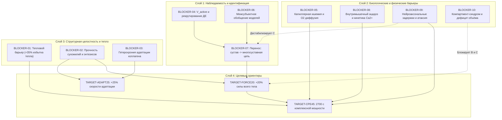

# SUBJECT-01 — CYCLE 13: STAGE 3 — BREAKTHROUGH DEPENDENCY MAP

**Дата:** 12 ноября 2026 г.  
**Цель:** Определение причинно-следственных зависимостей между устранением научно-инженерных препятствий и достижением целевых показателей проекта.

---

## 1. Карта зависимостей прорывов (Mermaid DAG)

---

## 2. Классификация препятствий по технологической доступности

### Категория 1: Доступно для автономного решения на существующих вычислительных ресурсах и открытых данных
Эти препятствия не требуют новой лабораторной инфраструктуры и могут быть разрешены или математически ограничены непосредственно в рамках SUBJECT-01:
- **BLOCKER-07 (Перенос «сустав $\to$ кинематическая цепь»):** Решается через интеграцию OpenSim с данными Bird 2026 и Malaga, моделированием мышечной ко-активации и синергий.
- **BLOCKER-06 (Межсубъектное обобщение):** Решается разработкой инвариантных признаковых пространств, domain adaptation и физически информированных нейросетей (PINN).
- **BLOCKER-01 (Тепловой баланс):** Решается 3D-термодинамическим моделированием уравнения биотермопереноса Пеннеса для строгого доказательства тепловых пределов.
- **BLOCKER-10 (Компартмент-синдром):** Решается 3D анатомо-геометрическим анализом объёма фасциальных лож по открытым МРТ-датасетам (например, Human Connectome Project, Visible Human).

### Категория 2: Требует неинвазивных лабораторных экспериментов на людях
Задачи, требующие привлечения стандартных лабораторных протоколов спортивной медицины и физиологии (без имплантаций и генных модификаций):
- **BLOCKER-04 (Идентификация $V_{\text{active}}$):** Требует синхронного 64-канального HD-sEMG картирования и ультразвуковой эластографии мышц в динамике.
- **BLOCKER-05 (Капиллярная перфузия):** Требует NIRS высокого разрешения и контрастной ультразвуковой флоуметрии при нагрузках разной интенсивности.
- **BLOCKER-08 (Ацидоз и кинетика $P_i$):** Требует когортных исследований на томографах 31P-MRS с временным разрешением $\le 2$ с.

### Категория 3: Зависит от технологических прорывов (Breakthrough-Dependent)
Задачи, которые в принципе не могут быть решены в рамках современной стандартной биологии и требуют создания принципиально новых технологий:
- **BLOCKER-02 & BLOCKER-03 (Преодоление прочности и ускорение синтеза коллагена):** Требует методов молекулярного сшивания фибрилл коллагена in vivo (synthetic cross-linking) или специфических теногенных векторов доставки факторов роста.
- **BLOCKER-01 (Преодоление кожного теплового потока):** Требует создания имплантируемых сосудистых или подкожных фазовых микротеплообменников с высокой теплопроводностью.
- **BLOCKER-09 (Преодоление нервной задержки):** Требует изменения физических свойств мембран аксонов (искусственная сверхмиелинизация) или предиктивного опережающего нейрочипирования моторной коры.

---

## 3. Критический путь проекта (Critical Path)

1. **Шаг 1 (Фундамент):** Разрешить **BLOCKER-07** и **BLOCKER-06** вычислительными методами (Cycle 13–14). Построить замкнутую модель «от мышцы к многосуставному движению».
2. **Шаг 2 (Физическая проверка целевой силы):** Проверить на многосуставной модели влияние +20% силы на прочность сухожилий (**BLOCKER-02**) и ко-активацию антагонистов.
3. **Шаг 3 (Тепловой и адаптационный фильтр):** Произвести связанный расчёт теплового баланса (**BLOCKER-01**) и гетерохронии соединительной ткани (**BLOCKER-03**).
4. **Шаг 4 (Архитектурное решение):** На основе шагов 1–3 окончательно подтвердить или доказательно закрыть Архитектуры B и C.
