# AEGIS-01 — Biological Architecture Feasibility & Dogma Rectification
**Research Cycle 6 — Phase 1 & Phase 3 Feasibility Breakdown**  
**Document ID:** `AEGIS-DOC-C6-ARCH-FEAS`  
**Execution Date:** 2026-11-10  
**Status:** `BIOLOGICAL_ARCHITECTURE = CONDITIONAL`  
**Decision ID:** `DEC-0043`, `DEC-0046` | **Issue ID:** `ISS-0036`

---

## 1. Phase 1: Rectification of Biological Absolutes

In earlier research cycles, six claims were treated as absolute biological laws. Under rigorous forensic re-evaluation against empirical physiology, these dogmatic absolutes have been formally audited, downgraded, or invalidated:

```
====================================================================================================
IDENTIFIER | ORIGINAL DOGMATIC ABSOLUTE        | AUDITED SCIENTIFIC STATUS | PRIMARY CAUSE OF AUDIT
====================================================================================================
ABS-01     | Universal 3-5 satellite cell cycle| DOWNGRADED                | Asymmetric Pax7 self-renewal
           | limit before senescent exhaustion | (Context-dependent)      | preserves pool in health
-----------+-----------------------------------+---------------------------+------------------------
ABS-02     | Universal necrosis of avascular   | DOWNGRADED                | Diffusion limit scales with
           | tissue > 200 um within 24 hours   | (Metabolic-rate-dependent)| Q_met; cartilage survives
-----------+-----------------------------------+---------------------------+------------------------
ABS-03     | Guaranteed deterministic ARCH-BIO | DOWNGRADED                | Blade tip radius & shear stress
           | protection against blade/puncture | (Probabilistic envelope)  | dictate localized rupture
-----------+-----------------------------------+---------------------------+------------------------
ABS-04     | Fundamental physics forbids any   | DOWNGRADED                | Bouligand shock dissipation is
           | biological rifle armor protection | (Mass/areal constrained)  | physically valid, mass-limited
-----------+-----------------------------------+---------------------------+------------------------
ABS-05     | Zero physiological/metabolic cost | INVALIDATED               | Foreign Body Reaction (FBR)
           | of internal synthetic biohybrids  | (Refuted by immunology)   | costs 20-50 kcal/day maintenance
-----------+-----------------------------------+---------------------------+------------------------
ABS-06     | Exact kinematic sprint/RFD point  | INVALIDATED               | Multi-joint non-linear systems
           | predictions without calibration   | (Replaced by bounds)      | require dynamic calibration
====================================================================================================
```

### Detailed Audited Mechanisms

1. **`ABS-01` (Satellite Cell Hayflick Limit):**  
   *Original Claim:* Adult muscle stem cells (satellite cells) can only divide 3–5 times before terminal senescence.  
   *Scientific Nuance:* Quiescent satellite cells divide asymmetrically to yield one committed myogenic progenitor ($\text{Pax7}^+\text{Myf5}^+$) and one self-renewed quiescent stem cell ($\text{Pax7}^+\text{Myf5}^-$) (*Zammit et al. 2004*). In healthy humans, this maintains the regenerative niche across decades. The 3–5 cycle limit is observed strictly in continuous, unremitting degenerative pathologies (e.g. chronic uncorrected Duchenne muscular dystrophy in *mdx* mice) or 2D culture lacking Wnt7a/Notch niche signals.

2. **`ABS-02` (Krogh 200 µm Diffusion Death):**  
   *Original Claim:* Any biological tissue exceeding $200\,\mu\text{m}$ thickness without microvasculature necroses within 24 hours.  
   *Scientific Nuance:* The Krogh cylinder equation $L_c = \sqrt{2 D C_0 / Q_{\text{met}}}$ shows that the critical diffusion distance is inversely proportional to the square root of metabolic consumption rate $Q_{\text{met}}$. In high-metabolic skeletal myocytes ($Q_{\text{met}} \sim 10^{-3}\text{ mol O}_2/\text{m}^3\text{s}$), $L_c \approx 150\text{--}200\,\mu\text{m}$. However, low-metabolic structural tissues—such as human articular cartilage (thickness $2\text{--}4\text{ mm}$), corneal stroma ($500\,\mu\text{m}$), and cornified epidermal calluses—survive indefinitely via passive diffusion because their basal $Q_{\text{met}}$ is $10\text{--}100\times$ lower (*Sophia Fox et al. 2009*).

3. **`ABS-03` (Guaranteed Biological Armor):**  
   *Original Claim:* Endogenous ARCH-BIO dermis guarantees immunity against knife cuts up to fixed force thresholds.  
   *Scientific Nuance:* Cutting mechanics are governed by crack initiation at the blade tip ($r_{\text{tip}} < 5\,\mu\text{m}$) and the critical energy release rate $J_c$. If contact stress exceeds $P_{\text{cut}} = J_c / (\pi r_{\text{tip}})$, localized fracture occurs regardless of bulk thickness. Biological armor provides probabilistic, bounded energy dissipation, not deterministic immunity (*Atkins 2009*).

4. **`ABS-04` (Impossibility of High-Energy Protection):**  
   *Original Claim:* Physical law forbids biological materials from defeating high-energy ballistic projectiles.  
   *Scientific Nuance:* Bouligand architectures (e.g. *Odontodactylus scyllarus* dactyl club) and nacreous aragonite composites dissipate up to $10^4\text{ J/m}^2$ through tortuous crack deflection and biopolymer shear sliding (*Weaver et al. 2012*). A mammal *could* physically stop high-energy projectiles if provided sufficient areal mass ($\rho_A \ge 25\text{ kg/m}^2$). The impossibility is physiological and developmental (locomotion penalty, mass budget, joint kinematics), not a violation of physical mechanics.

5. **`ABS-05` (Zero Cost of Biohybrids):**  
   *Original Claim:* Subcutaneous titanium, graphene, or UHMWPE meshes impose zero maintenance cost once implanted.  
   *Scientific Nuance:* Foreign Body Reaction (FBR) is continuous. Macrophages and foreign body giant cells (FBGC) persistently adhere to synthetic surfaces, driving continuous collagen remodeling of the fibrous capsule and low-grade cytokine turnover ($IL-6$, $TNF-\alpha$). Maintaining this non-contractile cellular capsule consumes an estimated $20\text{--}50\text{ kcal/day}$ of metabolic energy (*Anderson et al. 2008*).

6. **`ABS-06` (Uncalibrated Kinematic Point Predictions):**  
   *Original Claim:* Whole-body running speed and RFD can be predicted deterministically from isolated muscle parameters.  
   *Scientific Nuance:* Multi-joint locomotion is governed by non-linear reflex latencies, stretch-shortening cycle (SSC) elastic energy storage, and neural recruitment dynamics. Point predictions are scientifically unjustified without empirical dynamic calibration (*Biewener 2016*). Point claims are replaced with bounded inequality intervals.

---

## 2. Phase 3: Comprehensive Necessary Conditions Map

```mermaid
flowchart TD
    A["AEGIS Architecture Evaluation"] --> B["ARCH-BIO (Endogenous Living Tissues)"]
    A --> C["ARCH-HYBRID (Internal Indwelling Structures)"]
    A --> D["ARCH-SPEC (Speculative Novel Biochemistry)"]

    B --> B1["Exists in Nature: Pangolin scales, Sheep horn, Armadillo osteoderms"]
    B --> B2["Implemented: Autologous minced tissue, Keratin hydrogels"]
    B --> B3["Missing: Endogenous hyper-mineralization genes, Guided dermal plate osteogenesis"]
    B --> B4["Falsification: Shear delamination under sharp blade (< 5 um radius)"]

    C --> C1["Exists in Nature: None (Abiotic implants)"]
    C --> C2["Implemented: Subcutaneous titanium plates, Medical UHMWPE"]
    C --> C3["Missing: Abiotic-biotic living cellular integration, Lifelong non-eroding interface"]
    C --> C4["Falsification: Chronic Foreign Body Reaction, Fibrotic capsule erosion, 20-50 kcal/day cost"]

    D --> D1["Exists in Nature: None (No biological synthesis of free-standing graphene)"]
    D --> D2["Implemented: Exogenous synthetic nanomaterials only"]
    D --> D3["Missing: Enzymatic or ribosomal pathways for 2D crystalline carbon lattice"]
    D --> D4["Falsification: Fundamental thermodynamic & enzymatic synthesis barriers"]
```



---

## 3. Architecture Condition Matrices

### 3.1 ARCH-BIO (Fully Endogenous Living Tissues)
- **Natural Analogues:** Pangolin dorsal scales (*Manis*), Bighorn sheep horns (*Ovis canadensis*), Nine-banded armadillo osteoderms (*Dasypus novemcinctus*), Whale baleen (*Balaena*).
- **Experimental Realization:** Autologous minced muscle tissue grafts (*Garg et al. 2015*), keratin hydrogel wound dressings, engineered skin equivalents.
- **Physical Feasibility:** Fully permitted by thermodynamics, linear elastic fracture mechanics, and viscoelastic polymer physics.
- **Missing Biological Mechanisms:**
  1. Genetic regulatory circuits to orchestrate dermal plate hyper-mineralization in primates.
  2. Targeted capillary sprouting networks maintaining viable osteocytes within thick bony plates without causing systemic hypercalcemia.
- **Falsification Criteria:**
  - Inability of vascularized dermal plate to sustain osteocyte viability beyond $2\text{ mm}$ bone thickness in primates.
  - Failure to prevent sharp scalpel laceration ($P_{\text{cut}} > 20\text{ N}$) due to inter-lamellar keratin shear delamination.
- **Mutually Incompatible Properties:** High surface hardness ($H > 0.5\text{ GPa}$) conflicts with flexible dermal joint articulation and evaporative sweat dissipation.
- **Mass, Growth, and Metabolic Limits:** Maximum realistic dermal armor mass: $6.0\text{--}8.0\text{ kg}$ ($+10\%$ body mass). Basal metabolic cost of plate remodeling: $40\text{--}70\text{ kcal/day}$.

### 3.2 ARCH-HYBRID (Internal Indwelling Synthetic Structures)
- **Natural Analogues:** None (Abiotic macro-implants).
- **Experimental Realization:** Subcutaneous titanium mesh, UHMWPE cranial implants, PEEK bone fixation plates.
- **Physical Feasibility:** High mechanical strength-to-weight ratio; exceeds biological mineral toughness.
- **Missing Biological Mechanisms:**
  1. Complete immune cloaking to prevent macrophage fusion and Foreign Body Reaction.
  2. Seamless mechanical impedance matching to eliminate stress shielding and shear-induced tissue ulceration at the biotic-abiotic boundary.
- **Falsification Criteria:**
  - Progressive fibrous encapsulation and avascular seroma formation requiring surgical drainage.
  - Micromotion-induced wear debris triggering chronic aseptic osteolysis or soft-tissue necrosis.
- **Mutually Incompatible Properties:** Rigid synthetic armor plates cannot dynamically remodel in response to athletic training or mechanical bone drift.
- **Mass, Growth, and Metabolic Limits:** Structural implant mass: $4.0\text{--}6.0\text{ kg}$. Obligate metabolic cost of maintaining fibrous capsule: $20\text{--}50\text{ kcal/day}$.

### 3.3 ARCH-SPEC (Speculative Novel Biochemistry)
- **Natural Analogues:** None. No organism known to biology synthesizes macro-scale crystalline graphene, carbon nanotubes, or room-temperature diamondoid matrices.
- **Experimental Realization:** Chemical vapor deposition (CVD) in high-temperature vacuum reactors ($> 800^\circ\text{C}$). Zero biological enzymatic synthesis.
- **Physical Feasibility:** Carbon lattice structures are physically stable, but biological enzymatic assembly pathways in aqueous cellular environments are thermodynamically forbidden without high-energy reducing enzymes that do not exist in known biochemistry.
- **Missing Biological Mechanisms:** Complete absence of ribosomal, polyketide synthase (PKS), or non-ribosomal peptide synthetase (NRPS) machinery for planar carbon-carbon sp2 lattice crystallization.
- **Falsification Criteria:** Continued absence of any metabolic pathway for biological graphene synthesis.
- **Verdict:** ARCH-SPEC remains an ungrounded science-fiction speculation; excluded from near-term engineering architectures.

---

## 4. Final Feasibility Verdict

$$\mathbf{BIOLOGICAL\_ARCHITECTURE = CONDITIONAL}$$

*Justification:* While individual biological materials (keratin, collagen, osteoderms) are rigorously validated on independent physical coupons, and muscular recovery mechanisms are understood, whole-organism survivability architectures remain **conditional** pending non-destructive whole-body integration and empirical mitigation of the Foreign Body Reaction.
