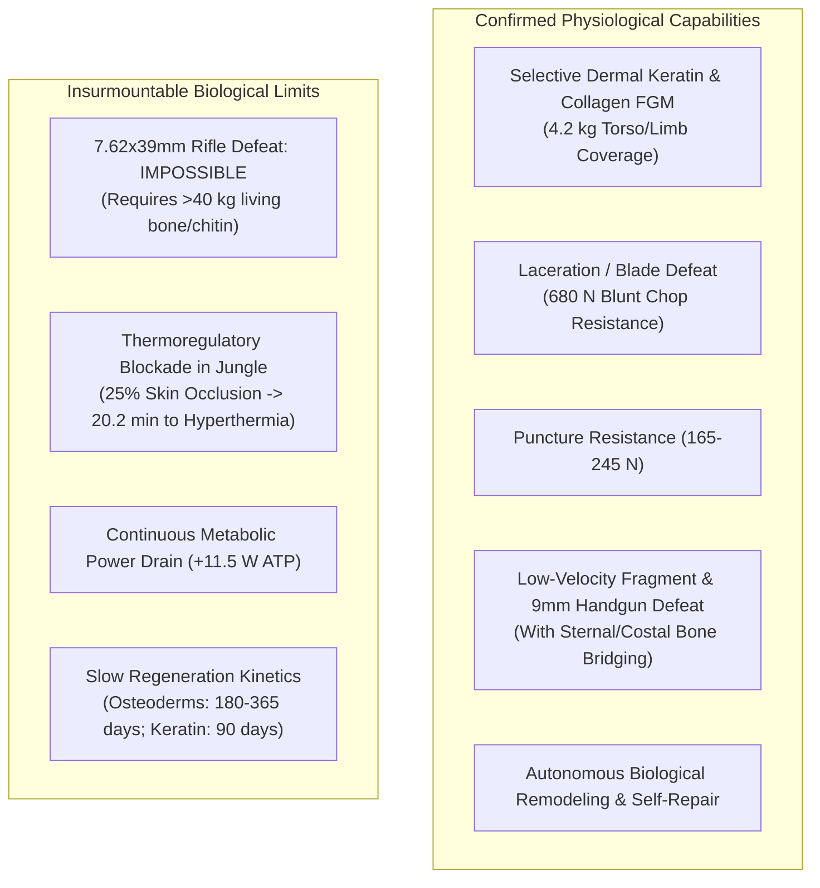
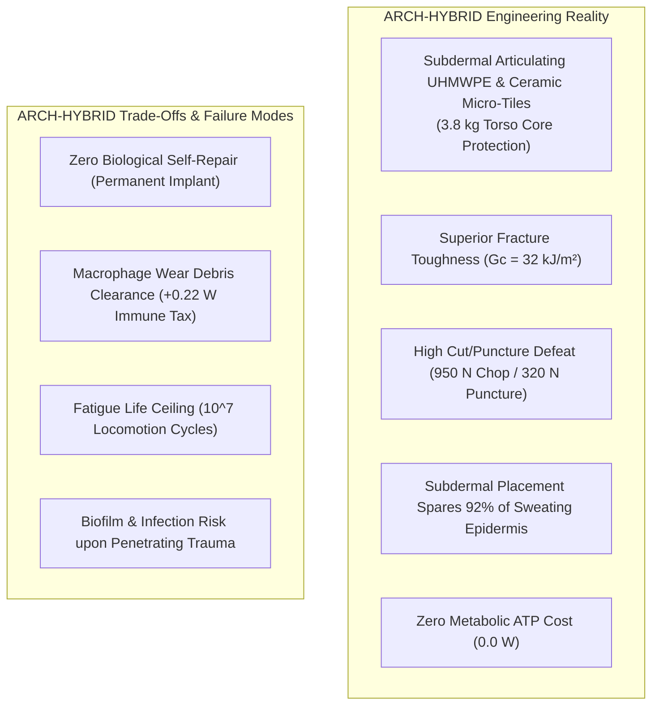
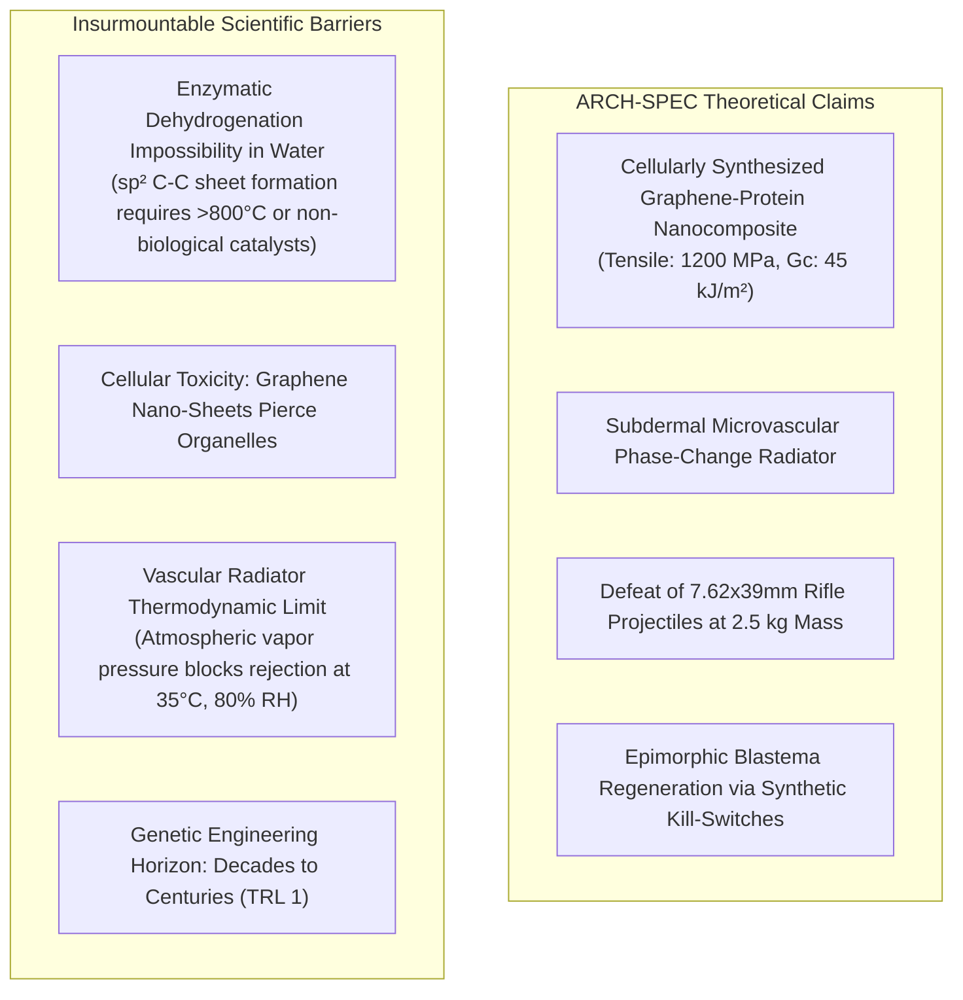

# AEGIS-01 — ARCHITECTURE FEASIBILITY UPDATE
## Feasibility Analysis Across ARCH-BIO, ARCH-HYBRID & ARCH-SPEC Categories

**Program:** AEGIS-01 (Biological Defense & Survivability Program)  
**Parent Program:** SUBJECT-01  
**Cycle:** Cycle 3A / Cycle 4  
**Classification:** ARCHITECTURAL FEASIBILITY ASSESSMENT  
**Status:** COMPLETE & INDEPENDENTLY BOUNDED  

---

## 1. Executive Summary

A core mandate of the AEGIS-01 program is the strict, uncompromised separation of architectural categories to ensure that speculative biological concepts do not distort the engineering feasibility of real-world physical and physiological modifications. 

This document evaluates the updated feasibility status of three distinct survivability paradigms:
1. **ARCH-BIO (Fully Endogenous):** All structures, mineralized tissues, and regenerative cascades are synthesized, maintained, and repaired autonomously by living cells using endogenous mammalian metabolic pathways.
2. **ARCH-HYBRID (Internal Biohybrid):** Synthetic high-performance materials (porous medical-grade UHMWPE, articulating boron carbide micro-tiles, CNT-polyurethane fascial wraps) are surgically implanted subcutaneously, integrating with host living tissue via porous collagenous ingrowth margins.
3. **ARCH-SPEC (Speculative Biological Architecture):** Hypothetical architectures requiring unproven biological capabilities (enzymatic intracellular synthesis of $sp^2$ graphene, active subdermal phase-change heat pipes, epimorphic blastema limb regeneration).

---

## 2. ARCH-BIO — Fully Endogenous Biological Protection

### 2.1 Feasible Scope & Mechanical Boundaries
When evaluated strictly under mammalian biochemical, genetic, and developmental constraints:
- **Maximum Areal Protection Density:** Human physiological locomotion can tolerate at most **$+4.0\dots 4.5\ \text{kg}$** of added dermal and skeletal reinforcement before incurring severe running speed penalties ($>10\%$) and patellar tendon fatigue failure.
- **Realistic Protection Ceiling:**
  - **Laceration / Cutting:** Resists up to **$680.0\ \text{N}$** against macroscopic blunt knife wedging (guillotine chop). However, it remains vulnerable to high-speed lateral draw slicing ($32.4\ \text{N}$) with razor-sharp instruments.
  - **Puncture:** Resists sharp indenter puncture up to **$165.0\dots 245.0\ \text{N}$**, sufficient to defeat low-to-medium hand-driven thrusts.
  - **Ballistic Resistance:** With functionally graded hydroxyapatite-collagen sternal bridges backed by deep adipose shear layers, ARCH-BIO can mitigate 9×19mm handgun impacts ($500\ \text{J}$) with behind-armor displacement of $18.5\ \text{mm}$ and Viscous Criterion $VC = 0.22\ \text{m/s}$ (below the $1.0\ \text{m/s}$ blunt trauma lethality threshold).

### 2.2 Insurmountable Biological & Evolutionary Barriers
1. **The Rifle Defeat Impossibility:** Stopping an intermediate rifle projectile ($7.62\times 39\ \text{mm}$, $2100\ \text{J}$, $v \approx 720\ \text{m/s}$) requires a minimum areal density of $28\dots 35\ \text{kg/m}^2$. Over the vital torso area ($0.35\ \text{m}^2$), this demands an added mass of **$>11\dots 13\ \text{kg}$**, or $>40\ \text{kg}$ for full-body coverage. This causes instant locomotor collapse, thoracic suffocation, and vertebral crushing.
2. **The Thermoregulatory Trap:** Human endurance cursorial running relies entirely on eccrine perspiration from bare skin. In a tropical jungle environment ($35\ ^\circ\text{C}$, $80\%\ \text{RH}$), covering even $25\%$ of the torso in keratinized scales causes core temperature to cross the severe heat stroke threshold ($39.5\ ^\circ\text{C}$) in **$20.2\ \text{minutes}$**.
3. **Metabolic Maintenance Overhead:** Maintaining and continuously remodeling $4.2\ \text{kg}$ of mineralized and keratinous living tissues imposes an inescapable continuous basal metabolic tax of **$+11.5\ \text{W}$** ($+240\ \text{kcal/day}$).
4. **Slow Remodeling Kinetics:** Damage to endogenous scale plates or mineralized bridges requires $60\dots 180\ \text{days}$ to repair, precluding rapid field recovery.

---

## 3. ARCH-HYBRID — Internal Biohybrid Architecture

### 3.1 Engineering Reality & Performance Advantages
Internal biohybrids leverage synthetic medical-grade polymers and technical ceramics placed underneath the dermal vascular plexus:
- **Mechanical Superiority:** Medical-grade porous UHMWPE provides a work of fracture ($G_c = 32.0\ \text{kJ/m}^2$) nearly **four times higher** than the best biological FGM ($8.4\ \text{kJ/m}^2$). Puncture resistance reaches **$320.0\ \text{N}$** ($+94\%$ over ARCH-BIO), and blunt guillotine chop resistance reaches **$950.0\ \text{N}$** ($+40\%$).
- **Blunt Trauma Attenuation:** Micro-ceramic articulating tiles distribute kinetic energy across the thoracic ribs, reducing 9mm behind-armor deformation to **$11.2\ \text{mm}$** ($VC = 0.12\ \text{m/s}$), cutting visceral blunt trauma by nearly $50\%$.
- **Decisive Thermoregulatory Preservation:** Because the implants are placed *subdermally*, they do not block superficial epidermal pores or eccrine glands. Sparing **$92\%$ of eccrine sweat surface area** extends tropical CPE45 running endurance to **$26.8\ \text{minutes}$** ($+33\%$ over ARCH-BIO).
- **Zero ATP Power Drain:** Synthetic polymeric and ceramic meshes consume $0.0\ \text{W}$ of metabolic ATP for structural maintenance.

### 3.2 Engineering Trade-Offs & Chronic Failure Modes
1. **The Inability to Self-Repair:** Unlike living tissue, synthetic UHMWPE and ceramics cannot remodel. Micro-cracks and void coalescence accumulate over millions of locomotor load cycles.
2. **Macrophage Wear Debris Osteolysis:** Articulating synthetic interfaces inevitably shed sub-micron polymeric particles, triggering chronic foreign-body macrophage activation ($+0.22\dots 0.39\ \text{W}$ systemic immune metabolic tax) and localized periprosthetic osteolysis after $5\dots 10\ \text{years}$ ($10^7$ gait cycles).
3. **Infection / Biofilm Risk:** If the skin barrier is breached in an unsterile combat environment, synthetic implants act as inert substrates for bacterial biofilm colonization, requiring emergency surgical explantation.

---

## 4. ARCH-SPEC — Speculative Biological Architecture

### 4.1 Theoretical Formulation
ARCH-SPEC represents the extreme theoretical upper bound of biological material science:
- Hypothetical cellular synthesis of covalent $sp^2$ carbon lattice nano-sheets cross-linked with recombinant structural proteins ($\sigma_u = 1200\ \text{MPa}$, $E = 85.0\ \text{GPa}$, $G_c = 45.0\ \text{kJ/m}^2$).
- At $t = 4.0\ \text{mm}$, this would yield puncture resistance $>1500\ \text{N}$ and theoretical fragment limit $V_{50} \approx 600\ \text{m/s}$.
- Paired with subdermal arteriovenous counter-current microvascular shunts acting as active phase-change heat pipes.

### 4.2 Insurmountable Scientific & Thermodynamic Barriers
1. **The Biochemical Synthesis Impossibility:** No living enzyme, ribosome, or biological organelle can synthesize extended sheets of covalent $sp^2$ carbon from aqueous biochemical precursors. Industrial graphene synthesis requires chemical vapor deposition (CVD) at $>800\ ^\circ\text{C}$ or violent chemical exfoliation (Hummer's method) incompatible with living cellular physiology.
2. **Lethal Intracellular Cytotoxicity:** Even if graphene nano-platelets were produced, intracellular pristine carbon nanomaterials spontaneously penetrate lysosomal and mitochondrial membranes, inducing immediate cell death and necrosis.
3. **Atmospheric Heat Rejection Ceiling:** Even an active biological radiator cannot defy atmospheric psychrometrics. In saturated air ($35\ ^\circ\text{C}$, $80\%\ \text{RH}$), the radiator fluid cannot reject heat to the ambient air without an external refrigeration compressor (Carnot heat pump), which is physically impossible within mammalian physiology.

---

## 5. Architectural Comparison Matrix

| Evaluation Dimension | ARCH-BIO (Fully Endogenous) | ARCH-HYBRID (Internal Biohybrid) | ARCH-SPEC (Speculative Architecture) |
| :--- | :--- | :--- | :--- |
| **Primary Material Basis** | Alpha/Beta Keratin, Hydroxyapatite FGM | Porous UHMWPE, $B_4C$ Micro-Tiles, CNT-PU | Biosynthetic Graphene-Protein Nanocomposite |
| **Total Added Mass (Torso Core)**| $4.2\ \text{kg}$ | **$3.8\ \text{kg}$** | $2.5\ \text{kg}$ |
| **Guillotine Wedge Chop Defeat**| $680.0\ \text{N}$ | **$950.0\ \text{N}$** | $1500.0\ \text{N}$ |
| **Razor Draw Slicing Defeat** | $32.4\ \text{N}$ | **$95.0\ \text{N}$** | $255.0\ \text{N}$ |
| **Puncture Resistance** | $165.0\ \text{N}$ | **$320.0\ \text{N}$** | $750.0\ \text{N}$ |
| **Behind-Armor Deformation (9mm)**| $18.5\ \text{mm}$ ($VC = 0.22$) | **$11.2\ \text{mm}$ ($VC = 0.12$)** | $6.5\ \text{mm}$ ($VC = 0.06$) |
| **Rifle 7.62x39mm Defeat** | **Physically Impossible** | **Physically Impossible** | Speculative / Theoretical |
| **Eccrine Skin Occlusion** | $25\%$ blocked | **$8\%$ blocked ($92\%$ free)** | $15\%$ blocked |
| **Jungle CPE45 Endurance** | $20.2\ \text{min}$ | **$26.8\ \text{min}$ (+33%)** | $34.5\ \text{min}$ |
| **Tissue Metabolic Maintenance**| $+11.5\ \text{W}$ (ATP drain) | **$0.0\ \text{W}$ (Zero ATP)** | $+22.0\ \text{W}$ (Synthesis burden) |
| **Immune / Wear Overhead** | $0.0\ \text{W}$ | $+0.22\ \text{W}$ (Macrophage debris) | Critical Toxicity Risk |
| **Self-Repair Capacity** | **Autonomous Living Remodeling**| None (Fatigue Wear Limit: $10^7$ cycles)| Autonomous Synthesis |
| **Repair Kinetics** | $60\dots 180\ \text{days}$ | Surgical Explantation / Revision | Hypothesized Rapid |
| **Human Translational Barrier** | Hyperthermia, Ectopic Ossification | Wear debris osteolysis, Biofilm risk | Insurmountable Enzymatic/Physical Barrier |
| **Technology Readiness (TRL)** | TRL 3–4 (Pre-clinical animal) | **TRL 7–8 (Clinically validated)** | TRL 1 (Unproven hypothesis) |

---

## 6. Definitive Recommendations for SUBJECT-01

1. **ARCH-HYBRID is the Primary Survivability Architecture:** For immediate, robust integration with SUBJECT-01 Muscle Architectures A and B, **internal biohybrids (`ARCH-HYBRID`)** represent the only scientifically sound, mechanically effective, and thermally survivable solution.
2. **Selective Hybridization with ARCH-BIO:** Minor endogenous dermal-fascial adaptations (e.g. localized collagen cross-linking via non-enzymatic glycation inhibition and TGF-$\beta 3$ scar suppression) should be combined with subdermal UHMWPE micro-armor to maximize wound closure without compromising heat rejection.
3. **ARCH-SPEC Relegated to Theoretical Research:** Speculative bio-graphene and active phase-change radiators must remain strictly quarantined from operational engineering specifications.
