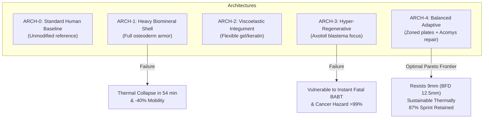

# AEGIS-01 — ARCHITECTURE OPTIONS & TRADEOFF ANALYSIS

## 1. СРАВНИТЕЛЬНЫЙ ОБЗОР БИОАРХИТЕКТУР

В рамках первого цикла исследований разработаны и сопоставлены 5 альтернативных биологических архитектур организма:

---

## 2. МАТРИЦА СРАВНИТЕЛЬНЫХ ХАРАКТЕРИСТИК

| Параметр / Метрика | ARCH-0 (Базовый человек) | ARCH-1 (Тяжёлый панцирь) | ARCH-2 (Вязкоупругий покров) | ARCH-3 (Гипер-регенератор) | ARCH-4 (Сбалансированная зонная) |
| :--- | :--- | :--- | :--- | :--- | :--- |
| **Общая масса организма** | 75.0 кг | 99.3 кг ($+24.3$ кг) | 85.8 кг ($+10.8$ кг) | 75.2 кг ($+0.2$ кг) | **84.2 кг ($+9.2$ кг)** |
| **Масса защитного слоя** | 0.0 кг | 19.4 кг | 8.6 кг | 0.2 кг | **7.3 кг** |
| **Площадь покрытия тела** | 0% | 75% | 85% | 10% | **55% (Зонная защита)** |
| **Базальный метаболизм (BMR)** | 86.4 Вт | 113.4 Вт ($+31\%$) | 97.3 Вт ($+13\%$) | 86.7 Вт | **95.8 Вт ($+11\%$)** |
| **Макс. скорость спринта** | 10.0 м/с (100%) | 5.97 м/с (59.7%) | 8.41 м/с (84.1%) | 9.88 м/с (98.8%) | **8.70 м/с (87.0%)** |
| **Предел терморегуляции при нагрузке**| Неограничен | **54.0 мин (Тепловой удар)**| 321.4 мин | Неограничен | **Неограничен (Устойчив)** |
| **Стойкость к проколу (MODEL-01)** | 28.7 Н | 499.0 Н | 155.0 Н | 35.0 Н | **280.0 Н** |
| **Стойкость к порезу (MODEL-01)** | 212.5 Н | 140.0 Н (Хрупкий) | 685.0 Н | 230.0 Н | **850.0 Н** |
| **Запреградный прогиб от 9мм (BFD)**| 55.0 мм (Летально) | **5.8 мм (Безопасно)** | 20.4 мм | 50.0 мм (Летально) | **12.5 мм (Безопасно, AIS 1)** |
| **Вязкостный критерий от 9мм ($VC$)**| 14.3 м/с (Летально) | **0.045 м/с (Безопасно)** | 1.19 м/с (Погранично) | 12.0 м/с (Летально) | **0.18 м/с (Безопасно)** |
| **Время гемостаза средней артерии**| 57.4 с (Кровопотеря 6.9%) | 50.0 с | 40.0 с | 18.0 с | **23.6 с (Кровопотеря 2.7%)** |
| **Качество регенерации тканей** | Рубцовый фиброз (85%) | Медленное срастание | Фиброз | Безрубцовое (100%) | **Безрубцовое по типу *Acomys*** |
| **10-летний онкогенный риск** | 3.4% | 3.4% | 3.4% | **99.6% (Смертельно)** | **6.1% (Стабилизирован $TP53$)** |
| **СВОДНЫЙ ИНДЕКС ЖИВУЧЕСТИ** | **49.9 / 100** | **69.3 / 100** | **68.4 / 100** | **61.2 / 100** | **90.0 / 100** |

---

## 3. ДЕТАЛЬНЫЙ АНАЛИЗ КАЖДОГО ВАРИАНТА

### ARCH-0: Standard Human Baseline (Базовый человек)
- **Сущность:** Немодифицированная биология современного человека.
- **Преимущества:** Превосходная терморегуляция (открытая поверхность потоотделения), высокая подвижность.
- **Критические уязвимости:** Нулевая баллистическая стойкость, уязвимость к ножевым проколам и порезам, фиброзное рубцевание с потерей эластичности, медленный гемостаз.

### ARCH-1: Heavy Biomineral Shell (Монолитный остеодермальный панцирь)
- **Сущность:** Сплошной слой минерализованных костных пластинок, покрывающий 75% тела по аналогии с глиптодонтами и черепахами.
- **Преимущества:** Максимальная баллистическая защита от пистолетных пуль (BFD всего 5.8 мм, $VC = 0.045$ м/с) и проколов (499 Н).
- **Критические тупики (NO-GO):**
  1. *Массовый коллапс:* Прибавка в массе $+24.3$ кг снижает скорость бега на $40\%$ ($5.97$ м/с против $10.0$ м/с), превращая организм в малоподвижную мишень.
  2. *Терморегуляторная ловушка:* Блокировка $70\%$ площади потоотделения снижает теплоотвод до 354 Вт при выделении 837 Вт. Тепловой удар наступает через 54 минуты.
  3. *Хрупкость к порезу:* Монолитная биоминеральная фаза скалывается при скользящих ударах лезвием ($\sigma_u$ на срез низкая).

### ARCH-2: Flexible Viscoelastic Integument (Вязкоупругий эластичный покров)
- **Сущность:** Многослойный дермальный композит из перекрестно-сшитого коллагена и вязкоупругой жидкости неньютоновского типа (дилатантный гель).
- **Преимущества:** Высокая гибкость, минимальное ограничение подвижности (спринт $8.41$ м/с), великолепная стойкость к порезам (685 Н).
- **Критические уязвимости:** При баллистическом ударе 9мм пули гибкий слой прогибается на 20.4 мм, а $VC$ достигает $1.19$ м/с, что создает риск тяжелой контузии легких и переломов ребер (AIS 3–4).

### ARCH-3: Extremophilic Regenerative Organism (Гипер-регенератор)
- **Сущность:** Полный отказ от тяжелой пассивной брони в пользу неограниченной эпиморфной регенерации (аксолотль / саламандра).
- **Преимущества:** Сохранение легкой массы (75.2 кг) и полной подвижности, способность заново отращивать ткани без рубцов.
- **Критические тупики (NO-GO):**
  1. *Бессилие против мгновенной летальности:* Пулевое или осколочное поражение сердца, аорты или ствола мозга убивает за секунды. Регенерация, требующая недель, неприменима.
  2. *Онкогенная катастрофа:* При соматической пролиферации без расширения генома $TP53$ кумулятивный риск малигнизации (саркома) достигает $>99\%$ за 10 лет.

### ARCH-4: Balanced Adaptive Survivability Architecture (Сбалансированная зонная биоархитектура)
- **Сущность:** Комбинированная парадигма:
  - *Зонирование брони:* Жесткие композитные остеодермы монтируются только над критическими органами (грудина, передняя брюшная стенка, череп, проекция сонных артерий — 55% площади тела).
  - *Суставы и конечности:* Защищены легкой гибкой коллаген-эластиновой матрицей.
  - *Терморегуляция:* Сохранено 70% эффективной площади потоотделения (спина, подмышечные области, дистальные конечности), обеспечивая непрерывный сброс $>825$ Вт тепла.
  - *Гемостаз:* Локальные эндотелиальные биогерметики сокращают время тромбообразования до 23 секунд без системного риска ДВС-синдрома.
  - *Регенерация и геном:* Безрубцовое заживление дермы по типу *Acomys* (TGF-$\beta 3$) и экспансия генов $TP53$ (12 копий, как у слонов) для удержания риска рака на уровне $6.1\%$.
- **Результат:** Наивысший сводный индекс выживаемости **90.0 / 100**, отсутствие критических системных тупиков.
