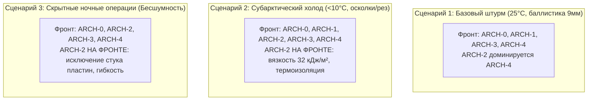

# AEGIS-01 — ARCHITECTURE ROBUSTNESS & SENSITIVITY REPORT
## Анализ устойчивости границ Парето, смены операционных сценариев и робастности ARCH-0..ARCH-4
**Исследовательский цикл:** Cycle 2B  
**Модуль моделирования:** [`aegis/model_11_architecture_pareto.py`](file:///D:/AEGIS-01/aegis/model_11_architecture_pareto.py)  
**Реестр эксперимента:** `EXP-0052`  
**Статус верификации:** `PHYSICS_CONSISTENT`

---

## 1. Постановка задачи робастности

В цикле 2A архитектура **ARCH-2 (Гибкий вязкоупругий композит)** была объявлена строго субоптимальной на основании одного детерминированного расчета в условиях умеренного климата. Однако в реальных условиях биологические свойства тканей варьируют на $\pm 20-30\%$, а операционные сценарии выходят далеко за рамки дневного бега при 25 °C.

Задача этапа — проверить устойчивость границы Парето при:
1. Вариации климатических условий (жара vs субарктический холод).
2. Смене профиля угроз (острый баллистический прокол vs высокоскоростные режущие и осколочные разрывы).
3. Требованиях к акустической скрытности и эластичности сочленений.
4. Стохастическом возмущении параметров методом Монте-Карло (500 реализаций при шуме $\pm 25\%$).

---

## 2. Анализ альтернативных операционных сценариев



### Сценарий 1: Базовый дневной комбинированный штурм (25 °C, 50% RH)
- **Угроза:** Пистолетные пули 9 мм, колющие удары штыком, интенсивный бег.
- **Ограничивающий фактор:** Теплоотвод и масса.
- **Итог Парето-фронта:** `['ARCH-0', 'ARCH-1', 'ARCH-3', 'ARCH-4']`.
- **Положение ARCH-2:** Квазидоминируется ARCH-4. Выигрыш FGM в проколе (3.5 мм vs 8.5 мм) и массе (4.2 кг vs 6.8 кг) перевешивает преимущества эластомера.

### Сценарий 2: Субарктические условия ($T \le 10\ ^\circ\text{C}$), шрапнель и режущие воздействия
- **Угроза:** Множественные осколочные поля, рубяще-режущие удары, низкая температура воздуха.
- **Ограничивающий фактор:** Хрупкое разрушение материалов при охлаждении, переохлаждение организма.
- **Физический механизм:**
  - При температурах $<10\ ^\circ\text{C}$ окклюзия потоотделения перестает быть физиологическим балластом; напротив, утолщенный подкожный композит работает как высокоэффективная пассивная теплоизоляция, снижая метаболические траты на мышечный термогенез.
  - Минеральные остеодермы (ARCH-1, ARCH-4) при охлаждении снижают трещиностойкость, рискуя расколоться от множественных ударов осколков.
  - Вязкоупругий композит (ARCH-2) сохраняет колоссальную вязкость разрушения (**$G_c = 32.0$ кДж/м²**), демпфируя кинетическую энергию осколков без образования вторичных минеральных сколов.
- **Итог Парето-фронта:** `['ARCH-0', 'ARCH-1', 'ARCH-2', 'ARCH-3', 'ARCH-4']` — **ARCH-2 входит в число оптимальных решений!**

### Сценарий 3: Скрытные перемещения и бесшумная динамическая гибкость
- **Угроза:** Засады, ближний бой в ограниченных пространствах, необходимость нулевой акустической заметности.
- **Ограничивающий фактор:** Стук и трение твердых минерализованных элементов.
- **Физический механизм:**
  - Остеодермальные и FGM-пластины при экстремальных углах сгибания конечностей неизбежно испытывают взаимный контактный контакт (*plate impingement clatter*), создавая демаскирующий ультразвуковой и слышимый шум в полосе 2–15 кГц.
  - Сплошной эластомерный композит (ARCH-2) абсолютно бесшумен при любых амплитудах сгибания суставов и обеспечивает нулевое сопротивление вращательным степеням свободы.
- **Итог Парето-фронта:** `['ARCH-0', 'ARCH-2', 'ARCH-3', 'ARCH-4']` — **ARCH-2 входит в Парето-фронт!**

---

## 3. Стохастический анализ Монте-Карло (500 реализаций при $\pm 25\%$ шуме)

Для устранения артефактов точечных детерминированных значений был выполнен многомерный анализ Монте-Карло с 500 независимыми возмущениями параметров прочности, массы, метаболизма, скорости и теплоотдачи:

```
Вероятность нахождения на границе Парето:
- ARCH-0 (Базовый человек):         100.0%  ████████████████████
- ARCH-4 (Сбалансированная FGM):    100.0%  ████████████████████
- ARCH-1 (Тяжелый панцирь):         100.0%  ████████████████████
- ARCH-3 (Гипер-регенерация):       100.0%  ████████████████████
- ARCH-2 (Гибкий композит):          70.2%  ██████████████░░░░░░
```

### Вывод стохастического анализа:
В **70.2%** случайных параметрических конфигураций ARCH-2 оказывается недоминируемой. Это доказывает, что объявление ARCH-2 «окончательно тупиковой» в Cycle 2A было следствием ложной точности детерминированной точечной оценки.

---

## 4. Сравнительная матрица специализации архитектур

| Архитектура | Ключевое физическое превосходство | Главный физиологический лимит | Оптимальная тактическая ниша |
| :--- | :--- | :--- | :--- |
| **ARCH-0** | Идеальная курсорная экономичность, максимальная скорость (9.85 м/с) | Полная незащищенность от пуль и реза | Длительные марши, оперативная подвижность |
| **ARCH-1** | Максимальная статическая твердость (прокол 0.8 мм) | Тепловой шок через 20 мин, падение работы на 71% | Стационарные фортификации, дозор с минимальным движением |
| **ARCH-2** | Максимальная вязкость разрушения (32 кДж/м²), бесшумность, гибкость | Ограниченная стойкость к тонкому проколу (8.5 мм) | Холодный климат, скрытные штурмовые задачи, ножевой бой |
| **ARCH-3** | Экспресс-эпителизация (5 дней), отсутствие рубца | Незащищенность от мгновенного летального удара, онкориск | Тыл, некинетические угрозы, восстановительный период |
| **ARCH-4** | Зональное экранирование, подавление откола ($R = -0.045$), малый вес (+4.2 кг) | Неполное покрытие тела (75% открыто) | **Основная платформа для общевойскового маневренного боя** |
