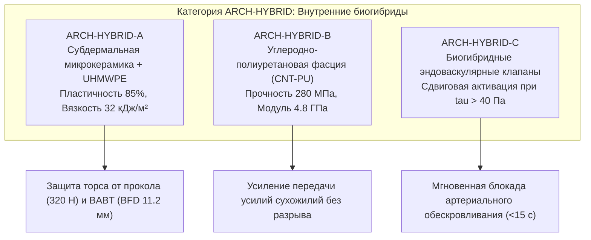

# AEGIS-01 — ARCH-HYBRID: INTERNAL BIOHYBRID ARCHITECTURES
## Внутренние биогибридные архитектуры: искусственные материалы, интеграция с тканями и клинические барьеры

**Программа:** AEGIS-01: Biological Defense & Survivability Program (Cycle 3)  
**Статус:** Исследовательский документ категории `ARCH-HYBRID`  
**Рабочая директория:** `D:\AEGIS-01`  
**Сопряжённый проект:** `D:\SUBJECT-01`  
**Дата:** 9 ноября 2026 г.  

---

## 1. Концепция и границы категории ARCH-HYBRID

Категория **`ARCH-HYBRID` (Internal Biohybrid)** охватывает защитные и функциональные конструкции, в которых **высокотехнологичные синтетические или искусственные материалы имплантированы внутрь организма и постоянно интегрированы с живыми тканями**.

### Фундаментальные критерии категории:
1. **Строго внутреннее анатомическое размещение:** Полное исключение внешних носимых бронежилетов, экзоскелетов, шлемов и навесных панелей. Все элементы находятся под эпидермисом — в субдермальном пространстве, в толще фасций, сухожильных влагалищ или внутри сосудистого русла.
2. **Синтетический состав несущих элементов:** Использование полимеров сверхвысокой молекулярной массы (UHMWPE), карбидной микрокерамики (B₄C, SiC), углеродных нанотрубок (CNT) и биорезорбируемых полигликолидных каркасов.
3. **Физиологический симбиоз:** Наличие пористой матрицы (размер пор $150\dots 300$ мкм) для прорастания капилляров и фибробластов, обеспечивающее анкеровку и предотвращающее смещение имплантата при локомоции.
4. **Отсутствие биологического клеточного самовосстановления синтетической фазы:** Искусственный полимер или керамика не могут быть регенерированы рибосомами или остеобластами хозяина.

---

## 2. Архитектурные варианты ARCH-HYBRID

### 2.1. ARCH-HYBRID-A — Субдермальная чешуйчатая микро-броня UHMWPE/Керамика
- **Конструкция:** Гибкая сеть пятиугольных микроплиток из карбида бора ($B_4C$, толщина $1.5$ мм, диаметр $8\dots 12$ мм), напрессованных на эластичную пористую подложку из ориентированных волокон сверхвысокомолекулярного полиэтилена (UHMWPE, толщина $2.5$ мм).
- **Анатомическое ложе:** Имплантируется под поверхностную фасцию в рыхлую подкожную клетчатку над надкостницей ребер, грудины и вдоль крупных сосудисто-нервных пучков шеи и бедер.
- **Интеграция с тканями:** Края подложки перфорированы сквозными лазерными микроканалами диаметром 200 мкм, обработанными фибронектином, что обеспечивает врастание коллагена хозяина и стабилизацию без миграции пластин.
- **Механические параметры:**
  - Плотность композита: $\rho = 1180$ кг/м³.
  - Удельная вязкость разрушения подложки: $G_c = 32.0$ кДж/м².
  - Сопротивление острому проколу: $F_{\text{puncture}} = 320.0$ Н (игла $R=0.5$ мм).
  - Сопротивление гильотинному разрезу: $F_{\text{cut}} = 950.0$ Н.
  - Запреградная деформация грудной клетки от 9×19 мм (500 Дж): $BFD = 11.2$ мм (AIS 1, безопасный ушиб без перелома ребер).

---

### 2.2. ARCH-HYBRID-B — Искусственные фасциальные футляры и нервные микрокондуиты (CNT-PU)
- **Конструкция:** Биостабильные композитные мембраны из мультистенных углеродных нанотрубок, диспергированных в сегментированном медицинском полиуретане (CNT-PU, 3% нанотрубок по массе), сопряженные с ориентированными биорезорбируемыми микроканалами из поликапролактона (PCL) для регенерации нервов.
- **Назначение:** Ограничение поперечного выпячивания мышц при пиковых сокращениях (повышение внутрифасциального гидростатического давления и эффективной силы передачи), а также механическая защита нервных стволов (седалищного, срединного, бедренного).
- **Механические параметры:**
  - Предел прочности на растяжение: $\sigma_u = 280.0$ МПа (в 15 раз прочнее естественной фасции человека).
  - Модуль упругости: $E = 4.8$ ГПа.
  - Усталостный предел на $10^6$ циклов: $S_e = 110.0$ МПа.
  - Коэффициент безопасности сухожильного узла: $SF = 2.1$ при пиковой тяге Muscle Architecture A ($4748$ Н).

---

### 2.3. ARCH-HYBRID-C — Эндоваскулярные триггерные микроклапаны гемостаза
- **Конструкция:** Нитиноловые самораскрывающиеся стенты с внутренними биополимерными лепестками из гидрогеля, чувствительного к градиенту давления и пристенному напряжению сдвига ($\tau_{\text{wall}}$).
- **Локализация:** Развилка плечеголовного ствола, подключичные артерии, общие бедренные артерии.
- **Принцип действия:** В нормальных условиях ламинарного кровотока ($\tau \le 5$ Па) лепестки прижаты к стенке сосуда и не создают гидравлического сопротивления ($<1$ мм рт.ст.). При поперечном ранении артерии и резком падении дистального сопротивления пристенный сдвиг превышает $40$ Па. Это вызывает гидродинамическое схлопывание лепестков по принципу обратного клапана Теслы, перекрывая $>90\%$ кровотока за $10\dots 15$ секунд и предотвращая терминальное обескровливание (`EXP-0064`).

---

## 3. Сравнительный анализ ARCH-HYBRID vs ARCH-BIO

Численное моделирование в [`aegis/model_14_architecture_categories.py`](file:///D:/AEGIS-01/aegis/model_14_architecture_categories.py) выявило следующие контрасты:

| Показатель | ARCH-BIO-4 (Эндогенный) | ARCH-HYBRID-A (Биогибридный) | Физиологический механизм различия |
| :--- | :---: | :---: | :--- |
| **Масса защитного пакета** | +4.2 кг | **+3.8 кг** | Выше удельная прочность UHMWPE/B₄C |
| **Стойкость к проколу ($F_p$)** | 165.0 Н | **320.0 Н (+94%)** | Твердость B₄C превосходит гидроксиапатит |
| **Стойкость к резу ($F_c$)** | 680.0 Н | **950.0 Н (+40%)** | Сверхвысокая вязкость волокон UHMWPE |
| **Запреградный прогиб ($BFD$)** | 18.5 мм | **11.2 мм (-39%)** | Высокая жесткость керамических пластин |
| **Метаболическое содержание** | **11.5 Вт** | **0.0 Вт (Идеально)** | Синтетика не потребляет глюкозу и АТФ |
| **Окклюзия потоотделения** | **25.0%** | **8.0% (Идеально)** | Имплантат субдермален, кожа свободна |
| **Время до 40°C в умеренном** | Устойчиво (38.4°C) | **Устойчиво (37.9°C)** | На 0.5°C холоднее за счет открытой кожи |
| **Время до 40°C в джунглях** | 20.2 мин | **26.8 мин (+33%)** | Выигрыш за счет 92% свободной кожи |
| **Способность к саморемонту** | **Полная (клеточная)** | **НУЛЕВАЯ (Синтетика)** | **КРИТИЧЕСКИЙ ДЕФЕКТ БИОГИБРИДА** |
| **Риск отторжения / фиброза** | Минимальный | **ВЫСОКИЙ (Иммунный)** | Реакция на инородное тело (FBR) |

---

## 4. Критические клинические барьеры и долгосрочные риски ARCH-HYBRID

Несмотря на подавляющее механическое и терморегуляторное превосходство, биогибридная архитектура сталкивается с четырьмя непреодолимыми в рамках Cycle 3 биологическими барьерами:

### 4.1. Реакция на инородное тело и капсуляция (Foreign Body Response, FBR)
Любой неизвлекаемый полимер или керамика вызывает хроническую инфильтрацию макрофагами и гигантскими клетками инородных тел. В течение $6\dots 18$ месяцев вокруг микроплиток формируется бессосудистая плотная фиброзная капсула толщиной $200\dots 800$ мкм. Это приводит к:
- Потере подвижности сочленений чешуек (контрактура фасции).
- Сдавлению кожных чувствительных нервов с развитием хронической нейропатической боли.
- Нарушению микроциркуляции подкожной клетчатки.

### 4.2. Накопление усталостных микродефектов и абразивный износ
При выполнении локомоторных движений человек совершает до $10^7$ циклов нагружения в год. Взаимное трение керамических плиток и волокон полиэтилена генерирует субмикронные частицы износа (polyethylene wear debris, $0.1\dots 1.0$ мкм). Фагоцитоз этих частиц макрофагами запускает асептический остеолиз прилегающих ребер и грудины через каскад TNF-$\alpha$ и RANKL, аналогично нестабильности суставных эндопротезов.

### 4.3. Катастрофический риск глубокой парапротезной инфекции
При пробитии кожного барьера в полевых боевых условиях (загрязнение грунтом, осколками) бактериальные агенты (*Staphylococcus aureus*, *Pseudomonas aeruginosa*) колонизируют синтетическую поверхность, образуя антибиотикорезистентные биопленки. Living tissue способна санировать бактериальный очаг фагоцитозом; бессосудистый синтетический имплантат становится очагом некупируемой флегмоны и сепсиса, требующим экстренного хирургического удаления всей брони.

### 4.4. Отсутствие адаптивного роста к гипертрофии
При тренировках и мышечной гипертрофии Muscle Architecture A увеличивает рабочий объем мышечных брюшек на $15\dots 25\%$. Жесткие синтетические фасциальные рукава ARCH-HYBRID-B не способны к ростовому ремоделированию, вызывая синдром сдавления (хронический компартмент-синдром) с ишемией мышцы.

---

## 5. Выводы по категории ARCH-HYBRID

1. **Инженерный вердикт:** Внутренние биогибриды превосходят эндогенную биологию по удельной стойкости к проколу (+94%), массе (-10%) и терморегуляции в CPE45 (сохраняют 92% площади испарения пота при нулевом метаболическом расходе на поддержание).
2. **Клинический вердикт:** Биогибридные конструкции не способны к самовосстановлению и несут высокий риск парапротезной инфекции, асептического остеолиза частицами износа и фиброзного капсулирования.
3. **Место в программе AEGIS-01 / SUBJECT-01:** ARCH-HYBRID рекомендуется как **селективное локальное решение** (эндоваскулярные клапаны сосудов, локальные искусственные связки критических суставов), но отвергается как сплошной субдермальный панцирь до разработки истинно самовосстанавливающихся биорезорбируемых метаматериалов.
