# AEGIS-01 — BIOLOGICAL FEASIBILITY REPORT
## Анализ онтогенетической, физиологической и генетической реализуемости защитных модификаций
**Исследовательский цикл:** Cycle 2B  
**Статус документа:** Биологический и системно-инженерный аудит  
**Статус реализуемости:** `BIOLOGICAL_FEASIBILITY: PARTIAL` (высокая реализуемость селективного кератина/FGM при низкой реализуемости STF-гидрогелей и гомойотермной бластемы)  
**Этический кодекс:** Строгий запрет планирования экспериментов на людях и высших животных. Все выводы базируются на сравнительной зоологии, физиологии человека и математических моделях.

---

## 1. Фундаментальные физиологические барьеры гомойотермного организма

Любая модификация защитного покрова человека неизбежно вторгается в коэволюционно сбалансированные системы поддержания гомеостаза:

```mermaid
flowchart TD
    subgraph S1["1. Кальций-фосфатный обмен"]
        A1["Эктопическая минерализация дермы"] --> A2["Нагрузка на паращитовидные железы и почки"]
        A2 --> A3["Риск нефрокальциноза и сосудистого кальциноза"]
    end
    subgraph S2["2. Цитогенетика и онкогенез"]
        B1["Активация эпиморфного пула клеток"] --> B2["Увеличение митотической нагрузки (10^10 делений)"]
        B2 --> B3["Экспоненциальный рост онкотрансформации (Парадокс Пето)"]
    end
    subgraph S3["3. Капиллярная перфузия и диффузия"]
        C1["Утолщение дермального слоя (>5 мм)"] --> C2["Превышение диффузионного предела кислорода (200 мкм)"]
        C2 --> C3["Очаговый ишемический некроз и фиброз"]
    end
```

---

## 2. Сравнительный анализ эволюционных прецедентов

| Модификация | Природный прецедент | Молекулярный механизм в природе | Препятствия для переноса на гомойотермных приматов |
| :--- | :--- | :--- | :--- |
| **Кератиновые чешуи (Система B)** | Панголины (*Manis tricuspis*), броненосцы | Перекрестно-сшитый $\beta$-кератин, экспрессия трансглутаминаз эпидермиса | Высокая (прецедент среди плацентарных млекопитающих). Основная цена — потеря потоотделения. |
| **Костные остеодермы (Система C)** | Броненосцы (*Dasypus novemcinctus*), крокодилы | Внутридермальное окостенение мезенхимы через фактор Runx2/Osterix | Требует непрерывной мобилизации до 3–5 кг гидроксиапатита; риск остеомаляции опорных костей. |
| **Градиентные FGM (Система E)** | Швы панциря черепах, чешуя костных рыб (*Polypterus*) | Пространственный градиент остеопонтина и коллагена I типа | Умеренная; требует тонкой микропространственной регуляции экспрессии фосфатаз (TNAP). |
| **Дисперсные STF-гидрогели (Система D)** | **ОТСУТСТВУЕТ** у позвоночных | В природе биологические жидкости псевдопластичны (разжижаются) | **КРИТИЧЕСКОЕ:** Живые клетки не способны поддерживать концентрированные взвеси наночастиц без макрофагального фагоцитоза. |
| **Бесрубцовое заживление (ARCH-3)** | Иглистые мыши (*Acomys*), хвостатые амфибии | Подавление провоспалительных макрофагов M1, сдвиг TGF-$\beta3$ / TGF-$\beta1$ | Высокая для кожи; **НУЛЕВАЯ для объемных мышц и органов** (у мышей регенерирует только тонкая кожа уха). |

---

## 3. Совместимость с ключевыми целями SUBJECT-01

Проект SUBJECT-01 оптимизирует организм по параметрам предельной локомоторной мощности, скорости сокращения и устойчивости к утомлению. Проанализируем точки системного конфликта:

### 3.1. Максимальная сила и Rate of Force Development (RFD)
- Наличие жестких остеодерм в области грудины и ребер ограничивает экскурсию грудной клетки, снижая максимальный дыхательный объем на 12–18%.
- Масса брони на дистальных участках конечностей недопустима: увеличение массы голени на 500 г увеличивает момент инерции ноги на 18%, снижая угловое ускорение коленного сустава и пиковую скорость бега.
- **Инженерное решение ARCH-4:** Полный отказ от бронирования дистальных звеньев конечностей (стопа, голень, предплечье). Размещение защиты строго на проксимальных узлах (торс, шея, плечевой пояс).

### 3.2. Доставка кислорода и сердечный выброс
- Базовый сердечный выброс в модели SUBJECT-01 составляет $25$ л/мин при $VO_2 = 4.0$ л/мин.
- Паразитная масса брони 14.8 кг (ARCH-1) требует дополнительно $0.62$ л/мин кислорода при скорости 4.5 м/с. В результате анаэробный порог наступает на скоростях на 1.5–2.0 м/с ниже базовых.
- Селективная архитектура ARCH-4 с массой 4.2 кг расходует лишь $+0.18$ л/мин кислорода, что легко компенсируется физиологическим резервом сердечно-сосудистой системы.

### 3.3. Кальциевый гомеостаз и метаболическая цена обслуживания
- Поддержание 4.2 кг зональных FGM-пластин требует метаболического ремоделирования на уровне $3.2$ Вт покоя (дополнительно к BMR).
- Суточный оборот кальция возрастает на 150–200 мг/сутки, что безопасно и укладывается в стандартные диапазоны реабсорбции в почечных канальцах при условии адекватного пищевого снабжения.

---

## 4. Классификация уровней биологической реализуемости модификаций

| Класс реализуемости | Концепция биозащиты | Биологические предпосылки | Рекомендуемый статус |
| :--- | :--- | :--- | :---: |
| **Уровень I: Высокая реализуемость (Proven Mammalian Mechanics)** | Селективные кератиновые чешуи, внутридермальные микроостеодермы | Существуют у современных плацентарных млекопитающих (панголины, броненосцы) | **РАЗРЕШЕНО К МОДЕЛИРОВАНИЮ** |
| **Уровень II: Умеренная реализуемость (Biomimetic Gradient)** | Функционально-градиентные FGM-пластины вдоль реберных зон | Встречаются в опорных тканях амниот; требуют тканеинженерного контроля минерализации | **ПЕРСПЕКТИВНЫЙ ФОКУС (ARCH-4)** |
| **Уровень III: Низкая реализуемость (Theoretical Speculation)** | Искусственные концентрированные STF-коллоиды в живой дерме | Отсутствуют биологические механизмы синтеза и поддержания коллоидных золей | **NO-GO (ЗАКРЫТО)** |
| **Уровень IV: Критический тупик (Fundamental Incompatibility)** | Полный костный панцирь гомойотермного существа (ARCH-1) | Прямое нарушение законов теплообмена, тепловой удар за 20 минут в тесте CPE45 | **NO-GO (ЗАКРЫТО)** |
| **Уровень V: Неразрешенный онкогенный конфликт** | Спонтанная эпиморфная регенерация конечностей у взрослых приматов | Риск злокачественной трансформации пулов дедифференцированных клеток | **ТРЕБУЕТ ДОКЛИНИЧЕСКИХ ДАННЫХ** |
