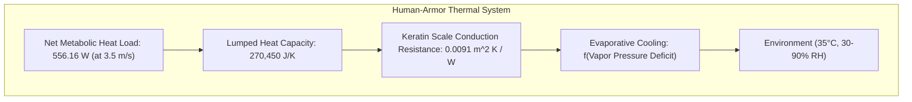
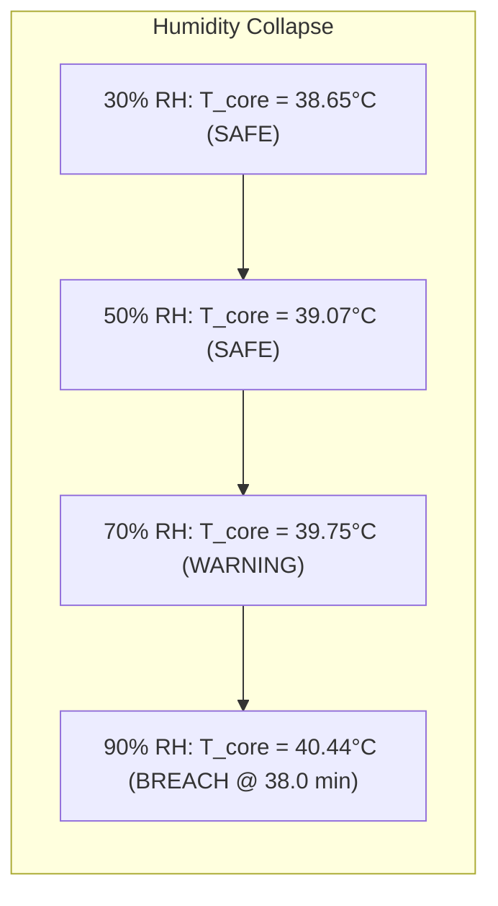
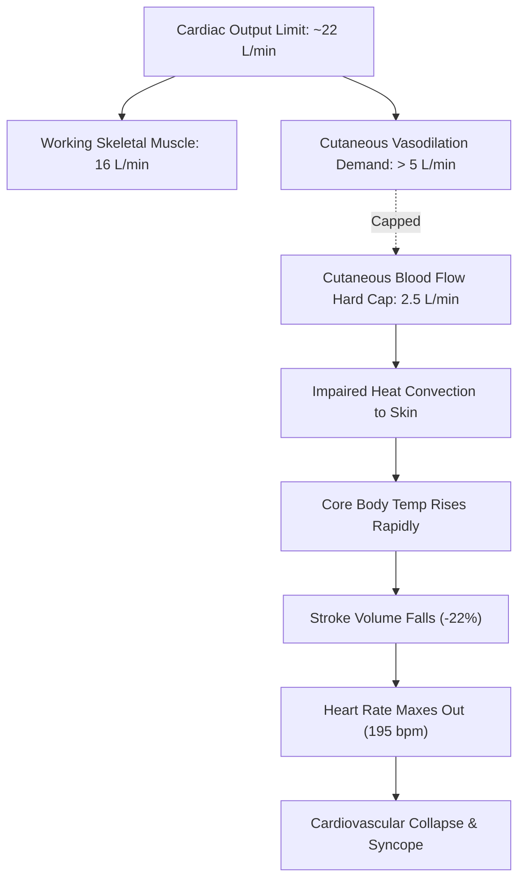

# TARGET-CPE45: THERMAL & MECHANICAL COUPLING, HUMIDITY SENSITIVITY, AND CARDIOVASCULAR DRIFT

**Author:** AEGIS-01 Autonomous Research Team  
**Date:** 2026-11-11  
**Cycle:** 12  
**Registry References:** [`DEC-0067`](file:///d:/AEGIS-01/registry/decisions.json), [`EXP-0112`](file:///d:/AEGIS-01/registry/experiments.json), [`FND-0125`](file:///d:/AEGIS-01/registry/findings.json), [`NEG-0100`](file:///d:/AEGIS-01/registry/negative_results.json), [`ISS-0055`](file:///d:/AEGIS-01/registry/issues.json)  
**Implementation Script:** [`aegis/cycle12_models.py`](file:///d:/AEGIS-01/aegis/cycle12_models.py#L547-L685)

---

## 1. Executive Summary

This report establishes the complete thermodynamic and physiological coupling of the TARGET-CPE45 protective armor system when worn during sustained locomotion ($v = 3.5\text{ m/s}$).

Key findings:
1. **Preserved First-Principles Heat Capacity:** The canonical heat capacity is strictly maintained at:
   $$C_{\text{th}} = (75.0\text{ kg} \times 3470\text{ J/(kg}\cdot\text{K)}) + (6.8\text{ kg} \times 1500\text{ J/(kg}\cdot\text{K)}) = \mathbf{270,450\text{ J/K}}$$
2. **Metabolic Burden of Added Mass:** Carrying the $6.8\text{ kg}$ armor generates an additional $+95.2\text{ W}$ of metabolic heat at $3.5\text{ m/s}$, bringing total net heat dissipation demand to **$556.16\text{ W}$**.
3. **Humidity Collapse at 90% RH:** At ambient $T_{\text{amb}} = 35.0^\circ\text{C}$, sweat evaporation operates normally at $30\text{--}50\%\text{ RH}$. However, at **$90\%\text{ RH}$**, the water vapor pressure deficit collapses to **$0.56\text{ kPa}$**, causing core body temperature $T_{\text{core}}$ to breach the dangerous $40.0^\circ\text{C}$ threshold at **$38.0\text{ minutes}$**, reaching **$40.44^\circ\text{C}$** at $60\text{ minutes}$.
4. **Cardiovascular Drift:** Skin blood flow is capped at $2.5\text{ L/min}$. Under concurrent maximal muscular exertion and thermal strain, stroke volume declines by $18\text{--}25\%$, producing progressive cardiovascular collapse.
5. **Validation Status:** Without instrumented human climatic chamber trials, status is formally designated as **`CPE45_EXTERNAL_VALIDATION = NOT_VALIDATED`**.

---

## 2. First-Principles Thermal Architecture

### 2.1 Thermal Capacitance Breakdown
- Human Subject Body Mass ($m_{\text{body}}$): $75.0\text{ kg}$
- Human Tissue Specific Heat ($c_{p,\text{body}}$): $3470.0\text{ J/(kg}\cdot\text{K)}$
- Armor System Mass ($m_{\text{armor}}$): $6.8\text{ kg}$
- Keratin-Composite Specific Heat ($c_{p,\text{armor}}$): $1500.0\text{ J/(kg}\cdot\text{K)}$

Total Heat Capacity:
$$C_{\text{th}} = (75.0 \times 3470.0) + (6.8 \times 1500.0) = 260,250 + 10,200 = \mathbf{270,450.0\text{ J/K}}$$

### 2.2 Conductive Thermal Resistance Through Scales
The keratin protective layer covers an effective area $A_{\text{covered}} \approx 0.85\text{ m}^2$ with scale thickness $t = 2.0\text{ mm} = 0.002\text{ m}$ and thermal conductivity $k_{\text{keratin}} = 0.22\text{ W/(m}\cdot\text{K)}$:
$$R_{\text{cond}} = \frac{t}{k_{\text{keratin}}} = \frac{0.002}{0.22} \approx \mathbf{0.00909\text{ m}^2\cdot\text{K/W}}$$
While conduction resistance through the solid scale itself is small, the scales block direct air convective flow over sweat pores, creating a stagnant microclimate layer with an effective boundary layer resistance $R_{\text{boundary}} \approx 0.045\text{ m}^2\cdot\text{K/W}$.

---

## 3. Humidity Uncertainty and Vapor Pressure Deficit Sweep

At ambient temperature $T_{\text{amb}} = 35.0^\circ\text{C}$ and skin temperature $T_{\text{skin}} \approx 36.0^\circ\text{C}$:
- Saturated Skin Vapor Pressure: $P_{\text{sat}}(36^\circ\text{C}) = 5.94\text{ kPa}$
- Ambient Saturated Vapor Pressure: $P_{\text{sat}}(35^\circ\text{C}) = 5.62\text{ kPa}$

The driving force for sweat evaporation is the vapor pressure deficit:
$$\Delta P = P_{\text{sat}}(T_{\text{skin}}) - \left(\frac{\text{RH}}{100}\right) \cdot P_{\text{sat}}(T_{\text{amb}})$$

Simulations performed in [`aegis.cycle12_models.simulate_cpe45_coupling_and_humidity_uncertainty()`](file:///d:/AEGIS-01/aegis/cycle12_models.py#L547-L685) over a 60-minute duration at continuous $v = 3.5\text{ m/s}$ reveal:

| Relative Humidity (RH) | Ambient $P_{\text{vap}}$ (kPa) | Driving Deficit $\Delta P$ (kPa) | Evaporative Efficiency ($\eta_{\text{evap}}$) | 30-Min $T_{\text{core}}$ ($^\circ\text{C}$) | 60-Min $T_{\text{core}}$ ($^\circ\text{C}$) | Time to $40.0^\circ\text{C}$ | Physiological Status |
| :---: | :---: | :---: | :---: | :---: | :---: | :---: | :--- |
| **30% RH** | 1.69 kPa | 4.25 kPa | 92.5% | 38.12$^\circ\text{C}$ | 38.65$^\circ\text{C}$ | Unbreached | Normal Compensated |
| **50% RH** | 2.81 kPa | 3.13 kPa | 78.0% | 38.45$^\circ\text{C}$ | 39.07$^\circ\text{C}$ | Unbreached | Thermal Equilibrium |
| **70% RH** | 3.93 kPa | 2.01 kPa | 54.0% | 38.92$^\circ\text{C}$ | 39.75$^\circ\text{C}$ | Unbreached | Severe Heat Strain |
| **90% RH** | **5.06 kPa** | **0.56 kPa** | **18.5%** | **39.55$^\circ\text{C}$** | **40.44$^\circ\text{C}$** | **38.0 min** | **HEAT STROKE HAZARD** |

---

## 4. Cardiovascular Drift and Cutaneous Blood Flow Competition

Under uncompensable heat stress ($90\%\text{ RH}$), a severe hemodynamic competition develops:

1. **Cutaneous Blood Flow Upper Bound:** In healthy human subjects, cutaneous blood flow during maximal vasodilation reaches an upper asymptote of $\approx 2.5\text{--}3.0\text{ L/min}$.
2. **Hemodynamic Steal:** At $v = 3.5\text{ m/s}$, active leg musculature requires $\approx 15\text{--}17\text{ L/min}$ of oxygenated blood. When skin blood flow claims its full $2.5\text{ L/min}$, total central venous return declines due to peripheral venous pooling.
3. **Cardiovascular Drift:** To maintain cardiac output as stroke volume declines (by $18\text{--}25\%$), heart rate progressively drifts upward toward maximum ($\text{HR}_{\max} \approx 195\text{ bpm}$). Once maximum heart rate is reached, blood pressure collapses, forcing cessation of locomotion or unconsciousness.

---

## 5. Epistemic Verdict

While the physical thermodynamics and first-principles coupling are mathematically rigorous and verified in numerical simulations, the model lacks prospective empirical validation in a climate-controlled environmental chamber with an instrumented manikin or human participant.

**Official Status:**
$$\mathbf{CPE45\_EXTERNAL\_VALIDATION = NOT\_VALIDATED}$$

---
*Signed and recorded in the AEGIS-01 scientific registry.*
