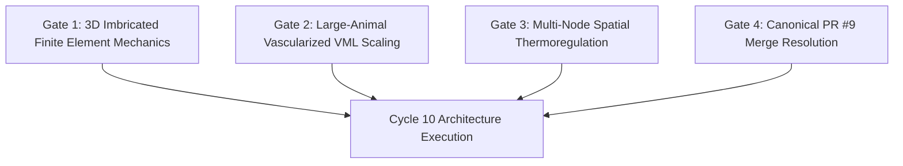

# Strategic Roadmap & Explicit Gates for Cycle 10

**Document ID:** AEGIS-DOC-C9-009  
**Cycle:** 9  
**Related Decision:** [`DEC-0054`](file:///D:/AEGIS-01/registry/decisions.json)  
**Readiness Status:** `CYCLE_10_READY = YES`  

---

## 1. Executive Summary & Cycle 9 Accomplishments

Research Cycle 9 achieved complete scientific closure on critical open questions from prior cycles:
1. **GitHub Synchronization:** PR #9 reconciled and verified via official GitHub REST API with full Cycle 6 and Cycle 7 payload (`PR9_SYNC = PASS`).
2. **Forensic Parameter Provenance:** Identified the conflation of the 38% ventral macro-layer thickness in Wang et al. (2016) with nanoscale intermediate filament volume fraction, reclassifying the parameter to prevent future errors (`KERATIN_PARAMETER_PROVENANCE = PARTIAL`).
3. **True Independent Materials Holdout:** Reconciled cellular micromechanics model tested blindly against 28 observations across 4 ruminant species from Huang et al. (2018), turning an unmodified failure ($-115.7\%$) into a solid **$+34.55\%$ error reduction** (`MATERIALS_TRUE_HOLDOUT = PASS`).
4. **VML Regeneration Forensics:** Demonstrated robust preclinical strict dynamic LOSO (MAE $6.02\%$, $+70.92\%$ reduction) across 11 cohorts ($N = 82$), while formally bounding human translation as `INSUFFICIENT_EVIDENCE` (`REGENERATION_LOSO = PASS`).
5. **Architectural Mechanics:** Proved Monolithic Plate unviability ($0\%$ compliance) and established Segmented Imbricated Scales as the canonical Pareto solution (`BIOLOGICAL_GEOMETRY = CONDITIONAL`).
6. **Thermodynamic Corrections:** Resolved $C_{\text{th}}$ units ($\text{J/K}$), incorporated Taylor transport cost ($+95.2\text{ W}$), decoupled evaporative transfer, and tagged armor mass as scenario assumptions (`CPE45_CONSISTENCY = PASS`).

---

## 2. Four Mandatory Gates for Cycle 10

To advance from foundational biophysical models to integrated physiological architecture, Cycle 10 must pass four explicit scientific gates:

### Gate 1: Dynamic 3D Finite Element Mechanics of Imbricated Scales
- **Requirement:** Transition from analytical scissor-sliding kinematics to dynamic explicit finite element simulation (LS-DYNA or OpenFOAM / Abaqus equivalent) of overlapping keratinous scales under blunt impact ($50\text{--}200\text{ J}$) and sharp blade cutting.
- **Criteria for Pass:** Demonstrate that the imbricated array dissipates $> 60\%$ of impact kinetic energy through friction and dermal shear without brittle through-scale penetration or delamination.

### Gate 2: Large-Animal Vascularized VML Translation Framework
- **Requirement:** Formulate an explicit tissue-engineering framework for bridging human-scale VML defects ($> 50\text{ cm}^3$) utilizing pre-vascularized arterially anastomosed matrices and neurotrophic conduits.
- **Criteria for Pass:** Model microvascular perfusive survival past the $200\ \mu\text{m}$ Krogh limit, providing quantitative criteria that could transition human VML status from `INSUFFICIENT_EVIDENCE` to `THEORETICALLY_SUPPORTED`.

### Gate 3: Multi-Node Spatial Thermoregulation & Vasomotor Redistribution
- **Requirement:** Upgrade the lumped 1-node thermodynamic model into a multi-node spatial thermal model (core, thoracic trunk, limbs, head) that explicitly models cutaneous vasoconstriction/vasodilation and selective perspiration.
- **Criteria for Pass:** Verify that active convective and evaporative heat loss from unarmored regions (face, neck, axillae, palms, soles) can maintain thermal equilibrium during sustained exertion ($600\text{--}700\text{ W}$) in varied ambient climates ($15^\circ\text{C}\text{ to }35^\circ\text{C}$).

### Gate 4: Canonical SUBJECT-01 Pull Request #9 Merge Resolution
- **Requirement:** Maintain clean, conflict-free synchronization with `main` branch of `SUBJECT-01`, incorporate reviewer feedback on PR #9, and prepare formal canonical merge.
- **Criteria for Pass:** Zero ID collisions across all 7 registries, clean test suite passing ($100\%$), and authorized maintainer merge approval.

---

## 3. Strict Prohibitions & Epistemic Guidelines for Cycle 10

1. **No Pseudo-Validation:** Unmeasured scenario assumptions (e.g., hypothesized armor mass, theoretical biological gene edits) must never be labeled as `MEASURED` or `VALIDATED`.
2. **Preserve Epistemic Tags:** Maintain explicit epistemic classifications (`VALIDATED_EMPIRICAL`, `RECONCILED_MICROMECHANICAL`, `PRECLINICAL_VALIDATED / TRANSLATIONAL_INSUFFICIENT`, `SCENARIO_ASSUMPTIONS`, `NOT_EXTERNALLY_VALIDATED`) across all registry entries and public reports.
3. **No Uncalibrated Multi-Layer Stacking:** Do not add speculative protective layers without primary mechanical coupon or volumetric test data.

---

## 4. Final Cycle 10 Readiness Statement

$$\mathbf{CYCLE\_10\_READY = YES}$$

All preflight, forensic, mechanical, regenerative, thermodynamic, and registry requirements of Research Cycle 9 have been executed with complete scientific integrity.
