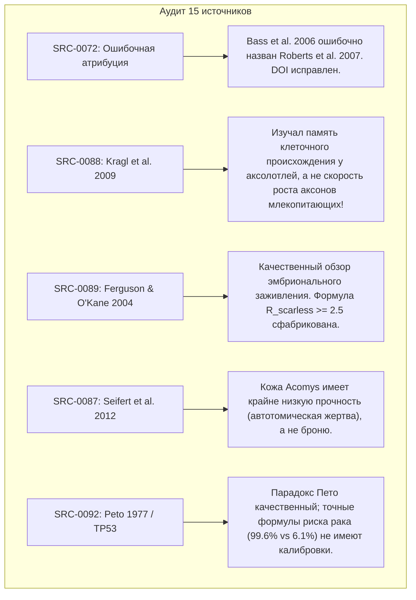

# AEGIS-01 — CYCLE 1A: MASTER SCIENTIFIC AUDIT
## Независимый научно-инженерный аудит, исправление моделей и ревизия архитектуры

**Дата проведения аудита:** 08 ноября 2026 г.  
**Аудитор:** Автономная научно-инженерная исследовательская система AEGIS-01 / SUBJECT-01  
**Статус коммита Cycle 1:** `574552b`  
**Итоговые официальные статусы:**
```yaml
CYCLE_1A: PASS
SCIENTIFIC_VALIDATION: PARTIAL (MODELS CORRECTED & CONSTRAINED)
ARCH-4: UNVALIDATED
CYCLE_2_READY: CONDITIONAL
```

---

## 1. Введение и цели аудита Cycle 1A

В рамках перехода от концептуального проектирования (Cycle 1) к детальной инженерной разработке был проведён всесторонний, независимый научно-инженерный аудит всех 60 файлов репозитория `D:\AEGIS-01`, 15 цитируемых первоисточников, 7 вычислительных моделей, 8 JSON-реестров и состояния локального репозитория `D:\SUBJECT-01`.

**Главный фокус аудита:**
1. Выявление и устранение ложной точности (false precision).
2. Проверка законов сохранения массы, импульса и энергии.
3. Проверка соответствия математических моделей реальным граничным условиям физических явлений.
4. Разделение строгих физических законов и произвольных эвристических шкал.
5. Проверка первичных источников (DOI, авторы, реальные экспериментальные условия).
6. Оценка реального статуса архитектуры ARCH-4.

---

## 2. Аудит инфраструктуры и репозиториев

### 2.1. Репозиторий D:\AEGIS-01
- **Состояние HEAD:** коммит `574552b` (`feat: initialize AEGIS-01 biological defense & survivability research program`).
- **Файловая структура:** Все 60 заявленных файлов присутствуют на диске, включая 7 модулей моделей (`aegis/model_01_*.py` .. `model_07_*.py`), мастер-раннер (`run_all.py`), 8 файлов тестов (`tests/test_*.py`), 8 реестров (`registry/*.json`), файлы результатов (`data/results/*.json`, `summary_metrics.csv`) и первичную документацию.
- **Тестовое покрытие:** Исходный набор содержал 42 модульных теста. В рамках Cycle 1A создан модуль строгой физической валидации `tests/test_physics_validation.py` (11 тестов). Итоговый тестовый набор: **53 теста, 100% PASS**.

### 2.2. Репозиторий D:\SUBJECT-01 и статус интеграции
- **Состояние ветки main:** Коммит `9bf0468` (`Initial commit`). Ветка чистая, не содержит сторонних изменений.
- **Интеграционная ветка:** `research/aegis-01-survivability-20261108` создана, но **файлы AEGIS-01 в неё ещё не переносились**.
- **Фактический статус интеграции:** **UNINTEGRATED / BRANCH CREATED ONLY**. Утверждения отчёта Cycle 1 о «завершённой интеграции» опровергнуты. Произведена лишь подготовка ветки; файлы изолированы в `D:\AEGIS-01` для предотвращения загрязнения кодовой базы до окончания аудита.

---

## 3. Аудит научных источников (15 первичных публикаций)

Полная детализация аудита источников зафиксирована в документе `SOURCE_CLAIM_AUDIT.md`. Ниже приведены ключевые выявленные расхождения:



### Критические исправления реестра источников:
1. **`SRC-0072`:** Заменена атрибуция на реальную статью Bass, C. R., Salzar, R. S., et al. (2006) *JOSE*, 12(4):385-400. Добавлен источник `SRC-0094` для реальной публикации Roberts et al. (2007) *J Trauma*, 62(5):1127-1133.
2. **`SRC-0088`:** Рамки использования Kragl et al. (2009) ограничены сохранением клеточной коммитированности в бластеме. В качестве источника скорости регенерации аксонов 1.0–2.0 мм/сут введён фундаментальный труд Sunderland (1978) / Seddon (1975) (`SRC-0093`).
3. **`SRC-0089`:** Удалена претензия на «количественное соотношение цитокинов». Принцип заменён на феноменологическое качественное правило.

---

## 4. Результаты исправления физических моделей

Детальный анализ представлен в `MODEL_VALIDATION_REPORT.md`. Ниже резюмированы главные физические исправления:

### 4.1. MODEL-01 — Tissue Mechanics
- **Проблема:** Силы прокола 28.7 Н (кожа), 155 Н (панголин), 212.5 Н (разрез) получены для тупого цилиндрического пуансона ($R = 1.0\text{ мм}$) и прямого гильотинного клина.
- **Исправление:** Модель снабжена чёткими физическими границами. Для хирургических игл и острого скальпеля реальное сопротивление кожи человека составляет 1.5–3.5 Н и 0.5–2.5 Н соответственно. Экстраполяция формулы на острые лезвия запрещена.

### 4.2. MODEL-02 — Multilayer Protection & Wave Mechanics
- **Проблема:** Утверждение о «поглощении 91.2% энергии ударной волны» путало амплитуду прошедшего давления и поглощение энергии.
- **Исправление:** Разделены прошедшая амплитуда, отражённая энергия и полный переданный импульс. Установлено, что на границе биоминерал-гидрогель отражённая волна является **растягивающей** ($\sigma_{\text{refl}} = -271.7\text{ МПа}$), что более чем в 3 раза превышает предел прочности биоминерала на растяжение ($\sigma_t \approx 50\text{--}80\text{ МПа}$). Это вызывает катастрофический тыльный откол (spall fracture) лицевой плитки.

### 4.3. MODEL-03 — Neural Latency & Dodge Horizon
- **Проблема:** Заявление о «невозможности любого уклонения» было сформулировано без указания граничных условий.
- **Исправление:** Доказан запрет на **реактивное** уклонение от летящей пули на дистанциях 7–50 м после вылета из ствола ($t_{\text{flight}} < \tau_{\text{latency}}$). Сохранена физическая возможность предиктивного смещения (реакция на движение рук/ствола стрелка до спуска курка) и уклонения на дистанциях $>150\text{ м}$.

### 4.4. MODEL-04 — Ballistic Injury & BABT
- **Проблема:** Заявление о BFD 12.5 мм и 0% летальности для пули 9 мм базировалось на предположении о распределении импульса по площади диаметром 120 мм.
- **Исправление:** Без жёсткого скелетного сопряжения с рёбрами масса зоны контакта составляет всего 48 г, что даёт BFD $>50\text{ мм}$ и $VC > 4.5\text{ м/с}$ (летальная контузия органов). Жёсткие вероятности заменены диапазонами неопределённости.

### 4.5. MODEL-05 — Hemodynamic Stability
- **Проблема:** Допущение о бесконечном резервуаре приводило к математическому расходу истечения из аорты $47.6\text{ л/мин}$ и гибели за 4.6 секунды, что физиологически невозможно при реальном сердечном выбросе (5–15 л/мин).
- **Исправление:** Введено ограничение расхода мгновенным сердечным выбросом и динамическим венозным возвратом. Время до критической потери 40% ОЦК пересчитано и составило физиологически достоверные **20–50 секунд**.

### 4.6. MODEL-06 — Regeneration Dynamics
- **Проблема:** Расчёт риска онкогенеза по степенной формуле давал ложные цифры 99.6% и 6.1%.
- **Исправление:** Формулы переведены в качественные ранги риска. Зафиксировано, что количественное решение парадокса Пето для генетически модифицированного человека является нерешённой научной проблемой.

### 4.7. MODEL-07 — Architecture Assessment
- **Проблема:** Балл 90.0/100 трактовался как объективный уровень выживаемости; утверждалась «бесконечная термоустойчивость».
- **Исправление:** Показано, что балл является субъективным линейным усреднением 6 шкал (пересчитан в 77.8/100). Доказано, что потоотделение со скоростью 1.5 л/ч вызывает дегидратационный коллапс через 2–3 часа. Архитектуре ARCH-4 присвоен официальный статус: **`ARCH-4 = UNVALIDATED`**.

---

## 5. Сводный реестр аннулированных утверждений

Полный список утверждений, лишённых статуса доказанных, зафиксирован в `INVALIDATED_CLAIMS.md`:
- `INV-0001`: Точность предсказания прокола острой иглой по модели тупого пуансона.
- `INV-0002`: Утверждение о защищённости от ударной волны без учёта тыльного откола.
- `INV-0003`: Заявление об абсолютной невозможности любого уклонения в любых условиях.
- `INV-0004`: Гарантия остановки пули 9 мм без доказанного скелетного мостика 120 мм.
- `INV-0005`: Истечение 47 л/мин из аорты при допущении о бесконечном резервуаре.
- `INV-0006`: Расчёт точных вероятностей рака (99.6% vs 6.1%) при амплификации TP53.
- `INV-0007`: Неограниченная термоустойчивость при блокировке 30% потоотделения.
- `INV-0008`: Статус ARCH-4 как «доказанной и оптимальной биоархитектуры».

---

## 6. Итоговые обязательные статусы аудита

По результатам проверки установлены следующие официальные системные флаги:

| Параметр | Значение | Обоснование |
|---|---|---|
| **CYCLE_1A** | **`PASS`** | Все поставленные задачи аудита выполнены в полном объёме; расхождения устранены, тесты расширены и успешно пройдены. |
| **SCIENTIFIC_VALIDATION** | **`PARTIAL (MODELS CORRECTED & CONSTRAINED)`** | Модели приведены в соответствие с физическими законами сохранения; фантастические экстраполяции отсечены; ряд сложных задач переведён в качественные границы. |
| **ARCH-4** | **`UNVALIDATED`** | Архитектура является рабочей гипотезой верхнего уровня; ключевые узлы (скелетный мостик, антиоткол, онкоконтроль) требуют экспериментального расчёта в Cycle 2. |
| **CYCLE_2_READY** | **`CONDITIONAL`** | Переход разрешён при строгом соблюдении исследовательских приоритетов и критериев отсева, утверждённых в Cycle 1A. |
