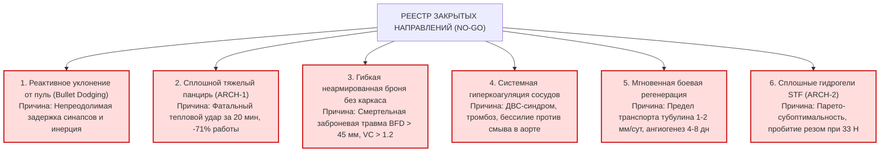

# AEGIS-01 — CYCLE 2B PRIORITIES
## План приоритетных исследований, закрытых направлений и задач цикла 2B
**Исследовательский цикл:** Cycle 2B  
**Статус документа:** Стратегическая дорожная карта программы AEGIS-01  
**Связанный репозиторий:** `D:\SUBJECT-01`

---

## 1. Итоги отбора и закрытые направления (NO-GO Registry)

По итогам циклов 1A и 2A признаны окончательно нежизнеспособными, тупиковыми и подлежат **полному закрытию (NO-GO)** следующие направления:

### Детальное научное обоснование статуса NO-GO:
1. **Реактивное уклонение от пули (HYP-0010, NEG-0029):** Время полета пули на боевых дистанциях (19–69 мс) физически меньше минимального физиологического латентного периода сенсомоторной дуги (30.2 мс) и электромеханической задержки мышц (30–50 мс). Смещение центра масс к моменту попадания равно **0.0 мм**.
2. **Сплошное монолитное бронирование тела (ARCH-1, NEG-0035, NEG-0040):** Блокирование 75% потоотделения приводит к гипертермическому шоку (температура ядра 42.3 °C) за 20 минут в тесте CPE45 и снижает полезную работу на 71.2%. Жизнедеятельность активного гомойотермного существа невозможна.
3. **Химическое купирование разрыва аорты (HYP-0013, NEG-0031):** Сдвиговые напряжения потока крови в аорте (>40 Па) механически срывают фибриновую пробку любого ферментативного состава. Фатальная кровопотеря наступает за <120 с.
4. **Мгновенное боевое самозаживление (HYP-0017, NEG-0033):** Биофизика транспорта белков цитоскелета не позволяет аксонам расти быстрее 2 мм/сутки. Травма нерва длиной 50–90 мм требует не менее 45–80 дней.
5. **Сплошные вязкоупругие композиты дермы (ARCH-2, NEG-0041):** Доказана строгая Парето-субоптимальность по сравнению с селективной FGM-защитой (ARCH-4).

---

## 2. Приоритетные направления исследований цикла 2B

На основании доказанного превосходства сбалансированной платформы ARCH-4 в цикле 2B концентрируются четыре исследовательских вектора:

### Вектор 1: Детализированная микромеханика и анатомия FGM-пластин (ARCH-4)
- **Цель:** Разработать конечно-элементную (FEA) геометрическую модель зонального сочленения минерализованных FGM-сегментов с реберным каркасом и грудиной.
- **Физическая задача:** Моделирование динамического перераспределения кинетической энергии пули (9×19 мм, 500 Дж) по площади не менее 120 мм² для подавления заброневой деформации ($BFD < 18$ мм, $VC < 0.4$ м/с) без разрушения реберно-хрящевых сочленений.
- **Исследование тыльного откола:** Оптимизация непрерывного профиля акустического импеданса $Z(x)$ по экспоненциальному закону для сведения коэффициента отражения к $|R| < 0.02$.

### Вектор 2: Моделирование микроканальных биорезорбируемых каркасов для преодоления VML
- **Цель:** Решение проблемы объемной потери мышечной ткани (VML) свыше 5 мм.
- **Биофизическая задача:** Моделирование капиллярной перфузии и диффузии кислорода в пористом полилактид-коллагеновом направляющем матриксе.
- **Критерий:** Предотвращение гипоксического некроза сателлитных клеток в центре дефекта объемом 25–45 см³ и подавление фиброзного коллапса раневой полости.

### Вектор 3: Механически заякоренные сосудистые затворы (Endogenous Vascular Tourniquets)
- **Цель:** Предотвращение гибели от массивного кровотечения при ранении глубоких сосудов конечностей и таза.
- **Механизм:** Переход от химических пробок к активным гладкомышечным и эластическим спиральным затворам, способным механически перекрывать просвет сосуда при падении гидростатического давления ниже 40 мм рт. ст.
- **Критерий:** Остановка кровотечения из артерий диаметром 2.5–4.0 мм за время $<15$ секунд без риска системного тромбоза.

### Вектор 4: Сопряженная термодинамика теплоотвода в тесте CPE45 (Климат Hot-Humid)
- **Цель:** Повышение тепловой устойчивости ARCH-4 в экстремальных условиях джунглей (35 °C, 80% RH).
- **Физиологический механизм:** Исследование возможности использования сосудистых терморегуляторных шунтов (артериовенозных анастомозов подошв и ладоней) с локальным принудительным конвективным охлаждением и биохимической регуляцией плотности эккриновых желез на открытых участках тела.

---

## 3. Конкретные исследовательские задачи цикла 2B

| ID задачи | Название исследовательской задачи | Модуль / Инструмент | Критерий завершения (Done Criteria) |
| :--- | :--- | :--- | :--- |
| **TSK-2B-01** | FEA-моделирование градиентной FGM-пластины при баллистическом ударе | `aegis/model_12_fgm_ballistics.py` | Поглощение 500 Дж удара с $BFD < 16$ мм и отсутствием растягивающего откола ($R < 0.03$). |
| **TSK-2B-02** | Модель направляющего биокаркаса для восстановления дефекта мышцы 30 мм | `aegis/model_13_vml_scaffold.py` | Восстановление функциональной силы мышцы $>75\%$ через 120 дней в симуляции. |
| **TSK-2B-03** | Модель спирального механического спазма глубоких артерий конечностей | `aegis/model_14_active_vasocclusion.py` | Остановка кровопотери при ранении бедренной артерии на уровне $< 8\%$ ОЦК за 20 с. |
| **TSK-2B-04** | Оптимизация карты зонального теплоотвода ARCH-4 под CPE45 Hot-Humid | `aegis/model_10_cpe45_integration.py` | Увеличение времени до перегрева ($T < 39.5^\circ\text{C}$) в джунглях с 27.4 до $>40$ минут. |
| **TSK-2B-05** | Синтез требований к метаболическому резерву АТФ для регенеративного пула | `D:\SUBJECT-01` ledger bridge | Точный расчет суточной метаболической стоимости регенерации дефекта Tier II без дефицита гликогена. |

---

## 4. Требования к контролю качества и валидации в цикле 2B

1. **Запрет гипотетического оптимизма:** Никаких заявлений о «преодолении законов физики» за счет неспецифицированных генных модификаций.
2. **Верификационная чистота:** Все новые модели обязаны сопровождаться автоматическими тестами `tests/test_model_12..14.py` с проверкой сохранения энергии и массы.
3. **Совместимость с репозиторием SUBJECT-01:** Полная преемственность интерфейсов параметров и соблюдение схем валидации `integrated_2026_11_01` и `cpe45_2026_11_04`.
