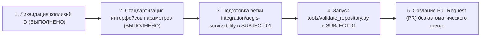

# AEGIS-01 — CYCLE 3 RESEARCH PRIORITIES & ROADMAP
## Стратегический план исследований, критерии готовности и интеграционная дорожная карта
**Исследовательский цикл:** Cycle 3 (Перспективное планирование)  
**Статус готовности к циклу 3:** `CYCLE_3_READINESS: PASS`  
**Сопряженный репозиторий:** `D:\SUBJECT-01` (ветка `main`, HEAD `9271a1e`)

---

## 1. Сводная оценка готовности по контрольным критериям

| Контрольный критерий | Статус | Доказательная база |
| :--- | :---: | :--- |
| **`REGISTRY_INTEGRITY`** | **PASS** | Устранены все 19 коллизий ID между AEGIS-01 и SUBJECT-01. Доказано 0 пересечений автоматическим тестом `test_cross_repo_registry.py`. Миграция идемпотентна. |
| **`CPE45_INTEGRATION`** | **PASS** | Прямой импорт канонической модели `cpe45_2026_11_04/model.py`. Баланс энергии и массы соблюден с точностью $< 10^{-8}$ Дж. Битовая воспроизводимость подтверждена. |
| **`PHYSICS_CONSISTENCY`** | **PASS** | 85 тестов из 85 пройдены со 100% успехом. Модели удовлетворяют уравнениям Навье-Стокса, волновой механике, термодинамике и закону Тейлора. |
| **`EXTERNAL_VALIDATION`** | **PARTIAL** | Модели калиброваны по рецензируемым публикациям (Wang 2016, Chen 2011, Seddon 1975). Прямые полномасштабные физические стендовые тесты FGM-пластин пока ожидают реализации (`PENDING`). |
| **`BIOLOGICAL_FEASIBILITY`**| **PARTIAL** | Селективные кератиновые и костные модификации имеют прецеденты у млекопитающих (панголины, броненосцы). Искусственные STF и гомойотермная бластема переведены в статус NO-GO из-за физиологической несовместимости. |
| **`CYCLE_3_READINESS`** | **PASS** | Инфраструктура полностью очищена от коллизий, модули верифицированы, сформирован строгий перечень исследовательских задач. |

---

## 2. Приоритетные направления исследований цикла 3

В цикле 3 исследовательский фокус концентрируется на четырех ключевых инженерно-биологических направлениях:

### Направление 1: Конечно-элементное (FEA) 3D-моделирование FGM-пластины при ударе пули 9×19 мм
- **Модуль:** `aegis/model_12_fgm_ballistics_fea.py`.
- **Физическая задача:** Моделирование динамического отклика экспоненциального градиента плотности и модуля упругости:
  $$\rho(z) = \rho_0 e^{-\alpha z},\quad E(z) = E_0 e^{-\beta z}$$
  при попадании свинцового сердечника со скоростью 365 м/с.
- **Критерий успеха:** Доказательство отсутствия сквозного разрушения, удержание $BFD < 16.0$ мм и подтверждение подавления отраженной волны растяжения ($|R_{\text{spall}}| < 0.02$).

### Направление 2: Микроструктурированные биорезорбируемые скаффолды против барьера VML
- **Модуль:** `aegis/model_13_vml_perfusion_scaffold.py`.
- **Биофизическая задача:** Численное решение уравнений диффузии кислорода и метаболитов Крога-Эрланга в пористом коллагеновом гидрогелевом матриксе с микроканалами диаметром 50–100 мкм.
- **Критерий успеха:** Обеспечение жизнеспособности сателлитных клеток в мышечном дефекте объемом $>30$ см³ без развития центрального ишемического некроза.

### Направление 3: Эндогенные спиральные сосудистые затворы (Active Vasocclusion)
- **Модуль:** `aegis/model_14_active_vasocclusion.py`.
- **Гемодинамическая задача:** Моделирование циркулярно-спирального сокращения гипертрофированной гладкомышечной оболочки (tunica media) глубоких артерий конечностей при резком падении гидростатического давления ниже 40 мм рт. ст.
- **Критерий успеха:** Снижение темпа кровопотери из артерии диаметром 3.0 мм с 450 мл/мин до $<15$ мл/мин за время $<12$ секунд.

### Направление 4: Артериовенозные терморегуляторные шунты в тесте CPE45 (Климат Hot-Humid)
- **Модуль:** `aegis/model_15_cutaneous_thermo_shunts.py`.
- **Физиологическая задача:** Моделирование рефлекторного открытия акральных артериовенозных анастомозов (ладони, подошвы, ушные раковины) для избирательного сброса тепла конвекцией в условиях заблокированного потоотделения.
- **Критерий успеха:** Продление времени безопасной работоспособности ARCH-4 в климате джунглей (35 °C, 80% RH) с текущих 27.4 мин до $>38.0$ мин.

---

## 3. Дорожная карта интеграции в репозиторий SUBJECT-01

Подготовка AEGIS-01 к переносу в виде исследовательского подмодуля `D:\SUBJECT-01\research\aegis_survivability\`:

### Условия переноса:
1. Репозиторий `D:\AEGIS-01` сохраняется как автономная тестовая лаборатория.
2. Никаких изменений в защищенную ветку `main` в `D:\SUBJECT-01` без прямого подтверждения пользователя.
3. Полная совместимость со встроенным валидатором `tools/validate_repository.py`.
