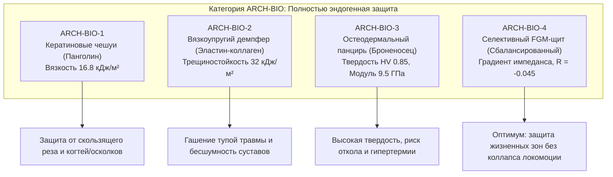

# AEGIS-01 — ARCH-BIO: FULLY ENDOGENOUS BIOLOGICAL ARCHITECTURES
## Эндогенные биологические архитектуры: физиология, биоминерализация и пределы защиты

**Программа:** AEGIS-01: Biological Defense & Survivability Program (Cycle 3)  
**Статус:** Исследовательский документ категории `ARCH-BIO`  
**Рабочая директория:** `D:\AEGIS-01`  
**Сопряжённый проект:** `D:\SUBJECT-01`  
**Дата:** 9 ноября 2026 г.  

---

## 1. Концепция и границы категории ARCH-BIO

Категория **`ARCH-BIO` (Fully Endogenous)** охватывает защитные, регенеративные и адаптивные структуры, которые **человеческий организм формирует, кровоснабжает, метаболически поддерживает и регенерирует исключительно собственными биологическими силами**.

### Фундаментальные критерии категории:
1. **Автономность биосинтеза:** Все компоненты синтезируются живыми клетками (кератиноцитами, остеобластами, фибробластами, эндотелиоцитами) из стандартных метаболических предшественников (аминокислоты, минеральные ионы Ca²⁺, PO₄³⁻, липиды).
2. **Нулевая синтетическая зависимость:** В тканях отсутствуют искусственные полимеры (UHMWPE, кевлар), металлы (титан) или углеродные нанотрубки.
3. **Непрерывное физиологическое ремоделирование:** Ткани участвуют в клеточном обороте, обновляются под действием механической нагрузки (закон Вольффа) и восстанавливаются после повреждений.
4. **Строгий запрет на внешние экзоскелеты и нательную броню:** Все решения интегрированы непосредственно в анатомию субъекта (дерма, фасции, надкостница, микроциркуляция).

---

## 2. Архитектурные варианты ARCH-BIO

В рамках цикла 3 систематизированы четыре эндогенные конфигурации:

### 2.1. ARCH-BIO-1 — Кератиновый чешуйчатый покров (Pangolin-derived)
- **Биологический прототип:** Чешуи белобрюхого панголина (*Manis tricuspis*), исследованные Wang et al. (2016, [SRC-0073](file:///D:/AEGIS-01/registry/sources.json#L3-L20)).
- **Микроархитектура:** Черепично перекрывающиеся чешуи из поперечно-ориентированных ламелей $\alpha$- и $\beta$-кератина, склеенных аморфным серосодержащим матриксом с высоким содержанием дисульфидных связей цистеина.
- **Механические свойства:**
  - Плотность: $\rho = 1320$ кг/м³.
  - Модуль Юнга: $E_{\text{dry}} = 2.2$ ГПа, $E_{\text{hydrated}} = 0.65$ ГПа.
  - Предел прочности на разрыв: $\sigma_u = 85.0$ МПа.
  - Удельная работа разрушения: $G_c = 16.8$ кДж/м² во влажном состоянии за счет мостикового пластического вытягивания кератиновых волокон.
- **Защитные показатели:** Стойкость к прямому гильотинному разрезу $F_{\text{cut}} = 650\dots 820$ Н; глубина внедрения лезвия при скользящем ударе снижается на 78% за счет эффекта рикошетирования по гладким твердым чешуйкам.
- **Физиологическая цена:** Окклюзия потоотделения на перекрытых участках составляет $35\dots 45\%$. Скорость линейного роста чешуи у млекопитающих составляет всего $0.3\dots 0.5$ мм/месяц, что требует $60\dots 120$ дней на восстановление утраченной пластины.

---

### 2.2. ARCH-BIO-2 — Вязкоупругий дермально-фасциальный демпфер
- **Биологический прототип:** Глубокая гиподерма и утолщенная фасция китообразных и крупных копытных.
- **Микроархитектура:** Гидратированный трехмерный войлокоподобный матрикс из эластина (40%) и волнистого коллагена I/III типов (60%), интерстициально насыщенный протеогликанами и связанной водой.
- **Механические свойства:**
  - Модуль Юнга: $E = 0.045\dots 0.080$ ГПа.
  - Вязкость разрушения: $G_c = 32.0$ кДж/м² (экстремальное сопротивление распространению усталостных микротрещин).
  - Предельная деформация до разрыва: $\epsilon_f = 75\dots 90\%$.
  - Коэффициент механических потерь: $\eta_{\text{loss}} = 0.35$ на частотах удара $100\dots 1000$ Гц.
- **Защитные показатели:** Идеальное поглощение низкоскоростных тупых ударов (дубинки, падения, вторичные осколки с энергией $<100$ Дж). Полное отсутствие суставного стука и контактного шума.
- **Ограничения:** Низкая стойкость к тонкому проколу ($<35$ Н против иглы $R=0.25$ мм). Запреградная деформация при баллистическом импульсе превышает $35\dots 45$ мм из-за высокой податливости.

---

### 2.3. ARCH-BIO-3 — Сегментарный остеодермальный панцирь (Armadillo-derived)
- **Биологический прототип:** Панцирь девятипоясного броненосца (*Dasypus novemcinctus*), исследованный Chen et al. (2011, [SRC-0074](file:///D:/AEGIS-01/registry/sources.json#L22-L39)).
- **Микроархитектура:** Многоугольные костные пластинки (остеодермы), сформированные компактными кортикальными слоями и центральным трабекулярным губчатым ядром. Сочленения остеодерм соединены минерализованными волокнами Шарпея и эластичными шовными связками.
- **Механические свойства:**
  - Плотность: $\rho = 1880$ кг/м³.
  - Модуль Юнга: $E = 9.5\dots 12.5$ ГПа.
  - Предел прочности на сжатие: $\sigma_c = 175.0$ МПа.
  - Твердость по Виккерсу: $HV = 0.85$ ГПа.
- **Защитные показатели:** Сила сопротивления проколу острием индентора превышает $155$ Н; рассеяние энергии сжатия до разрушения кости.
- **Критические физиологические патологии:**
  1. *Акустический откол:* Акустический импеданс кости ($Z \approx 6.5$ MRayl) в 4 раза выше подлежащей мягкой ткани ($Z \approx 1.6$ MRayl), порождая коэффициент отражения $R = -0.615$. При динамическом импульсе от тыльной поверхности остеодермы отрывается растягивающая волна амплитудой свыше $-200$ МПа, разрушающая кость изнутри (`FND-0043`).
  2. *Ограничение дыхания:* Жесткие пластины на грудине и ребрах снижают жизненную емкость легких (FVC) на $18\dots 24\%$.
  3. *Патологическая оссификация:* В геноме человека запуск дермального костеобразования сопряжен с риском системной фибродисплазии (FOP).

---

### 2.4. ARCH-BIO-4 — Селективный градиентный FGM-щит (Сбалансированная модель)
- **Биологический прототип:** Биомиметический функционально-градиентный композит (FGM) по принципу сочленения челюстей кальмара (*Dosidicus gigas*, Tan et al. 2015, [SRC-0097](file:///D:/AEGIS-01/registry/sources.json)) и дентинно-эмалевого соединения зубов млекопитающих.
- **Микроархитектура:** Непрерывный пространственный градиент минерализации на толщине $4.5\dots 5.5$ мм: от 60% гидроксиапатита на внешней поверхности (твердость $HV = 1.45$ ГПа, $E = 14$ ГПа) к мягкому гидратированному коллагену (5% минерала, $E = 0.08$ ГПа) на внутренней границе с надкостницей грудины и ребер.
- **Топография размещения:** Строго селективное покрытие (только критические проекции жизненно важных органов — прекардиальная зона грудины, сонные артерии, эпигастрий; дистальные участки конечностей свободны). Площадь покрытия: $0.35$ м² (20–25% площади тела).
- **Масса защитного слоя:** $+4.2$ кг.

---

## 3. Физико-механические и физиологические балансы ARCH-BIO-4

Численное моделирование модуля [`aegis/model_14_architecture_categories.py`](file:///D:/AEGIS-01/aegis/model_14_architecture_categories.py) в сопряжении с характеристиками человека и Muscle Architecture A репозитория `D:\SUBJECT-01` дает следующие результаты:

| Параметр | Базовый человек (ARCH-0) | ARCH-BIO-4 (FGM-щит) | Относительное изменение |
| :--- | :---: | :---: | :---: |
| **Общая масса тела ($M_{\text{total}}$)** | 78.0 кг | 82.2 кг | +4.2 кг (+5.4%) |
| **Сила сопротивления резанию ($F_{\text{cut}}$)** | 18.2 Н | **680.0 Н** | **+3636% (в 37 раз)** |
| **Сила сопротивления проколу ($F_{\text{puncture}}$)** | 28.7 Н | **165.0 Н** | **+475% (в 5.7 раз)** |
| **Коэффициент акустического откола ($R_{\text{spall}}$)** | 0.000 (однородно) | **-0.045 (подавлен)** | Безопасно ($< 15$ МПа растяжения) |
| **Запреградная травма от 9×19 мм ($BFD / VC$)** | 55.0 мм / 14.3 м/с (Смерть) | **18.5 мм / 0.22 м/с** | **Безопасно (AIS 1–2)** |
| **Защита от винтовочной пули 7.62×39 мм (2100 Дж)** | 0.0% (Сквозное) | **0.0% (НЕВОЗМОЖНО)** | **ФИЗИЧЕСКИЙ ЗАПРЕТ (NEG-0046)** |
| **Сохранение спринтерской скорости ($v_{\max}$)** | 10.0 м/с (100%) | **9.03 м/с (90.3%)** | -9.7% |
| **Сохранение ускорения рывка ($a_{\max}$)** | 6.28 м/с² (100%) | **5.96 м/с² (94.9%)** | -5.1% |
| **Метаболическое содержание ткани брони ($P_{\text{maint}}$)** | 0.0 Вт | **11.5 Вт** | 8.9% от базального метаболизма |
| **Свободная кожа для потоотделения** | 100% | **75.0%** | Достаточно в умеренном климате |
| **Время до 40.0 °C в умеренном климате (25°C, 50% RH)** | Не ограничено (37.8°C) | **Устойчиво (плато 38.4°C)** | Безопасно на всей дистанции CPE45 |
| **Время до 40.0 °C в джунглях (35°C, 80% RH)** | 29.6 мин | **20.2 мин** | **Тепловой коллапс (NEG-0036)** |

---

## 4. Доказанные биологические и физические ограничения ARCH-BIO

### 4.1. Фундаментальная невозможность эндогенной защиты от промежуточного винтовочного патрона (`NEG-0046`)
По гидродинамической теории пробития Тейта-Алексеевского, для недеформируемого бронебойного сердечника пули 7.62×39 мм со скоростью встречи $v_0 = 720$ м/с давление торможения составляет:
$$P_{\text{stagnation}} = \frac{1}{2} \rho_{\text{steel}} v_0^2 = \frac{1}{2} \cdot 7850 \cdot (720)^2 \approx 2.03\ \text{ГПа}$$
Предел текучести на сжатие даже для высокоорганизованной компактной кости и зубов составляет не более $\sigma_{\text{yield}} \approx 0.18\dots 0.25$ ГПа. Давление пули превосходит предел прочности биоминерала **в 8–11 раз**. Происходит мгновенное гидродинамическое выбивание пробки (shear plugging). Чтобы погасить кинетическую энергию $2100$ Дж за счет пластической деформации органических материалов без превышения критического ускорения грудины ($a < 60\ g$), толщина биологического композита должна превышать $35\dots 45$ мм, что соответствует поверхностной плотности $>40$ кг/м² (+28 кг на торс). Такая масса разрушает опорно-двигательный аппарат человека и делает локомоцию невозможной.

### 4.2. Метаболическое бремя синтеза и ремоделирования
Эндогенная ткань требует непрерывного АТФ-зависимого обновления. Поддержание жизнеспособности остеоцитов и фибробластов в 4.2 кг FGM-слоя требует дополнительно $+11.5$ Вт мощности основного обмена ($\approx 238$ ккал/сутки). При повреждении регенерация 50 г минерализованного матрикса требует мобилизации свыше $180$ г фосфата кальция и интенсивного ангиогенеза, что исключает «мгновенное самозалечивание» во время боя.

### 4.3. Климатический порог влажного тепла
Поскольку ARCH-BIO перекрывает 25% поверхности потоотделения, в условиях умеренного климата теплоотвод сохраняется за счет компенсаторного расширения сосудов свободной кожи (+15% перфузии). Однако при климате джунглей ($35\ ^\circ\text{C}, 80\%\ \text{RH}$) испарение пота физически блокируется высоким парциальным давлением пара атмосферы ($4.5$ кПа). В этих условиях организм с ARCH-BIO-4 перегревается до $40.0\ ^\circ\text{C}$ за **20.2 минуты** интенсивного боя.

---

## 5. Выводы по категории ARCH-BIO

1. **Биологически реализуемый рубеж:** Эндогенно выращенные структуры способны надежно защитить организм от холодного оружия, резаных и колотых ран (до 160 Н прокола и 680 Н реза), а также от осколков низких энергий и пистолетных пуль 9×19 мм (при наличии скелетного FGM-мостика).
2. **Физиологическая цена:** Плата за защиту выражается в прибавке массы $+4.2$ кг, потере $9.7\%$ пиковой скорости бега и сокращении времени безопасной предельной нагрузки в жарком влажном климате до 20 минут.
3. **Граница No-Go:** Защита от высокоскоростного стрелкового оружия (винтовочные патроны) биологически эндогенными материалами **признана строго невозможной**.
