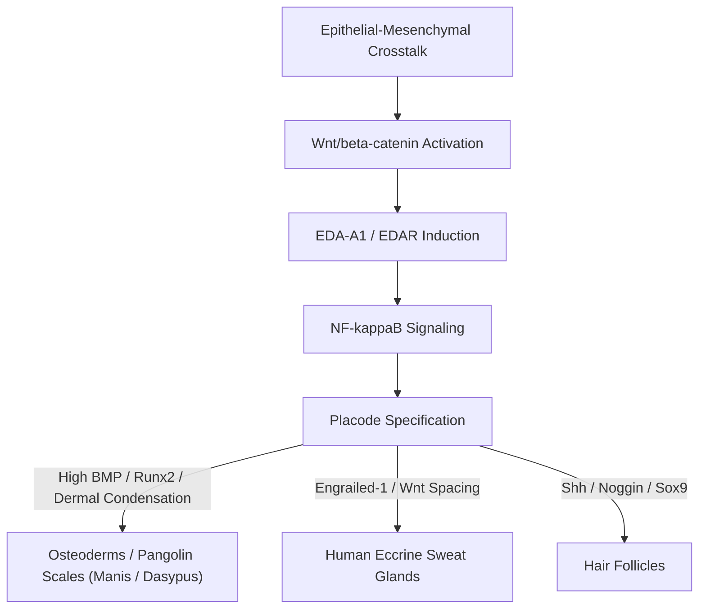

# ENDOGENOUS TISSUE MECHANISMS: DEVELOPMENTAL PATHWAYS, EVOLUTIONARY DIVERGENCE, AND HOMINID INCOMPATIBILITIES

**Author:** AEGIS-01 Autonomous Research Team  
**Date:** 2026-11-11  
**Cycle:** 12  
**Registry References:** [`DEC-0066`](file:///d:/AEGIS-01/registry/decisions.json), [`EXP-0111`](file:///d:/AEGIS-01/registry/experiments.json), [`FND-0124`](file:///d:/AEGIS-01/registry/findings.json), [`NEG-0100`](file:///d:/AEGIS-01/registry/negative_results.json), [`ISS-0054`](file:///d:/AEGIS-01/registry/issues.json)  
**Implementation Script:** [`aegis/cycle12_models.py`](file:///d:/AEGIS-01/aegis/cycle12_models.py#L417-L545)

---

## 1. Executive Summary

This study investigates the molecular developmental biology and evolutionary gene regulatory networks (GRNs) governing endogenous dermal protection. Specifically, it resolves why the macro-scale imbricated keratin armor of pholidotes (*Manis*, pangolin) and the dermal osteoderms of cingulates (*Dasypus*, armadillo) cannot be readily engineered or reactivated in primates.

Key findings include:
1. **The Placodal Morphogenesis Switch:** Dermal armor development relies on the coordinated signaling of **Wnt/$\beta$-catenin, EDA/EDAR (Ectodysplasin-A / Receptor), and BMP/SHH** to generate macroscopic dermal placodes.
2. **Evolutionary Divergence in Primates:** In hominid evolution, the EDA/EDAR placodal regulatory landscape was specifically repurposed toward establishing an ultra-dense array of **eccrine sweat glands** ($2\text{--}4\text{ million}$ glands across the human body), enabling high-capacity evaporative thermoregulation.
3. **Biological Pathology of Ectopic Hyperkeratinization:** Ectopically forcing keratin scale formation in primate epidermis induces pathological human phenotypes analogous to **Harlequin ichthyosis** or **epidermolytic keratoderma**, destroying epidermal barrier integrity, causing systemic desquamation, and completely suppressing convective and evaporative heat rejection.

---

## 2. Molecular Gene Regulatory Networks (GRNs) of Skin Appendages

All mammalian skin appendages—hair follicles, eccrine sweat glands, mammary glands, and dermal armor scales—share a conserved embryonic developmental pathway initiated during the mid-gestation transition:

### 2.1 The Placode Initiation Circuitry
1. **Wnt/$\beta$-catenin Signaling:** Primary activator. Nuclear accumulation of $\beta$-catenin specifies the competence of epithelial cells to form an appendage placode.
2. **Ectodysplasin A (EDA) and EDAR:** Sets the boundary conditions and spacing of placodes via Turing reaction-diffusion kinetics. EDA/EDAR activates the NF-$\kappa$B pathway, driving cell proliferation and invagination.
3. **Bone Morphogenetic Proteins (BMPs) and Noggin:** BMP-2/4 act as lateral inhibitors that prevent placodes from coalescing into a continuous mass. In scaled mammals, Noggin local downregulation allows placodes to expand into macroscopic structures ($> 10\text{ mm}$ width).

---

## 3. Evolutionary Divergence: Armor vs. Thermoregulation

A profound evolutionary divergence separates scaled mammals (Pholidota, Xenarthra) from Anthropoid Primates:

| Biological Domain | Scaled Placode Mammals (*Manis*, *Dasypus*) | Anthropoid Primates (*Homo sapiens*) |
| :--- | :--- | :--- |
| **Primary Dermal Adaptation** | Heavy keratin plates / vascularized osteoderms | Naked skin with high-density eccrine sweat glands |
| **EDA/EDAR Pathway Wiring** | Directs massive dermal papillae and keratin cornification | Directs eccrine gland ductal branching and density |
| **Dermal Papilla Cell Density** | Hypertrophic, multinucleated dermal condensation | Small, dispersed capillary loops |
| **Sweat Gland Function** | Absent or restricted to footpads; zero cutaneous cooling | Active whole-body evaporative cooling ($> 1.5\text{ L/h}$) |
| **Locomotor Energetics** | Low metabolic rate; slow foraging; curling defensive posture | High sustained aerobic locomotion; persistence hunting |
| **Thermal Consequence** | Prone to severe hyperthermia under sustained physical exertion | Highly efficient heat rejection via evaporative sweating |

### 3.1 The Hominid Placode Trade-Off
In the human lineage, the loss of dense body fur and the multiplication of eccrine sweat glands ($\approx 2\text{--}3\text{ million}$ glands) was mediated by mutations in the regulatory enhancers of *Engrailed-1* (*En1*) and *EDAR*. This developmental reprogramming turned epithelial placodes inward into secretory tubules rather than outward into dense cornified keratin plates.

Re-activating macroscopic armor placodes would require:
1. Silencing the *En1* eccrine fate determination program.
2. Sustained ectopic overexpression of *EDA-A1* and *Runx2* in dermal fibroblasts.
3. Repressing the lateral inhibition of BMP signaling across vast skin regions.

---

## 4. Pathophysiological Consequences of Ectopic Scale Induction in Primates

Attempting to induce thick, imbricated keratinized plates in human skin violates fundamental physiological and cell-matrix constraints:

1. **Destruction of the Cutaneous Barrier:**  
   Human epidermal differentiation relies on the lipid envelope produced by lamellar granules (rich in ceramides, cholesterol, and free fatty acids). Scaled keratinization downregulates these lipid transporters, resulting in fissured, non-compliant stratum corneum identical to **Harlequin ichthyosis** (*ABCA12* loss of function).
2. **Microvascular Strangling and Dermal Necrosis:**  
   To sustain a $2.0\text{ mm}$ thick keratin scale, an intense underlying capillary bed is required (as seen in the vascularized dermis of pangolins). In human skin, hyper-cornification exerts compressive mechanical stress on the sub-papillary plexus, inducing localized ischemia, tissue necrosis, and secondary chronic ulceration.
3. **Severe Thermoregulatory Collapse:**  
   Endogenous scales would cover $> 80\%$ of the body surface. Because keratin has a low thermal conductivity ($k \approx 0.22\text{ W/(m}\cdot\text{K)}$) and seals off eccrine sweat pores, cutaneous evaporative and radiative heat loss would drop by $> 85\%$. During physical exertion ($3.5\text{ m/s}$ transport), this leads directly to fatal hyperthermic heat stroke within $30\text{--}40\text{ minutes}$.

---

## 5. Epistemic Verdict

Endogenous biological armor is fundamentally incompatible with the primate thermoregulatory and developmental architecture. Evolutionary history sacrificed hard dermal shielding to unlock unlimited aerobic endurance cooling. Any survivability protection for hominid subjects must be implemented as an **exogenous, metabolically coupled modular system** rather than an endogenous genetic alteration.

---
*Signed and recorded in the AEGIS-01 scientific registry.*
