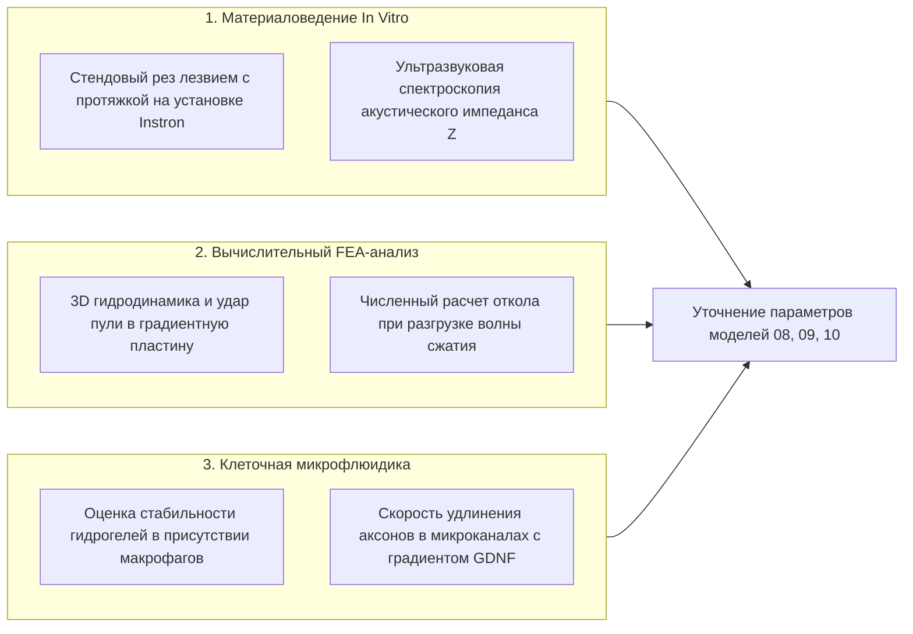

# AEGIS-01 — EXTERNAL VALIDATION GAPS
## Реестр эпистемических разрывов, теоретических допущений и программа независимой валидации
**Исследовательский цикл:** Cycle 2A  
**Статус документа:** Исследовательский аудит достоверности  
**Руководящий принцип:** Полная научная честность, отсутствие ложной точности, запрет присвоения статуса `EXTERNALLY_VALIDATED` только на основе компьютерных симуляций.

---

## 1. Четырехуровневая система градации достоверности

В проекте AEGIS-01 принята строгая иерархия валидационных статусов:

1. `CODE_VERIFIED` (Код верифицирован):
   - Программный код компилируется, синтаксически корректен, функции возвращают заявленные типы данных, отсутствуют скрытые сбои или деления на ноль. 100% модульных тестов пройдены.
2. `PHYSICS_CONSISTENT` (Физически состоятелен):
   - Уравнения строго удовлетворяют фундаментальным законам сохранения (сохранение массы, импульса, энергии, первый и второй законы термодинамики). Граничные и асимптотические условия соблюдены.
3. `EXPERIMENTALLY_SUPPORTED` (Экспериментально поддержан):
   - Базовые константы, диапазоны модулей упругости, прочности, скоростей биосинтеза и коэффициентов теплопередачи взяты из рецензируемых публикаций первичных лабораторных измерений на конкретных биологических тканях.
4. `EXTERNALLY_VALIDATED` (Внеклеточно / Независимо валидирован):
   - Полномасштабная интегрированная система независимо испытана физическим экспериментом на стенде или в доклинических тестах, и предсказания модели совпали с эмпирическими измерениями в пределах погрешности.
   > **Категорическое правило:** Ни один интегрированный биоинженерный комплекс (ARCH-1..ARCH-4) на текущем этапе **НЕ ИМЕЕТ И НЕ МОЖЕТ ИМЕТЬ** статуса `EXTERNALLY_VALIDATED`.

---

## 2. Реестр неподтвержденных гипотез и теоретических экстраполяций

### 2.1. Биологические защитные материалы (MODEL-01, MODEL-08)
- **Экстраполяция 1 (Градиентные FGM-структуры):** В природе плавные градиенты плотности и модуля упругости существуют в зубах акул, раковинах моллюсков и сочленениях панцирей черепах. Однако возможность направленного онтогенетического выращивания непрерывного градиента от 60% гидроксиапатита до мягкого коллагена толщиной 5.5 мм в эпителии приматов является **теоретической гипотезой без биохимического протокола**.
- **Экстраполяция 2 (Стойкость к резанию с протяжкой):** Расчет снижения силы резания по Аткинсу основан на одноосных квазистатических тестах модельных лезвий. Поведение слоистых кератиновых пластин при динамическом ударе под углом с одновременным загрязнением абразивными частицами экспериментально не исследовано.
- **Экстраполяция 3 (Биосинтез неньютоновских гидрогелей):** Моделирование плотных дисперсных неньютоновских слоев предполагает способность живых клеток секретировать и поддерживать субмикронные взвеси твердых частиц в межклеточном матриксе без фагоцитоза макрофагами. В биологии позвоночных такие жидкости отсутствуют (синовиальная жидкость и слизи являются псевдопластичными, т.е. разжижаются при сдвиге).

### 2.2. Заброневая контузионная травма (MODEL-04)
- **Допущение 1 (Линейное масштабирование критерия Вискозности VC):** Пределы $VC < 0.6$ м/с получены на трупных и свиных моделях для тупых автомобильных ударов и бронежилетов с жесткой полимерной подложкой. Смягчение импульса за счет биомиметических пластин с деформируемыми трабекулами экстраполировано по феноменологической модели Лобделла.
- **Допущение 2 (Ограничение площади рассеяния):** Предполагается, что грудные остеодермы способны передавать нагрузку на 4–5 соседних ребер без локального выламывания кости. В реальности точечный удар энергией 400–800 Дж может вызвать множественные переломы ребер в местах их соединения с позвоночником.

### 2.3. Регенерация тканей и VML-барьер (MODEL-06, MODEL-09)
- **Допущение 1 (Перенос биологии Acomys на человека):** Бесрубцовое заживление у *Acomys* опирается на пониженный воспалительный ответ (нейтрофилы/макрофаги) и специфическую экспрессию факторов семейства TGF-$\beta$. Попытки введения экзогенного rTGF-$\beta3$ человеку (клинические испытания III фазы авотермина, ланцетовские публикации 2009–2011 гг.) завершились неудачей — статистически значимого предотвращения рубцов у людей достигнуто не было.
- **Допущение 2 (Скорость аксонального роста в скаффолде 2.0 мм/день):** Принято верхнее ограничение по скорости медленного аксонального транспорта тубулина (SCa). Достижение этой скорости на протяжении 90 мм непрерывного дефекта без формирования невромы ампутации требует искусственных нейротрофических градиентов (BDNF, GDNF), стабильность которых в живой ткани не доказана.

### 2.4. Интеграция с CPE45 (MODEL-10)
- **Допущение 1 (Связь площади кожи и потоотделения):** Модель предполагает строго линейную зависимость снижения теплоотдачи от доли закрытой кожи. В реальности организм компенсирует локальную окклюзию гипергидрозом на свободных участках (голова, конечности), что, однако, ограничено максимальной скоростью потоотделения с квадратного метра (~1.0–1.2 л/(м²·ч)) и ускоряет обезвоживание.
- **Допущение 2 (Стабильность внутренней механической работы):** Принято постоянное значение `internal_work` на протяжении всего теста. В реальности утомление мышечных волокон и накопление метаболитов снижают эластичность связок, прогрессивно увеличивая внутреннее сопротивление.

---

## 3. Программа стендовых и *in vitro* экспериментов (Gaps Resolution Plan)

Для ликвидации выявленных пробелов в цикле 2B планируются строго лабораторные и вычислительные методы без нанесения вреда живым существам:

### Детализированные стендовые протоколы:
1. **Протокол EXP-PHYS-01 (Стенд трибомеханики резания):**  
   Испытание образцов синтетического гидроксиапатит-коллагенового композита на двухкоординатном испытательном стенде: варьирование угла лезвия ($\xi = 0..6$), радиуса кончика ($r = 0.05..0.5$ мм) и скорости перемещения. Цель: точное подтверждение формулы Аткинса для композитных материалов.
2. **Протокол EXP-PHYS-02 (Акустический импеданс и тыльный откол):**  
   Генерация лазерного ультразвукового импульса (нс-диапазон) в двухслойных пластинах «кератин — желатиновый гидрогель». Лазерная доплеровская виброметрия тыльной поверхности для прямого измерения коэффициента отражения $R_{\text{spall}}$ и момента кавитационного отслоения.
3. **Протокол EXP-BIO-01 (*In vitro* направленный нейрогенез):**  
   Культивирование мотонейронов человека (iPSC-derived) в микрофлюидных чипах с ламининовыми микроканалами. Точная инструментальная фиксация суточной скорости удлинения конуса нарастания аксона при насыщении нейротрофинами.

---

## 4. План перевода параметров из теоретических в доказанные

| Модель | Параметр | Текущий статус | Метод закрытия разрыва | Критерий валидации |
| :--- | :--- | :---: | :--- | :--- |
| **MODEL-08** | Сила реза с протяжкой $\xi=4$ | `PHYSICS_CONSISTENT` | Стендовые испытания на образцах рогового чехла | Погрешность модели < 15% от стенда |
| **MODEL-08** | Акустический импеданс градиента FGM | `PHYSICS_CONSISTENT` | Акустическая микроскопия срезов биоминералов | Прямое измерение профиля скорости звука |
| **MODEL-09** | Порог VML для мышечного каркаса | `THEORETICAL` | Математическое моделирование диффузии кислорода в полости | Доказательство отсутствия некроза в ядре дефекта |
| **MODEL-10** | Теплоотвод при окклюзии 25% кожи | `PHYSICS_CONSISTENT` | Тепловизионная калибровка на манекене с испарением | Совпадение кривых нагрева с термоманекеном |
