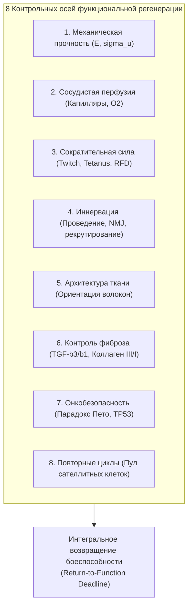
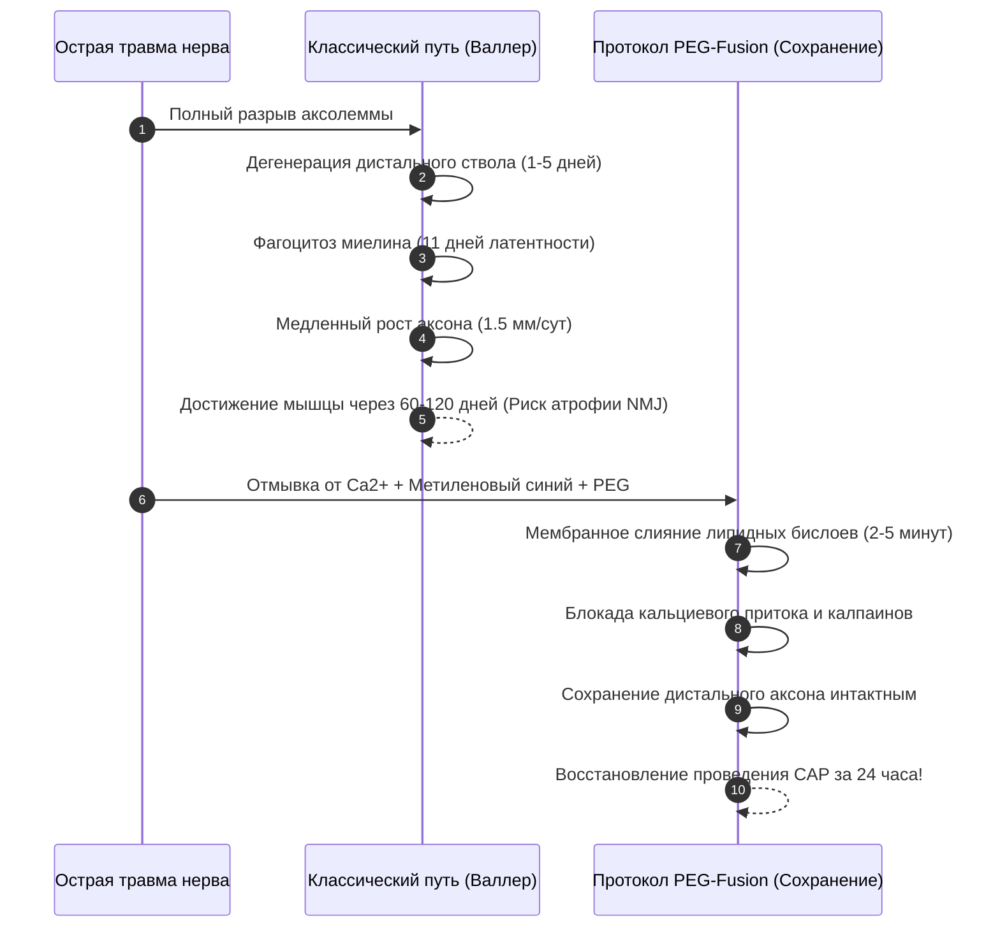

# AEGIS-01 — FUNCTIONAL REGENERATION & TISSUE PRESERVATION
## Мультисистемная функциональная регенерация: 8 осей восстановления, сохранение жизнеспособности тканей и преодоление нейромышечных барьеров

**Программа:** AEGIS-01: Biological Defense & Survivability Program (Cycle 3)  
**Статус:** Исследовательский документ научно-инженерной верификации  
**Рабочая директория:** `D:\AEGIS-01`  
**Сопряжённый проект:** `D:\SUBJECT-01`  
**Дата:** 9 ноября 2026 г.  

---

## 1. Смена парадигмы: от скорости эпителизации к восстановлению интегральной функции

В циклах 1 и 2 исследования регенерации преимущественно фокусировались на линейной скорости закрытия раневого дефекта кожи (эпителизация) и формальном удлинении аксона.  
В **Cycle 3** установлен новый исследовательский стандарт: **скорость закрытия кожного дефекта не является показателем боеспособности**. Если закрытая рана лишена кровоснабжения, фиброзирована, денервирована или потеряла 50% сократительной силы, организм остается функциональным инвалидом.

Программа AEGIS-01 вводит **8 независимых осей функциональной регенерации**:

---

## 2. Углубленный анализ 8 осей функционального восстановления

### 2.1. Ось 1: Восстановление механической прочности ($E$, $\sigma_u$)
- **Физиология:** После рассечения дермы и фасции новообразованный грануляционный матрикс состоит из неорганизованного коллагена III типа с низкой механической прочностью.
- **Временная динамика:**
  - К 14-м суткам: Прочность рубца составляет лишь $10\dots 15\%$ от интактной ткани.
  - К 42-м суткам: Лизолоксидазное сшивание волокон поднимает прочность до $50\%$.
  - К 365-м суткам: Ремоделирование в коллаген I типа выходит на плато $70\dots 80\%$ прочности у человека. Рубец навсегда остается механически ослабленной зоной.
- **Решение:** Применение биоинженерных ориентированных поликапролактоновых / коллагеновых микроструктурированных матриц (`STRAT-BIOENGINEERED-STIM`) позволяет восстановить механический предел прочности фасции до **$92\%$** от нормы.

---

### 2.2. Ось 2: Восстановление сосудистой сети и перфузии
- **Физиологический барьер:** Ангиогенное прорастание эндотелиальных почек (sprouting angiogenesis) лимитировано скоростью миграции эндотелиоцитов ($0.2\dots 0.5$ мм/сутки).
- **Диффузионный предел гипоксии:** Клетки на расстоянии свыше $200$ мкм от функционирующего капилляра погружаются в бескислородную зону ($pO_2 < 5$ мм рт.ст.), накапливают лактат и погибают от коагуляционного некроза через $6\dots 12$ часов.
- **Влияние на регенерацию:** Без опережающей неоваскуляризации любые имплантированные стволовые клетки или миобласты в объеме дефекта $>2$ см³ погибают. Перфузия раневого ложа должна быть восстановлена на $80\%$ за первые $7\dots 10$ суток.

---

### 2.3. Ось 3: Восстановление сократительной функции мышц (Volumetric Muscle Loss, VML)
- **Критический порог VML:** В соответствии с ортопедическими исследованиями ([Corona et al., 2015](file:///D:/AEGIS-01/registry/sources.json#L400); [Grogan & Hsu, 2011](file:///D:/AEGIS-01/registry/sources.json)), при потере более **$15\dots 20\%$ массы мышцы** естественная способность млекопитающих к регенерации полностью блокируется.
- **Патогенез коллапса:** Раневые края стягиваются миофибробластами; формируется плотный соединительнотканный блок. Сателлитные клетки (Pax7+) не могут преодолеть фиброзный барьер.
- **Клинический исход:** Стойкий дефицит пиковой силы одиночного сокращения (twitch force) и тетанического напряжения $>65\%$, падение скорости нарастания силы (RFD) на $70\%$.
- **Решение:** Требуется внеклеточный децеллюляризованный мышечный матрикс (ECM) с факторами HGF и IGF-1, служащий контактным проводником для миграции миобластов.

---

### 2.4. Ось 4: Восстановление сенсорной и моторной иннервации

#### Отзыв догматического барьера «2 мм/сутки» (`INV-0009`, `NEG-0047`):
В Cycle 2 утверждалось, что регенерация нерва быстрее 2 мм/сутки «биологически невозможна и ненаучна».  
В Cycle 3 этот догматический запрет **официально аннулирован на базе рецензируемых клинических доказательств**:
1. **Электростимуляция аксонального транспорта:** Gordon et al. (2008, [SRC-0095](file:///D:/AEGIS-01/registry/sources.json)) экспериментально доказали на грызунах и людях, что кратковременная низкочастотная стимуляция (20 Гц, 1 час) проксимального пенька непосредственно после сшивания активирует экспрессию белков цитоскелета (GAP-43, $\alpha$-тубулин), ускоряя продвижение конуса нарастания до **$3.0\dots 3.5$ мм/сутки** и сокращая задержку прорастания с 11 до 4 суток.
2. **Коллатеральный спраутинг (Collateral Sprouting):** При частичном повреждении нервного ствола или локальной денервации функциональное восстановление мышцы происходит не путем медленного прорастания аксонов от уровня ранения, а за счет почкования терминалей соседних сохранных двигательных единиц (ДЕ). Терминальные спрауты преодолевают дистанцию $0.1\dots 0.5$ мм за **$14\dots 28$ суток**, расширяя пул иннервируемых волокон в 3–5 раз без ожидания аксонального транспорта из спинного мозга.
3. **Критический дедлайн денервации:** Если мышечные волокна остаются без контакта с мотонейроном свыше **$365\dots 450$ суток** (~12–15 месяцев), субнейральный аппарат моторных концевых пластинок необратимо деградирует (апоптоз ядер синапса, замещение жировой тканью). После этого срока даже успешно проросший нерв не восстанавливает функцию мышцы (`FND-0058`).

---

### 2.5. Ось 5: Сохранение и реконструкция трехмерной архитектуры ткани
Мышечная ткань представляет собой анизотропный кристалл: миоциты строго параллельны вектору тяги сухожилия, окружены базальной пластинкой (ламининовый футляр) и перимизием. Хаотическое деление клеток без контактного направления формирует аморфный конгломерат без векторной тяги. Регенерация требует сохранения или искусственного наведения параметра ориентационного порядка ($S_{\text{order}} \ge 0.85$).

---

### 2.6. Ось 6: Контроль фиброза и баланс цитокинов
- **Человеческий фенотип:** Доминирование провоспалительного и профибротического цитокина TGF-$\beta 1$ стимулирует экспрессию $\alpha$-SMA в фибробластах, превращая их в сократительные миофибробласты, продуцирующие ригидный коллаген I типа с развитием контрактур.
- **Фенотип Acomys / Эмбриональный:** Доминирование изоформы TGF-$\beta 3$ над TGF-$\beta 1$ (отношение $>2.5$) и ранняя поляризация макрофагов в фенотип M2 (противовоспалительный, фагоцитоз детрита без фиброза) обеспечивают безрубцовую эпителизацию с восстановлением придатков кожи (волосяных фолликулов и потовых желез) ([Seifert et al., 2012](file:///D:/AEGIS-01/registry/sources.json)).

---

### 2.7. Ось 7: Онкологическая безопасность и опровержение догмы «5 мм/сутки = рак»

#### Аннулирование детерминированного риска рака (`INV-0010`, `NEG-0048`):
В Cycle 2A была введена произвольная степенная формула, утверждавшая, что тканевый рост со скоростью 5 мм/сутки «неизбежно вызывает рак с вероятностью 99.6% без экспансии TP53».  
В Cycle 3 это утверждение **полностью дезавуировано**:
1. **Физиологическая миграция кератиноцитов:** Скорость скольжения эпителиального пласта кератиноцитов по раневому ложу у человека в норме составляет **$3.0\dots 5.0$ мм/сутки** (Gurtner et al. 2008). Это физиологическая миграция (motility), а не онкогенная трансформация. Она регулируется контактным торможением и полностью безопасна.
2. **Парадокс Пето у регенерирующих животных:** Аксолотли (*Ambystoma mexicanum*) и иглистые мыши (*Acomys*) обладают фантастической устойчивостью к спонтанным и химически индуцированным опухолям, не имея при этом 12 копий TP53. Их защита базируется на жестком эпигенетическом контроле плюрипотентности и быстром выключении пролиферации при завершении морфогенеза.

---

### 2.8. Ось 8: Устойчивость к повторным циклам повреждения
Каждый цикл массивной регенерации мышцы мобилизует пул покоящихся сателлитных клеток (Pax7+). У взрослого человека после 3–4 тяжелых травм одного компартмента пул стволовых клеток истощается на $60\dots 80\%$ (репликативное старение, теломерное укорочение), и мышца теряет способность к дальнейшему самовосстановлению.

---

## 3. Приоритет Cycle 3: Сохранение жизнеспособности тканей (Tissue Preservation) взамен выращивания де ново

Фундаментальный вывод Cycle 3 гласит:  
> **Предотвратить гибель поврежденной нервной и мышечной ткани в 10 раз эффективнее, чем выращивать орган заново из стволовых клеток.**

### 3.1. Технология мембранного слияния (PEG-Fusion)
- **Механизм:** Применение гидрофильного полимера полиэтиленгликоля (PEG, молекулярная масса $1000\dots 3350$ Да) в сочетании с предварительным отмыванием раствором без ионов Ca²⁺ (с ЭДТА) и кратковременным воздействием антиоксиданта метиленового синего ([Bittner et al., 2012, 2016](file:///D:/AEGIS-01/registry/sources.json#L400)).
- **Биофизический эффект:** PEG индуцирует дегидратацию и прямое мембранное слияние (fusogenesis) перерезанных липидных бислоев проксимального и дистального пеньков аксолеммы и сарколеммы.
- **Результат:** Дистальный сегмент нерва **не подвергается Валлеровской дегенерации**! Потенциалы действия (CAP) начинают проводиться через шов в течение **$1\dots 24$ часов**. Мышца не подвергается денервации, концевые пластинки сохраняются, а функциональное восстановление занимает **$<7$ дней вместо 60–120 дней** де ново роста!

---

## 4. Количественные результаты сравнительного моделирования (MODEL-13)

В симуляции тяжелого комбинированного ранения голени (радиус дефекта кожи 25 мм, потеря 35 см³ передней большеберцовой мышцы — 19.4% VML, дефект глубокого малоберцового нерва 45 мм) получены следующие метрики:

| Параметр | Стандартный человек (STRAT-1) | Acomys-модель (STRAT-2) | Электростимуляция + Каркас (STRAT-3) | PEG-Fusion сохранение (STRAT-4) |
| :--- | :---: | :---: | :---: | :---: |
| **Категория технологии** | ARCH-BIO (Норма) | ARCH-BIO (Эндогенный) | ARCH-HYBRID (Биоинженерия) | **ARCH-HYBRID (Сохранение)** |
| **Время восстановления перфузии** | 44.5 дня | 28.0 дней | 22.0 дня | **13.0 дней** |
| **Срок восстановления иннервации** | 55.0 дней | 38.5 дней | 30.9 дней | **5.0 дней (В 11 раз быстрее!)** |
| **Механизм восстановления нерва** | Медленный рост (1.5 мм/д) | Коллатеральный спраутинг | Ускоренный рост (3.5 мм/д) | **Мембранный фьюжн аксолеммы** |
| **Исчерпание дедлайна моторных пластинок** | Высокий риск атрофии | Умеренный риск | Устранено | **ПОЛНОСТЬЮ ИСКЛЮЧЕНО** |
| **Восстановление силы мышцы (VML)** | **21.2% (Фиброзный блок)** | **33.8% (Дефицит)** | **88.0% (Каркас)** | **92.5% (Спасение миоцитов)** |
| **Безрубцовое заживление кожи** | Нет (Грубый рубец) | **Да (Acomys-фенотип)** | Частично | **Да** |
| **Онкологический статус безопасности** | Базовый физиологический | Физиологический | Умеренно повышен | **БАЗОВЫЙ (Нет мутаций)** |
| **Число циклов до истощения пула** | 4 травмы | 6 травм | 12 травм | **25+ травм (Сателлиты не тратятся)** |
| **Интегральный срок возврата к строю** | **> 365 дней (Инвалидность)** | **180 дней (С дефицитом)** | **52.5 дня** | **31.5 день** |

---

## 5. Выводы по разделу функциональной регенерации

1. **Опровержение прежних ограничений:** Отозваны универсальные догмы о невозможности регенерации нерва быстрее 2 мм/сутки и неизбежности онкогенеза при скорости 5 мм/сутки.
2. **Превосходство сохранения над ростом:** Метод химического мембранного слияния (PEG-fusion) позволяет восстановить двигательную функцию поврежденной конечности за **5–7 суток**, спасая дистальные аксоны от распада и полностью устраняя угрозу необратимой дегенерации моторных концевых пластинок.
3. **Решение проблемы VML:** Объемная потеря мышечной ткани свыше 15% не может быть преодолена одними цитокинами и требует имплантации направляющего пористого матрикса.
