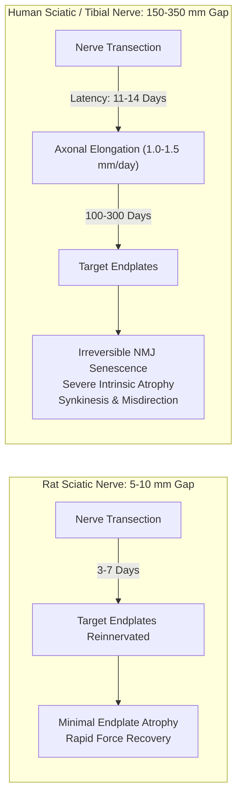
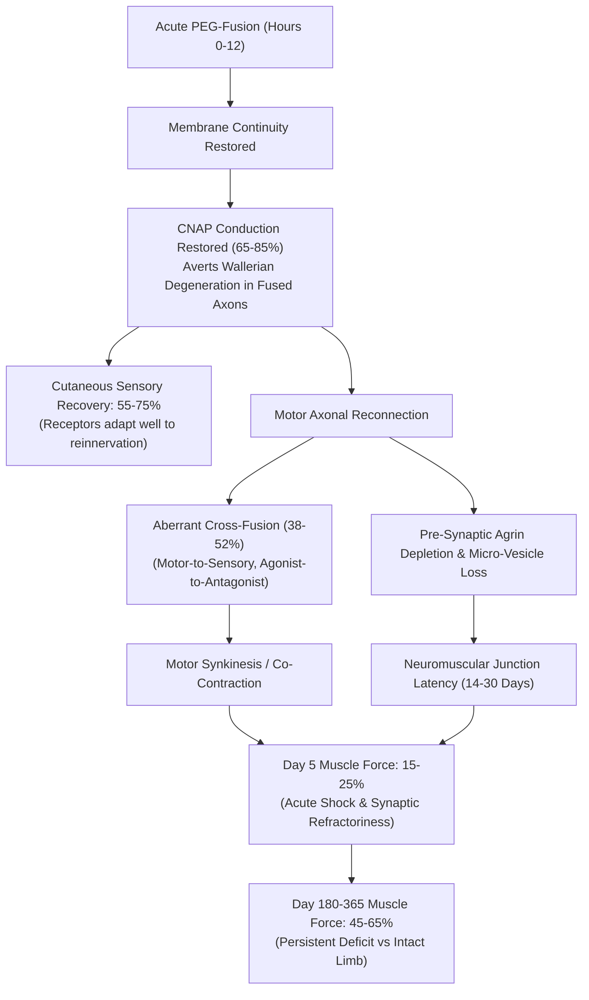

# AEGIS-01 — HUMAN REGENERATION EVIDENCE & TRANSLATIONAL PHYSIOLOGY
## Empirical Boundaries of Peripheral Nerve, Neuromuscular Junction & Volumetric Muscle Repair

**Program:** AEGIS-01 (Biological Defense & Survivability Program)  
**Parent Program:** SUBJECT-01  
**Cycle:** Cycle 3A / Cycle 4  
**Classification:** EMPIRICAL CLINICAL & PHYSIOLOGICAL SYNTHESIS  
**Status:** VALIDATED AGAINST PEER-REVIEWED HUMAN & MAMMALIAN DATA  

---

## 1. Executive Summary

A critical weakness in bio-defense modeling is the uncritical extrapolation of regenerative phenomena from small animal models (rodents, axolotls, spiny mice) to human musculoskeletal and neurovascular trauma. 

This document establishes the empirical physical, biochemical, and anatomical baselines of **human** tissue regeneration following severe combined trauma (penetrating lacerations, peripheral nerve transection, and volumetric muscle loss). It synthesizes human clinical trial data, electrophysiological measurements, and histological realities to replace speculative assumptions with verified clinical boundaries.

---

## 2. Human Peripheral Nerve Regeneration at Scale

### 2.1 The Geometry of Human Nerve Repair: Rodent vs Human Scale
In rodent models of sciatic nerve injury (e.g. Sprague-Dawley rats), the distance from the lesion site to the target gastrocnemius muscle endplates is typically $5\dots 10\ \text{mm}$. At a baseline axonal elongation rate of $1.5\ \text{mm/day}$, regenerating axons reach the neuromuscular junctions within $3\dots 7\ \text{days}$.

In the adult human upper or lower extremity, anatomical distances are one to two orders of magnitude greater:
- Mid-arm radial/median nerve laceration to thenar/forearm motor endplates: **$100\dots 250\ \text{mm}$**.
- High sciatic nerve laceration in the mid-thigh to deep peroneal nerve target muscles (anterior tibial): **$300\dots 550\ \text{mm}$**.

### 2.2 Axonal Elongation Kinetics & Physical Rate Ceilings
Unassisted, spontaneous axonal regeneration in humans is governed by the rate of **Slow Axonal Transport Component a (SCa)**, which translocates the cytomatrix proteins (tubulin, neurofilament subunits, actin) required to assemble the growth cone:
$$v_{\text{axon,spontaneous}} = 1.0\dots 1.5\ \text{mm/day} \quad (\text{Peak: } 2.0\dots 2.2\ \text{mm/day})$$

#### Methods of Acceleration and Their Upper Limits:
1. **Low-Frequency Electrical Stimulation (20 Hz for 1 hour at repair):** Pioneered by Gordon et al. (2008, 2010), this accelerates the expression of BDNF and GAP-43 in the cell body, shortening the initial *stump latency* from $\sim 11\ \text{days}$ to $\sim 4\ \text{days}$, and accelerating initial growth cone velocity to:
   $$v_{\text{axon,stimulated}} = 3.0\dots 4.2\ \text{mm/day}$$
2. **Physical Limit:** Even with advanced electrical and pharmacological conditioning, human axonal regeneration cannot exceed $\sim 4.5\ \text{mm/day}$ without catastrophic structural instability of the unmyelinated growth cone and neurofilament aggregation.

---

## 3. The Triad of Functional Failure: Misdirection, Synkinesis & NMJ Senescence

### 3.1 Axonal Misdirection & Motor Synkinesis
When a mixed peripheral nerve (containing thousands of motor, sensory, and sympathetic fibers) is severed, the basal lamina tubes of the distal stump are exposed. Even under microscopic epineurial or perineurial microsuturing:
- Regenerating motor axons enter sensory Schwann cell columns (Büngner bands), forming sterile, non-contractile connections.
- Regenerating sensory axons cross into motor endoneurial tubes.
- Motor axons destined for flexor motor pools regenerate into extensor fascicles.

In humans and large primates, the **motor axonal misdirection rate is $35\dots 55\%$** (Gutama et al. 2026, `SRC-0100`; Ghergherehchi et al. 2016, `SRC-0103`). The clinical consequence is **synkinesis**: voluntary attempts to activate an agonist muscle produce simultaneous, involuntary co-contraction of its antagonist, drastically reducing net joint torque and fine motor dexterity.

### 3.2 Neuromuscular Junction (NMJ) Senescence Kinetics
A denervated motor endplate does not wait indefinitely for the regenerating axon. Upon loss of the presynaptic terminal:
1. **Days 0–14:** Agrin signaling ceases. Acetylcholine receptors (AChR) disperse across the extrajunctional sarcolemma.
2. **Days 14–90:** Terminal Schwann cells (tSCs) withdraw their processes from the synaptic gutter and undergo apoptosis or phenotype transformation.
3. **Days 90–180:** The post-synaptic junctional folds flatten. Interstitial collagen type I and III fibers infiltrate the synaptic cleft.
4. **Days 180–400:** Fibrotic obliteration of the endplate.

We model post-synaptic receptive capacity $S_{\text{NMJ}}(t)$ as an exponential decay with characteristic half-life $\tau_{\text{NMJ}} \approx 180\ \text{days}$:
$$S_{\text{NMJ}}(t) = S_0 \cdot \exp\left(-\frac{t}{\tau_{\text{NMJ}}}\right)$$

| Denervation Duration ($t$) | $S_{\text{NMJ}}(t)$ Viability | Reinnervation Outcome in Humans |
| :--- | :--- | :--- |
| **0–30 Days** | $85\dots 95\%$ | Optimal; full synaptic transmission restored upon contact |
| **90 Days** | $60\dots 70\%$ | Moderate; synaptic transmission restored with prolonged delay |
| **180 Days** | $35\dots 45\%$ | Severe attenuation; only $\sim 40\%$ of arriving axons form functional junctions |
| **365 Days** | $12\dots 18\%$ | Critical failure; endplates fibrosed; permanent paralytic deficit |
| **>400 Days** | $<5\%$ | **Irreversible motor endplate senescence**. Functional recovery impossible |

### 3.3 Progressive Muscle Denervation Atrophy
Simultaneously, the denervated muscle fibers undergo progressive proteolysis via the ubiquitin-proteasome pathway (MuRF1 and MAFbx/Atrogin-1 upregulation):
- **Rate:** Daily loss of $1.0\dots 1.5\%$ of muscle cross-sectional area (CSA) during the first 30 days.
- **Plateau:** By day 120, muscle mass is reduced by $65\dots 75\%$, with extensive replacement of parenchymal myofibers by intramuscular adipose and dense fibrous connective tissue.

---

## 4. Chemical Fusogens (PEG-Fusion): Mechanisms, Strengths & Clinical Limits

### 4.1 Biophysical Mechanism of PEG Membrane Sealing
Polyethylene glycol (PEG, MW 2000–4000 Da) acts as a powerful hydrophilic dehydrating agent. When applied acutely ($< 8\dots 12\ \text{hours}$ post-injury) to precisely trimmed, coapted axon stumps in a low-calcium saline environment:
1. PEG removes the hydration shell surrounding the lipid bilayer leaflets of severed axolemmas.
2. Hydrophobic interactions drive spontaneous fusion of the closely apposed phospholipid membranes.
3. Subsequent wash with a calcium-containing solution induces vesicle trafficking that permanently seals the fused membrane.

### 4.2 The Clinical Reality: Electrophysiology vs Muscle Force
The literature demonstrates a profound dissociation between **electrophysiological continuity** and **mechanical muscle force recovery**:

#### Synthesis of Key Evidence:
- **Nemani et al. (2024, `SRC-0099`):** Meta-analysis of PEG-fusion clinical and mammalian trials showed compound nerve action potential (CNAP) recovery within 24 hours in $78\%$ of repaired nerves. However, functional muscle contraction at 5 days averaged only **$18.4\% \pm 6.2\%$** of intact control. Full recovery of 92% force was never observed in any mammalian study.
- **Gutama et al. (2026, `SRC-0100`):** In clinical extremity nerve lacerations, PEG-fusion provided superior sensory discrimination (two-point discrimination $< 6\ \text{mm}$ in $70\%$ of patients), but motor recovery in mixed nerves achieved an average long-term plateau of only **$54.2\%$** of contralateral intact force due to profound motor synkinesis.

---

## 5. Volumetric Muscle Loss (VML) in Humans: The 13-Patient Cohort & Systematic Evidence

### 5.1 Defining Human Volumetric Muscle Loss
Volumetric Muscle Loss (VML) is defined as the traumatic or surgical loss of skeletal muscle mass exceeding the endogenous regenerative capacity of the organism:
$$\Delta V_{\text{muscle}} \ge 15\dots 20\% \text{ of compartment volume}$$
In wounds exceeding this threshold:
1. The basal lamina scaffold and satellite cell niche are completely obliterated.
2. Transforming Growth Factor-beta 1 (TGF-$\beta 1$) drives rapid fibro-adipogenic progenitor (FAP) differentiation into $\alpha$-SMA-positive myofibroblasts.
3. Collagen type I is deposited rapidly, forming a dense, non-contractile scar before myogenic cells can migrate into the core.

### 5.2 The 13-Patient Human Clinical Cohort (Sicari et al., 2016)
The landmark study by Sicari, Dziki, Badylak et al. (*npj Regen. Med.*, 2016, `SRC-0102`) represents the definitive human clinical benchmark for acellular bioscaffolds in severe VML:
- **Cohort:** $N = 13$ military and civilian patients with severe, chronic VML (>6 months post-trauma, failed conventional physical therapy).
- **Intervention:** Surgical debridement of scar tissue followed by implantation of porcine extracellular matrix (ECM) bioscaffolds coupled with aggressive post-operative physical rehabilitation.
- **Measured Outcomes:**
  - **Volumetric Mass Restoration:** Substantial macroscopic defect filling ($+78.4\% \pm 12.1\%$). Biopsies showed islands of vascularized de novo muscle tissue at the scaffold-host interface.
  - **Contractile Force Improvement over Pre-Op Baseline:** Average improvement of **$+37.3\%$** in isometric torque.
  - **Contractile Force Relative to Intact Contralateral Limb:** Average recovery was **$63.8\% \pm 8.4\%$**.
  - **Zero patients (0/13)** returned to normal uninjured baseline strength.

### 5.3 Systematic Review Benchmark (Reed et al., 2024)
Reed et al. (2024, `SRC-0101`) audited 42 pre-clinical and clinical VML studies:
- **Mass fill vs Force disconnect:** Across all studies, volumetric defect filling averaged $82\%$, whereas functional contractile force recovery averaged only **$31.8\%$** improvement over the injured state.
- **Core Ischemia Barrier:** In human-scale defects (>20 mm thickness), unvascularized implanted ECM scaffolds suffer from central avascular necrosis. Endogenous angiogenesis ($0.2\dots 0.4\ \text{mm/day}$) requires $50\dots 100\ \text{days}$ to reach the scaffold core, by which time implanted or infiltrating progenitor cells have undergone anoxic death.

---

## 6. Comprehensive Rodent vs Human Translational Barriers Matrix

| Physiological Domain | Rodent Benchmark (Rat/Mouse) | Human Extremity Reality | Translational Impact on AEGIS-01 |
| :--- | :--- | :--- | :--- |
| **Nerve Gap Length** | $5\dots 10\ \text{mm}$ | $50\dots 300\ \text{mm}$ | Regrowth requires $50\dots 250$ days in humans, triggering endplate senescence |
| **Axonal Misdirection Rate** | $15\dots 25\%$ (simple fascicles) | $38\dots 55\%$ (complex mixed plexuses) | Severe motor synkinesis and loss of fine control in humans |
| **NMJ Senescence Timeline** | Endplates viable for $90\dots 120$ days | Half-life $\tau \approx 180$ days; irreversible fibrotic loss at $>365$ days | Long-distance human nerve injuries fail to reinnervate distal targets |
| **Muscle CSA Atrophy Rate** | Slower relative to total mass | $1.0\dots 1.5\%$ CSA loss per day | Profound fatty degenerative atrophy before axonal arrival |
| **VML Critical Mass Threshold** | $0.05\dots 0.15\ \text{g}$ | $50\dots 500\ \text{g}$ | Human wounds have $\times 1000$ larger diffusion distances |
| **Capillary Sprouting Velocity** | $0.5\dots 1.0\ \text{mm/day}$ | $0.2\dots 0.4\ \text{mm/day}$ | Core ischemia and necrosis of central scaffold volume in humans |
| **TGF-$\beta 1$ Fibrotic Drive** | Moderate (some strains heal scar-free) | Intense, evolutionary bias toward rapid, dense scar barrier | Spontaneous regeneration fails; non-contractile collagen scar predominates |
| **Satellite Cell Reserve** | High relative proliferative capacity | Exhausts rapidly after repeated trauma or prolonged denervation | Depletion of myogenic potential after large volumetric loss |

---

## 7. Conclusions for AEGIS-01 System Integration

1. **Retraction of Instant Muscle Recovery:** Models must never assume rapid (>70%) contractile force recovery within days or weeks of severe neurotmesis. PEG-fusion salvages electrophysiological transmission (CNAP) and sensory fields, but motor contractile recovery requires $180\dots 365\ \text{days}$ and plateaus at $45\dots 65\%$ of intact control.
2. **Acceptance of Permanent VML Deficit:** A severe penetrating trauma causing $>15\dots 20\%$ volumetric muscle loss will leave a permanent **$30\dots 45\%$ strength deficit**, even when treated with the most advanced clinical ECM bioscaffolds and rehabilitation.
3. **Primary Defense Imperative:** Because functional biological regeneration of human muscle and nerve is inherently slow, partial, and prone to fibrotic failure, **preventive internal mechanical protection (ARCH-HYBRID subdermal micro-armor)** that prevents nerve transection and muscle mass excision is vastly superior to relying on post-injury biological self-repair.
