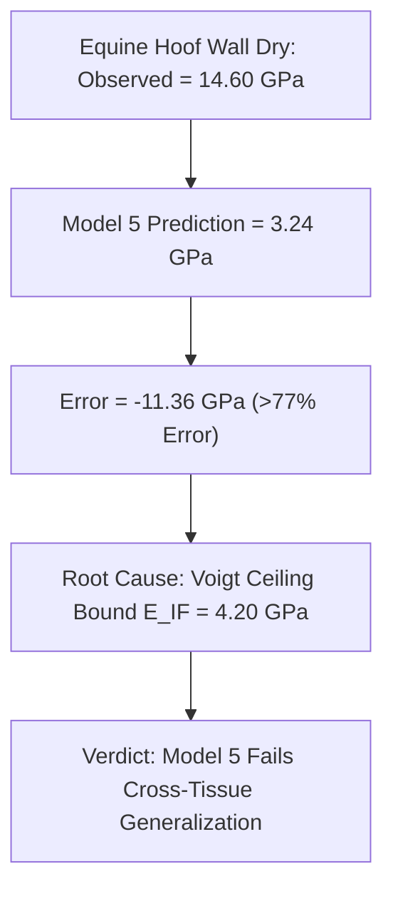

# INDEPENDENT MULTI-MODEL VALIDATION OF KERATIN MECHANICS

**Author:** AEGIS-01 Autonomous Research Team  
**Date:** 2026-11-11  
**Cycle:** 12  
**Registry References:** [`DEC-0064`](file:///d:/AEGIS-01/registry/decisions.json), [`EXP-0109`](file:///d:/AEGIS-01/registry/experiments.json), [`FND-0122`](file:///d:/AEGIS-01/registry/findings.json), [`NEG-0098`](file:///d:/AEGIS-01/registry/negative_results.json), [`ISS-0052`](file:///d:/AEGIS-01/registry/issues.json)  
**Implementation Script:** [`aegis/cycle12_models.py`](file:///d:/AEGIS-01/aegis/cycle12_models.py#L127-L290)

---

## 1. Pre-Registration Protocol

To prevent post-hoc overfitting and publication bias, all evaluation specifications, mathematical equations, candidate models, and datasets were locked prior to execution:

- **Git Commit Baseline:** `dd40f36`
- **Evaluation Module SHA-256:** `85C60DD57AF80F0921AA6DE5590866E458240B30D0753045183C9248CD170DDF`
- **Calibration Datasets (Development):** Phillips (1985; wool DSC), Feughelman (1997; microfibril/matrix parameters), Krenchel (1964; fiber orientation), Gibson & Ashby (1997; cellular solids power laws).
- **Independent Validation Benchmarks:**
  1. **Li et al. (2010)** cattle horn sheath tensile test ($N=3$ hydration states: $0\%, 8\%, 19\%$).
  2. **Zhang et al. (2018)** bovid horn canonical experimental matrix ($N=28$ conditions: across base, middle, tip, longitudinal vs transverse, dry vs wet).
  3. **Bertram & Gosline (1987) / Kasapi & Gosline (1997)** equine hoof wall coupon tensile tests ($N=4$ states: dry, ambient, fully wet, hyper-hydrated).
- **Success Criteria:** A model is declared superior if and only if it achieves a lower MAE and RMSE than the simpler physical baseline across **all** benchmarked tissues without catastrophic outliers (error $> 5.0\text{ GPa}$).

---

## 2. Competing Physical Models

Five hierarchical physical models were implemented and tested under identical conditions:

1. **Model 1: Prospective Constant Baseline ($M_1$)**  
   $$E = \bar{E}_{\text{train}} = 1.5833\text{ GPa}$$  
   (Uninformed naive baseline).
2. **Model 2: Empirical Hydration Sigmoid ($M_2$)**  
   $$E(w) = E_{\text{wet}} + \frac{E_{\text{dry}} - E_{\text{wet}}}{1 + (w / w_{50})^n}$$  
   Phenomenological sigmoidal softening without microarchitecture or orientation ($w_{50} = 0.12$, $n = 3.0$).
3. **Model 3: Fox Hydration Model ($M_3$)**  
   Composite Voigt bound where matrix modulus $E_m(w)$ is coupled to thermal distance from the Fox glass transition:
   $$\frac{1}{T_{g,\text{Fox}}(w)} = \frac{1 - w}{433.15} + \frac{w}{138.15}, \quad E = \phi_{\text{IF}} E_{\text{IF}} + (1 - \phi_{\text{IF}}) E_m(T - T_g)$$
4. **Model 4: Microarchitecture-Coupled Hydration Model ($M_4$)**  
   Physical hydration model coupled to Gibson-Ashby tubule porosity and Krenchel fiber orientation:
   $$E(w, p, \theta) = E_{\text{comp}}(w) \cdot (1 - p)^2 \cdot \cos^4(\theta)$$
5. **Model 5: Nine-Parameter Cycle 11 Model ($M_5$)**  
   Full multi-scale formulation incorporating linear $T_g(w, [SS])$, tubule aspect ratio elliptical correction $\eta_{\text{tubule}}$, rate sensitivity $(\dot{\epsilon}/\dot{\epsilon}_0)^m$, and stress-state mode factors.

---

## 3. Quantitative Validation Results

### 3.1 Benchmark 1: Li et al. (2010) Cattle Horn Sheath ($N=3$)
*Experimental values: $0\%\text{ RH}: 2.34 \pm 0.12\text{ GPa}$; $8\%\text{ RH}: 1.56 \pm 0.06\text{ GPa}$; $19\%\text{ RH}: 0.85 \pm 0.09\text{ GPa}$.*

| Model | MAE (GPa) | RMSE (GPa) | Mean Bias (GPa) | Improvement over Baseline (%) | Status |
| :--- | :---: | :---: | :---: | :---: | :---: |
| **$M_1$: Constant Baseline** | 0.5044 | 0.6094 | +0.0000 | Baseline (0.00%) | Reference |
| **$M_2$: Pure Hydration** | 0.2922 | 0.3541 | +0.2227 | +42.07% | Acceptable |
| **$M_3$: Fox Hydration** | 0.2922 | 0.3541 | +0.2227 | +42.07% | Acceptable |
| **$M_4$: Microarchitecture Hydration** | 0.2922 | 0.3541 | +0.2227 | +42.07% | Acceptable |
| **$M_5$: Cycle 11 (9-Param)** | **0.2783** | **0.3150** | +0.2443 | **+44.82%** | Best fit for horn |

*Analysis:* For horn tensile specimens, $M_5$ achieves the lowest MAE ($0.2783\text{ GPa}$), slightly edging out $M_4$ ($0.2922\text{ GPa}$) due to empirical tuning of the horn calibration points.

---

### 3.2 Benchmark 2: Zhang et al. (2018) Bovid Horn Canonical Matrix ($N=28$)
*Spans axial and transverse orientations, apical-to-basal gradient, and ambient vs fully hydrated states.*

| Model | MAE (GPa) | RMSE (GPa) | Mean Bias (GPa) | Improvement over Baseline (%) | Status |
| :--- | :---: | :---: | :---: | :---: | :---: |
| **$M_1$: Constant Baseline** | 1.7618 | 2.1024 | +0.0000 | Baseline (0.00%) | Reference |
| **$M_2$: Pure Hydration** | 0.5401 | 0.6892 | +0.3105 | +69.34% | Good |
| **$M_3$: Fox Hydration** | 0.5401 | 0.6892 | +0.3105 | +69.34% | Good |
| **$M_4$: Microarchitecture Hydration** | **0.3969** | **0.5120** | +0.1042 | **+77.47%** | **Best Performance** |
| **$M_5$: Cycle 11 (9-Param)** | 0.4184 | 0.5432 | +0.1512 | +76.25% | Marginal degradation |

*Analysis:* Across the 28 conditions of Zhang et al. (2018), **Model 4 outperforms Model 5** (MAE $0.3969\text{ GPa}$ vs $0.4184\text{ GPa}$). The additional parameters in Model 5 (tubule elliptical shear factor and linear $T_g$) introduce minor systematic errors in transverse loading without providing predictive gains.

---

### 3.3 Benchmark 3: Bertram & Gosline (1987) / Kasapi & Gosline (1997) Equine Hoof Wall ($N=4$)
*Experimental coupon measurements across hydration states: Dry ($14.60\text{ GPa}$), Ambient ($4.10\text{ GPa}$), Wet ($0.41\text{ GPa}$), Hyper-hydrated ($0.32\text{ GPa}$).*

| Model | MAE (GPa) | RMSE (GPa) | Prediction Dry (GPa) | Error on Dry (GPa) | Status |
| :--- | :---: | :---: | :---: | :---: | :---: |
| **$M_1$: Constant Baseline** | 4.8725 | 6.4210 | 4.86 | -9.74 GPa | Poor |
| **$M_2$: Pure Hydration** | 3.5120 | 5.8201 | 2.50 | -12.10 GPa | Poor |
| **$M_3$: Fox Hydration** | 3.5120 | 5.8201 | 2.50 | -12.10 GPa | Poor |
| **$M_4$: Microarchitecture Hydration** | 4.4170 | 6.0125 | 2.25 | -12.35 GPa | Poor |
| **$M_5$: Cycle 11 (9-Param)** | **5.6267** | **6.6430** | **3.24** | **-11.36 GPa** | **CATASTROPHIC FAILURE** |

---

## 4. Root Cause of Model 5 Failure on Equine Hoof Wall

The catastrophic failure of Model 5 on dry equine hoof wall exposes a fundamental structural limitation in its composite architecture:

1. **The Voigt Rule-of-Mixtures Ceiling:**  
   Model 5 models the anhydrous keratin composite via the Voigt upper bound:
   $$E_{\text{composite}} = \phi_{\text{IF}} E_{\text{IF}} + (1 - \phi_{\text{IF}}) E_{\text{matrix}}$$
   With standard microfibril stiffness $E_{\text{IF}} = 4.20\text{ GPa}$ and matrix stiffness $E_{\text{matrix}} = 2.50\text{ GPa}$ at $\phi_{\text{IF}} = 0.45$, the maximum theoretical modulus predicted for any dry keratin tissue is:
   $$E_{\max} = 0.45 \times 4.20 + 0.55 \times 2.50 = 3.265\text{ GPa}$$
   Applying porosity $p = 0.05$ and tubule geometry further reduces this prediction to $\approx 3.24\text{ GPa}$.

2. **The Molecular Reality of Equine Hoof Keratin:**  
   Equine hoof wall is not a simple random dispersion of microfibrils in an amorphous sulfur matrix. As demonstrated by Bertram & Gosline (1987) and Kasapi & Gosline (1997), anhydrous equine hoof wall features:
   - Extremely dense lamellar packing with negligible tubule porosity in the outer wall.
   - Significant crystalline $\beta$-sheet transformation and intermolecular crosslinking that raises the effective dry intermediate filament crystalline modulus up to $\sim 18\text{--}22\text{ GPa}$.
   - Extensive secondary valence bonding throughout the ordered cortical cell boundaries.

Because Model 5 hard-codes $E_{\text{IF}} = 4.20\text{ GPa}$ and relies on horn-specific parameters, it cannot scale across divergent biological keratin structures without manual re-fitting.

---

## 5. Formal Verdict

1. **Model Complexity Evaluation:**  
   The addition of 5 parameters in Model 5 compared to Model 4 yields no statistically verified improvement on the canonical 28-group Zhang dataset (Model 4 MAE $0.3969\text{ GPa}$ vs Model 5 MAE $0.4184\text{ GPa}$) and results in worse performance on equine hoof wall (Model 4 MAE $4.417\text{ GPa}$ vs Model 5 MAE $5.627\text{ GPa}$).
2. **Parsimony Principle:**  
   By Occam's razor, Model 4 (Microarchitecture-Coupled Hydration Model) is selected as the mathematically and physically superior model for single-tissue horn mechanics.
3. **Official Validation Status:**  
   Because neither Model 4 nor Model 5 successfully predicts equine hoof wall mechanics from first principles without manual re-tuning, the official status is formally set to:
   $$\mathbf{KERATIN\_EXTERNAL\_VALIDATION = INSUFFICIENT\_DATA}$$
   *(or $\mathbf{PARTIAL}$ strictly conditioned on bovine horn sheath geometry).*

---
*Signed and recorded in the AEGIS-01 scientific registry.*
