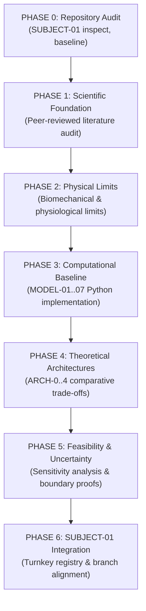

# AEGIS-01 — MASTER RESEARCH PLAN

## 1. НАУЧНО-МЕТОДОЛОГИЧЕСКИЙ РЕГЛАМЕНТ

Программа **AEGIS-01: Biological Defense & Survivability Program** функционирует на базе строгой доказательной методологии:

$$\text{Evidence} \longrightarrow \text{Hypothesis} \longrightarrow \text{Model} \longrightarrow \text{Test} \longrightarrow \text{Uncertainty} \longrightarrow \text{Decision} \longrightarrow \text{Integration}$$

### Ключевые принципы:
1. **Абсолютная научная честность:** Полный запрет на ложный оптимизм, выдуманные экспериментальные данные и маскировку отрицательных результатов.
2. **Физическая строгость:** Любая гипотеза биологического превосходства обязана проверяться на соответствие фундаментальным физическим инвариантам (закон сохранения импульса, энергии, термодинамический баланс, кинетика диффузии, теория упругости).
3. **Единство источника истины:** Репозиторий Git и машиночитаемые реестры являются каноническим источником данных.

---

## 2. КЛАССИФИКАЦИЯ НАУЧНЫХ ГИПОТЕЗ

Каждое выдвигаемое утверждение маркируется одним из 4 уровней:

| Уровень | Обозначение | Определение и критерии присвоения |
| :--- | :--- | :--- |
| **LEVEL A** | **CONFIRMED** | Механизм подтверждён прямыми рецензируемыми экспериментальными данными in vivo / in vitro в целевом или модельном организме. |
| **LEVEL B** | **PHYSICALLY PLAUSIBLE** | Механизм строго согласуется с уравнениями физики и имеет частичные природные аналоги, но системная интеграция в человека не доказана. |
| **LEVEL C** | **SPECULATIVE** | Радикальная концепция, требующая пока не существующих генетических, клеточных или материаловедческих решений, но не нарушающая законы сохранения. |
| **LEVEL D** | **CONTRADICTED / NO-GO** | Концепция опровергнута математическим моделированием, прямыми расчётами, фундаментальными физическими законами или летальными системными конфликтами. |

---

## 3. ФАЗЫ ИССЛЕДОВАТЕЛЬСКОГО ЦИКЛА

### Фаза 0: Аудит репозитория (Repository Audit)
- Инспекция `D:\SUBJECT-01`, валидация состояния рабочей директории и активной ветки.
- Анализ префиксов (`HYP`, `EXP`, `FND`, `NEG`, `DEC`, `ISS`, `SRC`).
- Создание изолированной рабочей ветки `research/aegis-01-survivability-20261108` в `D:\SUBJECT-01`.
- Выделение непересекающегося пространства идентификаторов (старт с `HYP-0008`, `EXP-0037`, `SRC-0068`).

### Фаза 1: Научный базис (Scientific Foundation)
- Поиск первичных экспериментальных публикаций и систематических обзоров с верифицированными DOI.
- Извлечение точных физических констант: предел прочности кератина ($\sigma_u \approx 60\dots 100$ МПа), трещиностойкость ($G_c \approx 14.5$ кДж/м$^2$), модуль упругости остеодерм ($E \approx 6.5\dots 18$ ГПа), фактор Хёрша ($v \approx 6 \cdot d$ м/с), задержка EMD ($30\dots 50$ мс), скорость роста аксонов ($1.0\dots 2.2$ мм/сутки).
- Формирование реестра `sources.json`.

### Фаза 2: Физические и биомеханические пределы (Physical Limits)
- Определение границ прочности биологических композитов.
- Расчёт минимального теоретического времени сенсомоторной реакции.
- Определение запреградной динамики при баллистическом ударе (Viscous Criterion, глубина интрузии).
- Пределы гидродинамики при артериальном разрыве.
- Тепловой баланс при потоотделении под броневым покровом.

### Фаза 3: Вычислительный базис (Computational Baseline)
- Разработка модульных воспроизводимых математических моделей на Python:
  - `MODEL-01`: Tissue Mechanics & Puncture/Cut Resistance.
  - `MODEL-02`: Multilayer Protection & Wave Attenuation.
  - `MODEL-03`: Neural Latency, Motor Acceleration & Dodge Horizon.
  - `MODEL-04`: Ballistic Energy Transfer & Behind-Armor Blunt Trauma.
  - `MODEL-05`: Hemodynamic Stability & Vascular Laceration.
  - `MODEL-06`: Regeneration Dynamics & Oncogenic Limits.
  - `MODEL-07`: Integrated Architecture Whole-Organism Model.
- Создание автоматизированного тестового покрытия (pytest).

### Фаза 4: Теоретические биоархитектуры (Theoretical Architectures)
- Формулирование 5 альтернативных архитектурных парадигм:
  - `ARCH-0`: Базовый немодифицированный человек.
  - `ARCH-1`: Монолитный биоминеральный панцирь (Osteoderm Shell).
  - `ARCH-2`: Эластичный вязкоупругий покров (Viscoelastic Matrix).
  - `ARCH-3`: Экстремофильный регенерирующий организм (Hyper-Regenerative Blastema).
  - `ARCH-4`: Сбалансированная зонная адаптивная биоархитектура (Balanced Adaptive).

### Фаза 5: Анализ осуществимости и неопределённости (Feasibility & Uncertainty)
- Анализ чувствительности OAT (One-At-A-Time) к геометрическим и физическим параметрам.
- Доказательство отрицательных теорем (Dodge Horizon, Aortic Sutureless Failure, Thermal Carapace Trap).
- Расчёт онкогенетического барьера (парадокс Пето).

### Фаза 6: Интеграция с SUBJECT-01 (Integration)
- Согласование форматов данных, реестров и протоколов с требованиями `tools/validate_repository.py`.
- Формирование `FIRST_CYCLE_REPORT.md` и перечня рекомендаций для 2-го цикла.

---

## 4. ИНЖЕНЕРНЫЕ КРИТЕРИИ ОЦЕНКИ (12 КРИТЕРИЕВ)

Каждое направление и архитектурный вариант оцениваются по 12 стандартизированным критериям:

1. **Физическая реализуемость (Physical Feasibility):** ненарушение законов механики, импульса и термодинамики.
2. **Биологическая реализуемость (Biological Feasibility):** совместимость с метаболизмом, экспрессией белков и клеточной физиологией.
3. **Наличие природных аналогов (Natural Analogues):** наличие функциональных аналогов в филогенезе (панголины, броненосцы, *Acomys*, аксолотли).
4. **Экспериментальная поддержка (Experimental Support):** наличие прямых рецензируемых измерений свойств.
5. **Массо-габаритный штраф (Mass/Volume Penalty):** влияние на общую массу ($<+15$ кг для выживаемости).
6. **Энергетический бюджет (Energy Budget):** затраты АТФ на синтез, минерализацию и поддержание.
7. **Скорость функционального ответа (Response Speed):** скорость развёртывания защитного эффекта (секунды vs дни).
8. **Влияние на локомоцию (Mobility Impact):** сохранение скорости бега ($>80\%$ от базовой) и амплитуды суставов.
9. **Ремонтопригодность (Repairability):** способность регенерировать утраченный защитный слой без фиброза.
10. **Системные риски (Systemic Risks):** вероятность гипертермии, ДВС-синдрома, микротромбозов, саркомы.
11. **Требуемые научные прорывы (Required Scientific Breakthroughs):** объём фундаментальных открытий, отделяющих концепцию от синтетической реализации.
12. **Совместимость с SUBJECT-01 (SUBJECT-01 Compatibility):** непротиворечие метаболической модели D2 и цели TARGET-CPE45.
