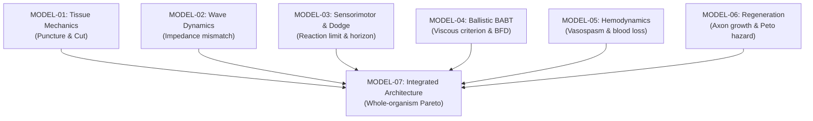

# AEGIS-01 — MATHEMATICAL MODELS & FORMULATION SPECIFICATION

## 1. СТРУКТУРА МАТЕМАТИЧЕСКИХ МОДЕЛЕЙ

Все модели реализованы на чистом Python с использованием `numpy` и `scipy`, протестированы и верифицированы на граничные условия и физическую размерность.

---

## 2. ПОДРОБНАЯ СПЕЦИФИКАЦИЯ МОДЕЛЕЙ

### 2.1. MODEL-01 — Механика тканей, прокол и порез (`aegis/model_01_tissue_mechanics.py`)

#### Уравнение прокола острым индентором:
При вдавливании конического или сферического индентора радиусом $R_{\text{tip}}$ в упругую полимерную мембрану толщиной $t$, критическая сила инициации разрыва определяется критерием разрушения Лейка-Томаса с учетом контактной пластичности:
$$F_{\text{puncture}} = 2 \pi R_{\text{tip}} t \sigma_u \left( \frac{G_c}{E t} \right)^{1/3} + F_{\text{contact}}$$
где:
- $R_{\text{tip}}$ — радиус острия индентора [м],
- $t$ — толщина слоя [м],
- $\sigma_u$ — предел прочности ткани при одноосном растяжении [Па],
- $G_c$ — критическая скорость высвобождения энергии деформации (вязкость разрушения) [Дж/м$^2$],
- $E$ — модуль Юнга [Па],
- $F_{\text{contact}} = \pi R_{\text{tip}}^2 \cdot H_V \cdot 0.35$ — контактное сопротивление смятию материала под острием индентора (где $H_V$ — твердость по Виккерсу в Па).

#### Уравнение резания лезвием (Модель Аткинса):
Усилие при установившемся резании клиновидным лезвием с углом заточки $\theta$:
$$F_{\text{cut}} = \frac{G_c \cdot t}{\tan(\theta / 2)} + 2 \mu \cdot \sigma_u \cdot t \cdot w \cdot \sin(\theta / 2)$$
где:
- $w$ — ширина контакта клинка [м],
- $\mu$ — коэффициент динамического трения стали о биополимер.

---

### 2.2. MODEL-02 — Многослойная броня и гашение ударных волн (`aegis/model_02_multilayer_protection.py`)

#### Акустический импеданс и скорость звука:
$$c_L = \sqrt{\frac{E}{\rho}},\quad Z = \rho \cdot c_L = \sqrt{\rho E}$$

#### Коэффициенты отражения и прохождения на границе раздела $i \to i+1$:
Коэффициент прохождения энергии:
$$T_E = \frac{4 Z_i Z_{i+1}}{(Z_i + Z_{i+1})^2}$$
Коэффициент отражения энергии:
$$R_E = \left( \frac{Z_{i+1} - Z_i}{Z_{i+1} + Z_i} \right)^2$$
Закон сохранения энергии потока волны: $T_E + R_E \equiv 1.0$.

#### Затухание в вязкоупругой среде:
$$\sigma(x) = \sigma_0 \cdot \exp(-\alpha x),\quad \alpha = \frac{\omega \cdot \eta_{\text{loss}}}{2 c_L}$$
где $\omega = 2\pi f$ — циклическая частота импульса, $\eta_{\text{loss}}$ — фактор механических потерь материала.

---

### 2.3. MODEL-03 — Нейромышечные задержки и горизонт уклонения (`aegis/model_03_reaction_movement.py`)

#### Полный бюджет времени реакции:
$$T_{\text{latency}} = \tau_{\text{sensory}} + \frac{L_{\text{afferent}}}{v_{\text{nerve}}} + N_{\text{syn}} \tau_{\text{synapse}} + \frac{L_{\text{efferent}}}{v_{\text{nerve}}} + \tau_{\text{NMJ}} + \tau_{\text{EMD}}$$
Скорость нервного проведения по закону Хёрша:
$$v_{\text{nerve}} = 6.0 \cdot d_{\text{axon}}\quad [\text{м/с}]$$

#### Динамика нарастания мышечной силы (RFD):
$$F(t) = \begin{cases} 0, & t < T_{\text{latency}} \\ F_{\max} \cdot \left(1 - \exp\left(-\frac{t - T_{\text{latency}}}{\tau_{\text{RFD}}}\right)\right), & t \ge T_{\text{latency}} \end{cases}$$

#### Уравнение движения сегмента тела (торс/голова):
$$M_{\text{segment}} \frac{d^2 x}{dt^2} + c \frac{dx}{dt} = F(t)$$
Время подлёта пули: $t_{\text{flight}} = \frac{L}{v_{\text{proj}}}$.  
Условие физической невозможности уклонения (Горизонт уклонения):
$$t_{\text{flight}} \le T_{\text{latency}} \implies x(t_{\text{flight}}) \equiv 0.0\ \text{мм}$$

---

### 2.4. MODEL-04 — Баллистическая энергия и запреградная травма (`aegis/model_04_energy_transfer.py`)

#### Сохранение импульса при неупругом ударе:
Начальная скорость сопряженной зоны грудной стенки в момент передачи импульса:
$$v_0 = \frac{m_{\text{proj}} v_{\text{proj}}}{m_{\text{proj}} + m_{\text{armor,local}} + m_{\text{tissue,local}}}$$

#### Нелинейная модель динамики грудной клетки Лобделла:
$$M_{\text{coupled}} \ddot{x} + c \dot{x} + k_1 x + k_2 x^3 = 0$$
где $k_1$ — линейная жесткость грудины и ребер, $k_2$ — геометрическое нелинейное утолщение, $c$ — вязкостное демпфирование внутренних органов.

#### Вязкостный критерий травмы (Viscous Criterion, Viano & Lau 1988):
$$C(t) = \frac{x(t)}{D_{\text{torso}}},\quad V(t) = \dot{x}(t),\quad VC(t) = V(t) \cdot C(t)\quad [\text{м/с}]$$
Критерии тяжести:
- $VC_{\max} < 0.6$ м/с, $\text{BFD} < 25$ мм $\implies$ легкая контузия (AIS 1–2).
- $VC_{\max} \ge 1.0$ м/с или $\text{BFD} \ge 44$ мм $\implies$ летальный разрыв органов грудной клетки (AIS 5–6).

---

### 2.5. MODEL-05 — Гемодинамика, вазоспазм и кровопотеря (`aegis/model_05_hemodynamic_stability.py`)

#### Истечение крови из дефекта сосуда:
$$Q(t) = C_d \cdot A(t) \cdot \sqrt{\frac{2 \Delta P(t)}{\rho_{\text{blood}}}}$$
где $\Delta P(t) = \text{MAP}(t) - P_{\text{tissue}}$.

#### Динамический мышечный вазоспазм:
$$r(t) = r_0 \left[1 - \psi_{\text{spasm}} \left(1 - \exp\left(-\frac{t}{\tau_{\text{spasm}}}\right)\right)\right]$$

#### Кинетика тромбообразования и гидродинамический срыв сгустка:
Степень закрытия дефекта: $\phi_{\text{clot}}(t) = \frac{t^3}{t^3 + \tau_{\text{clot}}^3}$.  
Пристеночное касательное напряжение сдвига (формула Пуазейля):
$$\tau_{\text{wall}} = \frac{4 \mu Q}{\pi r(t)^3}$$
Если $\tau_{\text{wall}} > \tau_{\text{crit}} \approx 15\dots 35$ Па, растущий тромбоцитарный сгусток механически срывается потоком.

#### Классы геморрагического шока ATLS:
По доле потерянного объема циркулирующей крови $f_{\text{loss}} = \frac{V_{\text{lost}}}{V_0}$:
- Класс I: $f_{\text{loss}} \le 15\%$ (компенсированный, тахикардия).
- Класс II: $15\% < f_{\text{loss}} \le 30\%$ (сужение пульсового давления).
- Класс III: $30\% < f_{\text{loss}} \le 40\%$ (декомпенсация, падение MAP).
- Класс IV: $f_{\text{loss}} > 40\%$ (терминальная гиповолемия, остановка сердца).

---

### 2.6. MODEL-06 — Регенерация, нейротизация и онкогенный риск (`aegis/model_06_regeneration_dynamics.py`)

#### Скорость закрытия раневой поверхности:
$$t_{\text{close}} = \frac{R_{\text{wound}}}{v_{\text{epithelial}}}$$

#### Восстановление двигательной иннервации (Нейротизация):
$$T_{\text{functional}} = \tau_{\text{sprout}} + \frac{L_{\text{gap}}}{v_{\text{axon}}} + \tau_{\text{synapse}}$$
где $v_{\text{axon}} \approx 1.0\dots 2.2$ мм/сутки — фундаментальная скорость медленного транспорта тубулина в микротрубочках аксона.

#### Индекс безрубцового заживления (*Acomys* / Ferguson & O'Kane):
$$R_{\text{scarless}} = \frac{[\text{TGF-}\beta 3]}{[\text{TGF-}\beta 1]} \cdot \frac{[\text{M2}]}{[\text{M1}]}$$
При $R_{\text{scarless}} \ge 2.5$ — безрубцовая регенерация с восстановлением волосяных фолликулов и эластичности.

#### Онкогенетический риск по парадоксу Пето (Модель Армитажа-Долла):
Кумулятивная 10-летняя вероятность злокачественной трансформации клеток бластемы:
$$P_{\text{cancer}} = 1 - \exp(-\lambda),\quad \lambda = \lambda_0 \cdot \frac{(N_{\text{divisions}} / N_0)^{2.2}}{(N_{TP53})^{1.8}}$$
где $N_{TP53}$ — множитель копийности генов опухолевой супрессии (2 копии у человека, до 24 у слонов).

---

### 2.7. MODEL-07 — Интегрированная архитектура целого организма (`aegis/model_07_integrated_architecture.py`)

#### Баланс массы организма:
$$M_{\text{total}} = M_{\text{baseline}} + \sum_j S_j \rho_{A,j} + M_{\text{musculoskeletal\_support}}$$

#### Закон Клайбера для базального метаболизма:
$$P_{\text{BMR}} = 3.39 \cdot (M_{\text{total}})^{0.75} + k_{\text{turnover}} \cdot M_{\text{armor}}\quad [\text{Вт}]$$

#### Уравнение теплового баланса при нагрузке:
Метаболическое тепловыделение при механической мощности $P_{\text{mech}}$:
$$P_{\text{heat}} = \frac{P_{\text{mech}}}{\eta_{\text{efficiency}}} - P_{\text{mech}}$$
Максимальный теплоотвод через излучение, конвекцию и испарение пота:
$$\dot{Q}_{\text{dissipation}} = (1 - \phi_{\text{occlusion}}) \left[ h_{\text{conv}} S (T_{\text{skin}} - T_{\text{amb}}) + \dot{m}_{\text{sweat,max}} \lambda_{\text{evap}} \right]$$
Время до фатального теплового удара ($T_{\text{core}} = 41.5^\circ$C):
$$t_{\text{hyperthermia}} = \frac{M_{\text{total}} \cdot c_{\text{tissue}} \cdot (41.5 - 37.0)}{P_{\text{heat}} - \dot{Q}_{\text{dissipation}}}$$
при условии $P_{\text{heat}} > \dot{Q}_{\text{dissipation}}$.

#### Локомоторный штраф:
$$v_{\text{sprint}} = v_0 \cdot \left( \frac{M_{\text{baseline}}}{M_{\text{total}}} \right)^{0.67} \cdot (1 - \psi_{\text{joint\_stiffness}})$$
$$a_{\max} = \frac{F_{\text{propulsion}}}{M_{\text{total}}}$$
