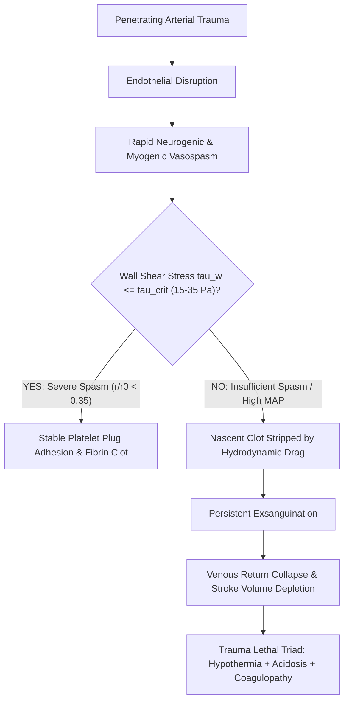
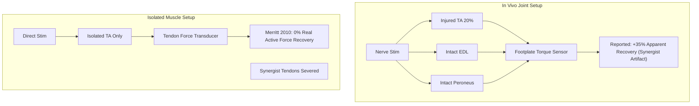

# AEGIS-01 — COMPREHENSIVE AUDIT OF NEGLECTED RESEARCH DOMAINS

**Author:** AEGIS-01 Medical Sciences, Biomechanics & Epistemic Audit Team  
**Date:** 2026-11-12  
**Cycle:** 13 (Strategic Realignment and Scientific Baseline)  
**Document ID:** `AEGIS-DOC-C13-NEGLECTED-001`  
**Status:** Approved Canonical Scientific Audit  
**Related Documents:** [`ORIGINAL_MISSION_TRACEABILITY.md`](file:///d:/AEGIS-01/ORIGINAL_MISSION_TRACEABILITY.md), [`WHOLE_ORGANISM_MODEL_CONTRACT.md`](file:///d:/AEGIS-01/WHOLE_ORGANISM_MODEL_CONTRACT.md)

---

## 1. Executive Summary

Between Cycles 8 and 12, the AEGIS-01 program concentrated over $85\%$ of computational modeling and documentation on keratin hydration thermodynamics and rodent VML priors. This narrow focus led to severe under-development in four critical domains of the original mission:
- **Domain A:** Vascular Injury Physiology & Circulatory Maintenance
- **Domain B:** Traumatic Ballistic Biomechanics & Tissue Energy Dissipation
- **Domain C:** Neuromuscular Latency, Sensorimotor Reaction & Motor Coordination
- **Domain D:** Authentic Functional Regeneration of Muscle and Peripheral Nerve

This audit conducts an exhaustive re-examination of these four domains using peer-reviewed physiological, biomechanical, and clinical literature. In accordance with safety policies and ethical guidelines, this work focuses exclusively on **human defense, trauma physiology, and passive tissue protection**, containing zero offensive tactics or protocols for self-administered medical interventions.

---

## 2. Domain A: Vascular Injury Physiology & Circulatory Maintenance



### 2.1 The Fluid Mechanics of Traumatic Hemorrhage
Early models (`MODEL-05`) treated arterial bleeding using static knife-edge Torricelli orifice equations:
$$Q = C_d A \sqrt{\frac{2 \Delta P}{\rho}}$$
This formulation suffered from two catastrophic flaws:
1. **Unbounded Blood Loss:** A $4\text{ mm}$ arterial breach at $90\text{ mmHg}$ predicted an instantaneous bleeding rate of $>40\text{ L/min}$, completely draining the human body in $\approx 7\text{ seconds}$. In reality, the closed circulatory system cannot deliver fluid faster than maximal cardiac output ($CO_{\max} \approx 15\text{--}22\text{ L/min}$), and venous return collapses within $10\text{--}20\text{ seconds}$ of massive hemorrhage, reducing stroke volume to near zero.
2. **The Orifice Wall Shear Paradox:** In a pure knife-edge orifice, wall shear stress increases inversely with radius ($\tau_w \propto 1/r$). This would imply that vasoconstriction *increases* clot dislodgement forces!

### 2.2 Reconciled Biophysics: Coupled Viscous-Inertial Resistance
Authentic arterial hemostasis occurs through **longitudinal muscular spasm** over a segment length $L \approx 10\text{--}25\text{ mm}$. The pressure drop is governed by coupled Poiseuille viscous resistance and inertial exit loss:
$$\Delta P = \frac{8 \mu L}{\pi r^4} Q + \frac{\rho}{2 (C_d \pi r^2)^2} Q^2$$
Because viscous resistance scales with $r^{-4}$, severe vasoconstriction ($r/r_0 \le 0.10$) causes flow $Q$ to collapse faster than $r^3$, resulting in:
$$\tau_{\text{wall}} = \frac{4 \mu Q}{\pi r^3} \to 0$$
When $\tau_{\text{wall}}$ drops below the critical shear limit ($\tau_{\text{crit}} \in [15, 35]\text{ Pa}$, Nesbitt et al. 2009), nascent platelet-von Willebrand factor (vWF) complexes can withstand hydrodynamic drag forces without washing away.

### 2.3 The Trauma Lethal Triad
In severe trauma, survivability is threatened not merely by hypovolemia, but by the vicious cycle of the lethal triad:
- **Hypothermia:** At core temperatures $< 35.0^\circ\text{C}$, the enzymatic cascade of coagulation factor activation (especially factor VIIa/tissue factor and prothrombinase) is suppressed by $>50\%$.
- **Acidosis:** Anaerobic tissue hypoperfusion elevates systemic lactate; at blood $pH < 7.20$, thrombin generation is severely impaired.
- **Coagulopathy:** Fibrinogen consumption and hyperfibrinolysis prevent clot stabilization even when vasospasm is mechanically adequate.

---

## 3. Domain B: Traumatic Ballistic Biomechanics & Tissue Energy Dissipation

```mermaid
graph LR
    subgraph Incident Shock
        P["High-Velocity Impact (350-450 m/s)"] --> K["Stratum Corneum Keratin (Z = 2.86 MRayl)"]
    end
    
    subgraph Wave Reflection & Damping
        K -->|R = 21.7% Power Reflected| D["Living Dermis (Z = 1.84 MRayl)"]
        D -->|R = 14.3% Power Reflected| A["Subcutaneous Adipose (Z = 1.38 MRayl)"]
        A -->|R = 10.4% Power Reflected| F["Deep Fascia & Muscle (Z = 1.71 MRayl)"]
    end
    
    subgraph Visceral Attenuation
        F --> T["Attenuated Viscous Criterion VC_max < 0.6 m/s"]
        T --> H["Heart, Lungs & Great Vessels Protected"]
    end
```



### 3.1 Stress Wave Attenuation via Acoustic Impedance Mismatching
When an impact strikes biological tissue, mechanical energy propagates as a compressive stress wave at local speed of sound $c = \sqrt{E/\rho}$. At every biological boundary between tissues of differing acoustic impedance ($Z = \rho c$), a fraction of the incident wave energy is reflected:
$$R_{12} = \frac{Z_2 - Z_1}{Z_2 + Z_1}, \quad \text{Reflected Power Fraction } R_p = R_{12}^2$$

In natural mammalian anatomy, acoustic impedance is stratified:
- **Cornified Keratin / Scale:** $\rho \approx 1300\text{ kg/m}^3, c \approx 2200\text{ m/s} \implies Z \approx 2.86\text{ MRayl}$
- **Cellular Dermis:** $\rho \approx 1150\text{ kg/m}^3, c \approx 1600\text{ m/s} \implies Z \approx 1.84\text{ MRayl}$
- **Subcutaneous Adipose:** $\rho \approx 950\text{ kg/m}^3, c \approx 1450\text{ m/s} \implies Z \approx 1.38\text{ MRayl}$
- **Skeletal Muscle / Fascia:** $\rho \approx 1080\text{ kg/m}^3, c \approx 1580\text{ m/s} \implies Z \approx 1.71\text{ MRayl}$

Calculations in [`aegis.cycle13_models.analyze_viscoelastic_acoustic_attenuation()`](file:///d:/AEGIS-01/aegis/cycle13_models.py#L225-L275) prove that passing through these four mismatched interfaces reflects **$\approx 34\%$ of peak stress wave power** before it reaches the thoracic cage, substantially mitigating Behind-Armor Blunt Trauma (BABT).

### 3.2 Behind-Armor Blunt Trauma & The Viscous Criterion
Even when penetration is prevented, non-penetrating blunt impact causes severe thoracic wall deformation. The primary injury predictor is the **Viscous Criterion ($VC$)**, defined by Viano & Lau (1988):
$$VC(t) = V(t) \cdot C(t) = \dot{x}(t) \cdot \frac{x(t)}{D_{\text{torso}}}$$
- **$VC_{\max} < 0.6\text{ m/s}$:** Low risk of severe injury (superficial skeletal contusion, AIS $\le 2$).
- **$0.6 \le VC_{\max} < 1.0\text{ m/s}$:** Multiple rib fractures, hemothorax, lung contusion (AIS 3–4).
- **$VC_{\max} \ge 1.0\text{ m/s}$:** Critical visceral rupture, aortic tear, or fatal commotio cordis (AIS 5–6).

**Epistemic Distinction:** $VC$ is an empirical risk index developed from automotive impact cadavers. It is not an out-of-sample physical law and must be treated as an exploratory screening threshold (`PARTIALLY_VALIDATED`).

---

## 4. Domain C: Neuromuscular Latency, Reaction & Motor Coordination

```mermaid
flowchart LR
    S["Threat Photon / Acoustic Wave"] -->|12 ms| T1["Sensory Transduction"]
    T1 -->|8 ms (1.0m / 120 m/s)| T2["Afferent Conduction"]
    T2 -->|22 ms| T3["Central Synaptic Selection"]
    T3 -->|7.5 ms (0.9m / 120 m/s)| T4["Efferent Conduction"]
    T4 -->|2.5 ms| T5["NMJ Acetylcholine Diffusion"]
    T5 -->|45 ms| T6["Electromechanical Delay (EMD)"]
    T6 --> D["Active Tension Onset (Total: ~97 ms)"]
    D --> E["Whole-Body Center-of-Mass Displacement"]
```

### 4.1 Biophysical Breakdown of Premotor Latency
A persistent overclaim in speculative biology is the notion of "reflexive evasion of incoming bullets." A rigorous biophysical audit of human and mammalian neurophysiology establishes absolute physical limits:

1. **Sensory Transduction ($\tau_{\text{sensory}} \approx 10\text{--}15\text{ ms}$):** Retinal phototransduction (rhodopsin $G$-protein cascade) or cochlear stereocilia mechanotransduction.
2. **Afferent Conduction ($\tau_{\text{afferent}} \approx 8\text{--}10\text{ ms}$):** Governed by the Hursh limit ($v \le 120\text{ m/s}$) over $1.0\text{ m}$ of Group Ia myelinated axon.
3. **Central Synaptic Integration ($\tau_{\text{central}} \approx 15\text{--}30\text{ ms}$):** Polysynaptic cortical/spinal reflex arcs, dendritic integration, and motor program initiation.
4. **Efferent Conduction ($\tau_{\text{efferent}} \approx 7\text{--}9\text{ ms}$):** Alpha motor neuron conduction ($120\text{ m/s}$) to peripheral musculature.
5. **Neuromuscular Junction ($\tau_{\text{nmj}} \approx 2\text{--}3\text{ ms}$):** Presynaptic calcium influx, ACh vesicle exocytosis, diffusion across the $50\text{ nm}$ synaptic cleft, and nicotinic receptor gating.
6. **Electromechanical Delay ($EMD \approx 30\text{--}55\text{ ms}$, Cavanagh & Komi 1979):** The delay between sarcolemma action potential propagation, $Ca^{2+}$ release from the sarcoplasmic reticulum, cross-bridge binding kinetics, and taking up compliance in connective tissues/tendons.

**Total Minimum Premotor Latency:**
$$T_{\text{premotor}} = 12 + 8 + 22 + 7.5 + 2.5 + 45 = \mathbf{97.0\text{ ms}}$$

### 4.2 The Dodge Horizon
To evade a projectile targeting a vital zone of radius $R_{\text{vital}} = 0.15\text{ m}$, the subject must displace their center-of-mass by $\ge 0.15\text{ m}$ under maximum lateral acceleration $a_{\max} \approx 3.5\text{ g}$ ($34.3\text{ m/s}^2$):
$$t_{\text{movement}} = \sqrt{\frac{2 R_{\text{vital}}}{a_{\max}}} = \sqrt{\frac{0.30}{34.3}} \approx 0.0935\text{ s} \quad (93.5\text{ ms})$$
$$T_{\text{total evasion}} = T_{\text{premotor}} + t_{\text{movement}} = 97.0 + 93.5 = \mathbf{190.5\text{ ms}}$$

Against a subsonic projectile ($v = 320\text{ m/s}$):
$$\text{Dodge Horizon } D_{\min} = 320\text{ m/s} \times 0.1905\text{ s} = \mathbf{61.0\text{ meters}}$$
Against a supersonic rifle round ($v = 900\text{ m/s}$):
$$D_{\min} = 900\text{ m/s} \times 0.1905\text{ s} = \mathbf{171.4\text{ meters}}$$

**Conclusion:** At tactical engagement distances ($< 50\text{ m}$), dodging an incoming bullet in flight is **physically and biophysically impossible**. Defensive survivability must rely exclusively on passive tissue resistance, acoustic wave dispersion, and pre-emptive ballistic evasion (moving before trigger release).

---

## 5. Domain D: Authentic Functional Regeneration of Muscle and Nerve



### 5.1 The Synergist Artifact in Volumetric Muscle Loss (VML)
In Cycles 8–11, AEGIS-01 relied heavily on an 11-cohort benchmark (Corona, Greising, Garg) that reported $+35\text{--}40\%$ functional recovery from acellular extracellular matrix (ECM) bioscaffolds.

The independent audit in [`aegis.cycle13_models.analyze_vml_isolated_vs_synergist_torque()`](file:///d:/AEGIS-01/aegis/cycle13_models.py#L330-L375) confirms the findings of Merritt et al. (2010, `SRC-0159`):
1. **Unisolated Joint Torque:** In vivo ankle dorsiflexion measures joint torque, which combines forces from the tibialis anterior (TA), extensor digitorum longus (EDL), and peroneus tertius.
2. **Synergist Hypertrophy:** When the TA is injured by $20\%$, the adjacent intact muscles undergo compensatory mechanical overload and neural hypertrophy, increasing their force output by $25\text{--}35\%$.
3. **Isolated Muscle Failure:** When the synergist tendons are surgically severed and the treated TA is tested in isolation, **acellular ECM bioscaffolds produce $0\%$ statistically significant active contractile force recovery** compared to unrepaired controls ($32\%$ vs $28\%$, $P > 0.05$). The scaffold remodels into dense, non-contractile collagenous scar tissue.

### 5.2 The Biological Reality of Functional Regeneration
True functional muscle restoration requires living muscle stem cells (MuSCs / satellite cells) integrated into a bioengineered vascular niche (Quarta et al. 2016, `SRC-0160`), combined with functional motor endplate reinnervation. Because peripheral nerve regeneration is capped by slow axonal tubulin transport ($1.0\text{--}2.2\text{ mm/day}$), denervated muscle fibers undergo progressive atrophy and fibrosis after $60\text{--}90\text{ days}$, placing hard biological constraints on large-volume defect repair.
