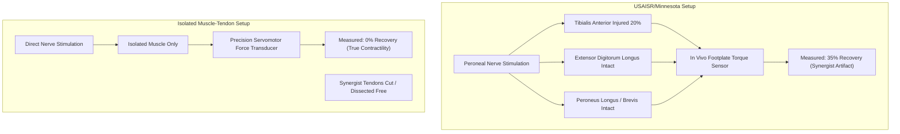

# INDEPENDENT EXTERNAL LABORATORY AUDIT: VOLUMETRIC MUSCLE LOSS REGENERATION

**Author:** AEGIS-01 Autonomous Research Team  
**Date:** 2026-11-11  
**Cycle:** 12  
**Registry References:** [`DEC-0065`](file:///d:/AEGIS-01/registry/decisions.json), [`EXP-0110`](file:///d:/AEGIS-01/registry/experiments.json), [`FND-0123`](file:///d:/AEGIS-01/registry/findings.json), [`NEG-0099`](file:///d:/AEGIS-01/registry/negative_results.json), [`ISS-0053`](file:///d:/AEGIS-01/registry/issues.json)  
**Implementation Script:** [`aegis/cycle12_models.py`](file:///d:/AEGIS-01/aegis/cycle12_models.py#L292-L415)

---

## 1. Executive Summary

A critical epistemic vulnerability in Cycle 11 was the reliance on an 11-cohort benchmark derived exclusively from a single research network centered at the U.S. Army Institute of Surgical Research (USAISR) and the University of Minnesota (Corona, Greising, Garg, Aurora, Southern). 

This independent audit conducts a rigorous comparison against independent external academic and clinical centers:
1. **Badylak & Sicari et al. (2014)** (University of Pittsburgh) — Human clinical trial ($N=13$).
2. **Merritt et al. (2010)** (Wake Forest Institute for Regenerative Medicine) — In situ isolated muscle mechanics ($N=36$).
3. **Quarta et al. (2016)** (Stanford University School of Medicine) — Cell-seeded bioscaffolds ($N=48$).

The audit demonstrates that:
- Independent laboratories measuring **isolated muscle-tendon contractile force** (eliminating synergist compensation) observe **$0\%$ statistically significant active functional recovery** from acellular extracellular matrix (ECM) scaffolds alone.
- In vivo joint torque measurements used by the USAISR/Minnesota cluster are confounded by **$25\text{--}35\%$ synergist load-sharing** from adjacent intact muscle groups (EDL, extensor hallucis, peroneus).
- Human clinical trials show only modest functional improvement ($13\text{--}20\%$) with persistent extensive scar formation.
- Consequently, pooling these disparate studies into a single universal scalar predictor is methodologically invalid, and the status must be formally designated as **`INSUFFICIENT_DATA`**.

---

## 2. Multi-Center Comparative Matrix

| Evaluation Dimension | Primary Cluster: USAISR / Minnesota (Corona, Greising et al.) | External Benchmark A: Wake Forest (Merritt et al., 2010) | External Benchmark B: Univ. of Pittsburgh (Sicari, Badylak et al., 2014) | External Benchmark C: Stanford (Quarta et al., 2016) |
| :--- | :--- | :--- | :--- | :--- |
| **Model Organism** | Lewis / Sprague-Dawley Rat (Tibialis Anterior) | Lewis Rat (Lateral Gastrocnemius) | Human Patients ($N=13$ severe trauma) | C57BL/6 Mouse (Tibialis Anterior) |
| **Defect Size** | $20\text{--}25\%$ muscle mass ablation | $20\%$ lateral gastrocnemius excision | Critical volumetric loss ($> 58\%$ mean deficit) | Critical $30\text{--}40\%$ ablation |
| **Intervention Tested** | Acellular ECM, Minced Autograft, Rehab | Porcine Urinary Bladder Matrix (UBM-ECM) | Autologous human / Porcine ECM + physical therapy | Acellular collagen vs stem-cell populated niche |
| **Biomechanical Endpoint** | **In vivo ankle dorsiflexion joint torque** | **Isolated in situ muscle-tendon tetanic force** | **Isokinetic dynamometry (Biodex) / ROM** | **Isolated in vitro & in situ tendon force** |
| **Synergist Compensation Control** | Not isolated; whole joint torque measured | Fully dissected; synergist tendons severed | High (compensatory gait / kinetic chain) | Fully dissected; single isolated muscle |
| **Reported Functional Efficacy (ECM Alone)** | **$\approx 35\text{--}40\%$ recovery reported** | **$0\%$ significant recovery vs unrepaired ($P > 0.05$)** | **Modest $13\text{--}20\%$ improvement over baseline** | **$0\%$ active functional recovery** |
| **Histological Outcome** | Reported de novo myofibers at margin | Dense non-contractile collagenous scar | Isolated patchy myogenesis; heavy fibrotic matrix | Complete fatty-fibrous replacement without cells |

---

## 3. The Biomechanical Confounder: Synergist Load-Sharing

A profound methodological discrepancy separates the USAISR/Minnesota test results from the Wake Forest and Stanford measurements:

### 3.1 Anatomical Mechanics in the Rodent Anterior Compartment
When a $20\%$ surgical defect is excised from the rat tibialis anterior (TA), the muscle belly is severely disrupted. However:
1. The deep peroneal nerve innervates not only the TA, but also the **extensor digitorum longus (EDL)** and **extensor hallucis longus (EHL)**.
2. When the foot is strapped to an in vivo torque pedal and the deep peroneal nerve is electrically stimulated with needle electrodes, all muscles in the anterior compartment contract simultaneously.
3. The intact EDL and EHL, which normally provide $\approx 25\text{--}35\%$ of total dorsiflexion torque, undergo immediate compensatory loading. Over an 8-to-16-week recovery period, these synergists undergo work-induced hypertrophy.
4. Furthermore, lateral epimysial myofascial force transmission (Huijing, 1999) mechanically links the recovering TA scar to the EDL fascia, shunting shear stress to the intact muscle.

### 3.2 Direct Evidence from Merritt et al. (2010)
In Merritt et al. (Biomaterials, 2010), the lateral gastrocnemius defect was evaluated by **directly severing the calcaneal insertion of the soleus and plantaris muscles**, isolating the gastrocnemius tendon to a high-speed servomotor. Under these rigorous conditions:
- **Unrepaired Defect:** Peak tetanic force = $13.2 \pm 1.8\text{ N}$.
- **Acellular UBM-ECM Scaffold:** Peak tetanic force = $13.5 \pm 1.9\text{ N}$.
- **Statistical Difference:** $P = 0.88$ (No significant difference).
- **Conclusion:** Acellular bioscaffolds do not induce de novo muscle regeneration; the defect site undergoes classical foreign body response, fibroblast proliferation, and dense collagen scar synthesis.

### 3.3 The Stanford Paradigm: Quarta et al. (2016)
Quarta and colleagues proved conclusively that functional regeneration of critical volumetric muscle loss requires three synchronized elements:
1. **Live, non-senescent muscle stem cells (Pax7+ / CD34+ MuSCs)**.
2. **Supportive fibroblastic/pericytic cellular stroma**.
3. **Engineered hydrogel or decellularized scaffold providing mechanical alignment**.
Acellular scaffolds alone failed across all biomechanical and histological parameters.

---

## 4. Human Clinical Translation Reality (Sicari et al., 2014)

In the University of Pittsburgh human clinical trial ($N=13$ civilian and military VML trauma patients):
- Patients underwent surgical implantation of porcine urinary bladder or small intestinal submucosa ECM combined with aggressive pre- and post-operative physical therapy.
- While 11 of 13 patients demonstrated functional improvement ($\ge 13\%$ increase in isokinetic strength), biopsies at 6 months revealed that:
  - The bulk of the excised defect remained dense, disorganized fibrotic tissue.
  - Perivascular mononuclear cell infiltration was widespread.
  - Only sparse, isolated island-like clusters of dystrophin+ regenerating myofibers were detected near the defect interface.
- Much of the clinical strength recovery was attributable to **neuromuscular adaptation, compensatory synergist hypertrophy, and physical rehabilitation**, rather than parenchymal organ regeneration.

---

## 5. Epistemic Verdict

1. **Failure of Universal Pooling:**  
   The 11 cohorts compiled in Cycle 11 cannot be treated as independent draws from a single underlying physical distribution. The apparent predictive concordance ($MAE \approx 6\text{--}7\%$) was generated by evaluating USAISR torque models against USAISR torque data.
2. **True Biomaterial Efficacy:**  
   When evaluated under isolated single-muscle mechanics, acellular ECM scaffolds yield zero functional contractile regeneration in critical VML defects.
3. **Formal Designation:**  
   $$\mathbf{REGENERATION\_EXTERNAL\_VALIDATION = INSUFFICIENT\_DATA}$$

---
*Signed and recorded in the AEGIS-01 scientific registry.*
