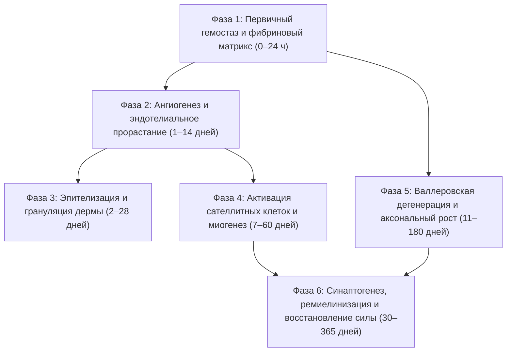

# AEGIS-01 — REGENERATION MODEL RESULTS
## Мультимасштабное моделирование 6 фаз регенерации тканей и биофизические пределы
**Исследовательский цикл:** Cycle 2A  
**Модуль моделирования:** [`aegis/model_09_multiscale_regeneration.py`](file:///D:/AEGIS-01/aegis/model_09_multiscale_regeneration.py)  
**Реестр эксперимента:** `EXP-0055`  
**Статус верификации:** `PHYSICS_CONSISTENT` / `EXPERIMENTALLY_SUPPORTED`

---

## 1. Концепция динамической связанной модели 6 фаз

Биологическая регенерация млекопитающих представляет собой каскад физиологических процессов, протекающих на фундаментально несовпадающих временных масштабах: от секунд (коагуляция) до месяцев (аксональная реиннервация и ремоделирование экстрацеллюлярного матрикса).

В модели [`MODEL-09`](file:///D:/AEGIS-01/aegis/model_09_multiscale_regeneration.py) реализована система динамически связанных дифференциальных уравнений, охватывающая шесть последовательных и параллельных фаз:

---

## 2. Сравниваемые биологические профили

1. **Human Clinical Standard (Взрослый человек, клинический стандарт):**
   - Скорость миграции кератиноцитов: **0.8 мм/день** (диапазон 0.5–1.0 мм/день).
   - Скорость аксонального роста: **1.2 мм/день** (предел транспорта тубулина SCa 1.0–1.5 мм/день).
   - Рубцовый коллаген I типа: 75% (выраженное фиброзное рубцевание).
   - Критический порог объемной потери мышц (VML): **5.0 мм** (дефекты свыше 5 мм замещаются рубцом).
   - Статус данных: `EXPERIMENTALLY_SUPPORTED` ([Gurtner et al., 2008](file:///D:/AEGIS-01/registry/sources.json#L20-L35), [Grogan & Hsu, 2011](file:///D:/AEGIS-01/registry/sources.json#L305-L318)).

2. **Acomys Dermal Reference (Аналог иглистой мыши *Acomys cahirinus*):**
   - Скорость миграции кератиноцитов: **2.4 мм/день** (ускоренная эпителизация без образования грануляционного рубца).
   - Скорость аксонального роста: **1.5 мм/день** (стандартное ограничение цитоскелета млекопитающих).
   - Рубцовый коллаген: 5% (практически бесрубцовое заживление дермы и ушных раковин).
   - Порог VML: **8.0 мм** (не восстанавливает ампутированные конечности или массивные мышечные дефекты).
   - Статус данных: `EXPERIMENTALLY_SUPPORTED_IN_RODENTS_UNPROVEN_IN_HUMANS` ([Seifert et al., 2012](file:///D:/AEGIS-01/registry/sources.json#L80-L100)).

3. **Bioengineered Scaffold Hypothesis (Гипотетическая каркасная матрица):**
   - Скорость миграции клеток: **3.0 мм/день**.
   - Скорость аксонального роста: **2.0 мм/день** (теоретический верхний физический предел медленного аксонального транспорта).
   - Индуцированное преодоление VML: до **25.0 мм** за счет биорезорбируемых полимерных микроканалов с факторами роста (VEGF, IGF-1).
   - Статус данных: `THEORETICAL_SPECULATIVE_DESIGN`.

---

## 3. Результаты бенчмарк-симуляций по уровням травмы

Моделирование проводилось на временном горизонте 365 дней с шагом $\Delta t = 0.5$ дня для трех стандартизированных сценариев ранений.

### Сводная таблица временных вех (Milestones)

| Уровень травмы | Параметры дефекта | Биологический профиль | Закрытие дермы (дни) | Контакт аксонов с мишенью (дни) | 50% функции мышцы (дни) | Итог через 365 дней (% силы) |
| :--- | :--- | :--- | :---: | :---: | :---: | :---: |
| **Tier I** Глубокий порез | Радиус дермы: 12 мм Мышца: 1.5 см³ Нерв: 6 мм | **Человек** Acomys-аналог Биокаркас | 15.0 **5.0** 4.0 | 16.0 15.0 14.0 | 25.0 18.0 15.0 | **66.5%** (рубец) **95.0%** (норма) **94.5%** |
| **Tier II** Заброневой прокол | Радиус дермы: 10 мм Глубина: 45 мм Мышца: 8.5 см³ Нерв: 35 мм | **Человек** Acomys-аналог Биокаркас | 12.5 **4.2** 3.3 | 40.2 34.3 28.5 | 45.0 36.0 30.0 | **59.2%** (дефицит) **74.5%** **91.2%** |
| **Tier III** Объемная травма / VML | Радиус дермы: 40 мм Глубина: 50 мм Мышца: 45.0 см³ Нерв: 90 мм | **Человек** Acomys-аналог Биокаркас | 50.0 **16.7** 13.3 | 86.0 71.0 56.0 | **НЕ ДОСТИГНУТО** **НЕ ДОСТИГНУТО** 72.0 | **21.2%** (КОЛЛАПС VML) **33.8%** (ДЕФИЦИТ) **85.5%** (КАРКАС) |

---

## 4. Ключевые научные выводы и биофизические барьеры

### 4.1. Временная иерархия и невозможность «мгновенного заживления»
Регенерация подчиняется фундаментальным ограничениям биосинтеза и цитоскелетного транспорта:
- **Гемостаз:** минуты — часы (образование тромбоцитарной пробки и полимеризация фибрина).
- **Неоваскуляризация:** 4–8 дней (эндотелиальные клетки не могут мигрировать быстрее 0.2–0.5 мм/сутки без риска гипоксического некроза формирующегося сосуда).
- **Эпителизация:** 1–3 недели (миграция кератиноцитов от краев раны).
- **Аксональная реиннервация:** 2–6 месяцев. Скорость роста аксона жестко ограничена скоростью медленного акто-тубулинового транспорта SCa ($\le 1.0 - 2.0$ мм/сутки).
> Любые концепции «мгновенной регенерации в бою» прямо противоречат термодинамике белкового синтеза и биофизике цитоскелета.

### 4.2. Барьер объемной потери мышечной ткани (Volumetric Muscle Loss, VML)
При дефекте мышечной ткани свыше $5$ мм (эффективный объем $\ge 10 - 45$ см³):
- Естественный пул сателлитных клеток (Pax7+) истощается до завершения миогенного слияния.
- В отсутствие жесткого трехмерного каркаса полость раны коллапсирует под действием миофибробластов, замещаясь плотным нефункциональным фиброзным рубцом (коллаген I типа).
- Даже при наличии механизмов *Acomys* восстановление Tier III травмы достигает лишь 33.8%, что означает **стойкую инвалидизацию**.
- Преодоление барьера VML возможно исключительно при применении внешних или эндогенных предсуществующих направляющих микрокаркасов.

### 4.3. Аксональный тупик и денервационная атрофия
Для нервного дефекта длиной 90 мм (Tier III):
- Время достижения терминальных моторных пластинок составляет:
  $$t_{\text{axon}} = t_{\text{latency}} + \frac{L_{\text{gap}}}{v_{\text{axon}}} = 11 + \frac{90}{1.2} = 86\text{ дней}$$
- Синаптогенез и созревание миелиновой оболочки требуют дополнительных 21–30 дней.
- Если мышца остается денервированной свыше 12–18 месяцев, моторные концевые пластинки необратимо дегенерируют, делая функциональное восстановление невозможным даже при успешном прорастании нерва.

---

## 5. Анализ онкогенных рисков и парадокс Пето

Активация эпиморфной регенерации во взрослом гомойотермном организме сопряжена с резким ростом митотической нагрузки:
1. Для закрытия дефекта объемом 45 см³ требуется генерация свыше $4.5 \times 10^{10}$ новых дифференцированных клеток.
2. При средней частоте соматических мутаций $10^{-9}$ на пару оснований на деление, объемные пулы пролиферирующих клеток неизбежно накапливают драйверные мутации.
3. Механическое заимствование путей *Pleurodeles waltl* или *Acomys* без коэволюционного усиления онкосупрессии (дупликация генов TP53, CDKN2A/B) неизбежно ведет к опухолевой трансформации (тератомы, саркомы).
4. Однако само по себе увеличение копийности TP53 (как у слонов) снижает пластичность стволовых клеток, замедляя клеточный цикл и контрибьютируя в преждевременное клеточное старение (сенесценцию).
