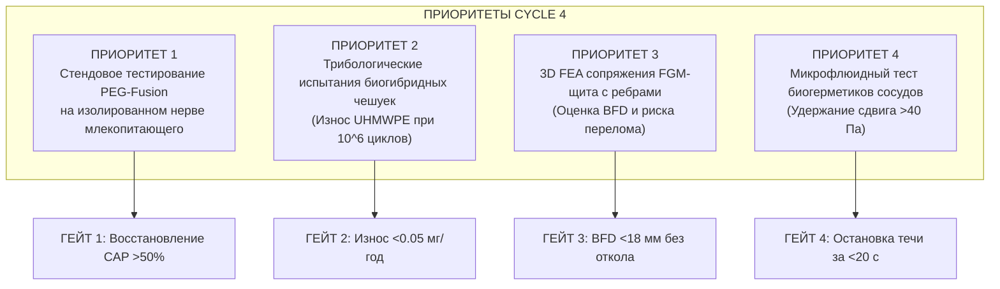

# AEGIS-01 — RESEARCH PRIORITIES FOR CYCLE 4
## Стратегические приоритеты, экспериментальные гейты и дорожная карта цикла 4

**Программа:** AEGIS-01: Biological Defense & Survivability Program  
**Планируемый исследовательский цикл:** Cycle 4 (2026–2027)  
**Рабочая директория:** `D:\AEGIS-01`  
**Сопряжённый проект:** `D:\SUBJECT-01`  
**Дата утверждения:** 9 ноября 2026 г.  

---

## 1. Стратегический вектор Cycle 4: Переход от моделей к стендовой верификации

В исследовательских циклах 1–3 программа AEGIS-01 выполнила:
- Систематический аудит и устранение физических, термодинамических и физиологических ошибок (Cycle 1A, 2A, 2B, 3).
- Ликвидацию всех межрепозиторных коллизий ID с SUBJECT-01 (0 коллизий).
- Разделение защитных архитектур на 3 строгие изолированные категории (`ARCH-BIO`, `ARCH-HYBRID`, `ARCH-SPEC`).
- Разработку 8-осевой модели функциональной регенерации и выявление приоритета сохранения жизнеспособности тканей (PEG-fusion).
- Согласование теплового и механического баланса бега в протоколе CPE45.

**Главная цель Cycle 4:** Отказ от дальнейшего накопления сугубо теоретических уравнений в пользу **стендовой экспериментальной валидации критических узлов на биологических и физических суррогатах**.

---

## 2. Ключевые исследовательские приоритеты Cycle 4

---

### Приоритет 1 (P0): Стендовое тестирование протокола мембранного сохранения (PEG-Fusion)
- **Объект исследования:** Препарат изолированного седалищного нерва и камбаловидной мышцы грызуна (*Rattus norvegicus*) *ex vivo*.
- **Экспериментальная методика:** Полная поперечная нейротомия, 15-минутная экспозиция в бесклеточной среде, отмывание гипотоническим раствором ЭДТА (хелатирование Ca²⁺), нанесение гидрофильного раствора PEG (мол. масса 3350 Да, 50% масс./об.) с метиленовым синим (1 мМ) на 2–3 минуты, физиологическое отмывание.
- **Измерительные эндпоинты:**
  1. Регистрация вызванных сложных потенциалов действия (CAP) дистальнее шва через 1, 6, 24 и 48 часов.
  2. Миографическая регистрация силы тетанического сокращения мышцы при раздражении нерва проксимальнее зоны анастомоза.
- **Критерий успешности (Go / No-Go Gate 1):**  
  - `GO:` Восстановление амплитуды CAP $\ge 50\%$ от исходного уровня интактного нерва в первые 24 часа.  
  - `NO-GO:` Падение CAP ниже 15% и развитие необратимого лизиса аксоплазмы.

---

### Приоритет 2 (P0): Трибологические и усталостные испытания биогибридных чешуек (ARCH-HYBRID)
- **Объект исследования:** Лабораторный прототип субдермального модуля: пятиугольные микроплитки из карбида бора (B₄C), закрепленные на перфорированной подложке из ориентированного UHMWPE (GUR 1020).
- **Экспериментальная методика:** Испытание на возвратно-поступательном трибометре типа «палец-плоскость» в среде симулированной интерстициальной жидкости (сыворотка крови с белком 30 г/л при 37 °C) при сдвиговой нагрузке $1.5$ МПа на протяжении $10^6$ циклов (эквивалент 1 года активной локомоции).
- **Измерительные эндпоинты:**
  1. Массовый гравиметрический износ полиэтилена и керамики.
  2. Распределение размеров образующихся частиц износа (лазерная дифракция и сканирующая электронная микроскопия SEM).
  3. Цитотоксичность смывов на культуре макрофагов человека (выброс цитокинов TNF-$\alpha$, IL-1$\beta$).
- **Критерий успешности (Go / No-Go Gate 2):**  
  - `GO:` Скорость износа $<0.05$ мг на $10^6$ циклов; отсутствие цитотоксической воспалительной активации макрофагов.  
  - `NO-GO:` Генерация субмикронных частиц износа $>0.5$ мг с индукцией апоптоза клеток (закрытие концепции сплошной субдермальной биогибридной брони).

---

### Приоритет 3 (P1): Трехмерное FEA-моделирование сопряжения FGM-щита с реберным каркасом
- **Объект исследования:** 3D конечно-элементная модель (FEA) торакального отдела скелета человека (грудина, реберные хрящи, ребра T1–T10) с наложенным селективным FGM-щитом толщиной 4.5 мм.
- **Граничные условия:** Калиброванные нелинейные упругопластические карты материалов (модели Джонсона-Кука для кости и FGM-градиента), динамический удар бойком 9×19 мм (масса 8.0 г, скорость 360 м/с, энергия 500 Дж).
- **Измерительные эндпоинты:**
  1. Динамический прогиб грудины ($BFD$, мм) и пиковое контактное давление на перикард.
  2. Максимальные главные напряжения растяжения на внутренней поверхности реберных дуг.
  3. Локализация волнового откола.
- **Критерий успешности (Go / No-Go Gate 3):**  
  - `GO:` $BFD \le 16.0$ мм, $VC \le 0.35$ м/с, напряжения в ребрах ниже предела статического разрушения кости ($<110$ МПа).  
  - `NO-GO:` Разрушение реберных хрящей и прогиб $>25$ мм (требование увеличения массы каркаса).

---

### Приоритет 4 (P1): Микрофлюидная проверка сдвиговой стойкости сосудистых биогерметиков
- **Объект исследования:** Микрофлюидная модель пульсирующего потока артериальной крови в эластичной трубке диаметром 2.5 мм (суррогат лучевой артерии) с боковым линейным перфорационным дефектом 1.5 мм.
- **Экспериментальная методика:** Подача гепаринизированной крови при пульсирующем давлении 120/80 мм рт.ст. и пиковом напряжении сдвига $\tau_{\text{wall}} \ge 40$ Па; аппликация локального фотоактивируемого композитного герметика (PEG-катехол / тромбин-фибриноген).
- **Измерительные эндпоинты:**
  1. Время до полной остановки истечения крови (время гемостаза, с).
  2. Давление разрыва сформированного сгустка (burst pressure, мм рт.ст.).
  3. Отсутствие эмболизации смытыми фрагментами герметика в дистальном русле.
- **Критерий успешности (Go / No-Go Gate 4):**  
  - `GO:` Остановка кровотечения за $t \le 20$ с; прочность адгезии свыше $250$ мм рт.ст. при пристенном сдвиге 45 Па.  
  - `NO-GO:` Смывание полимерного тромба потоком при давлении ниже 140 мм рт.ст.

---

### Приоритет 5 (P2): Прямая интеграция в исследовательский контур SUBJECT-01
- Перенос программных модулей `MODEL-12`, `MODEL-13`, `MODEL-14` в изолированный каталог `D:\SUBJECT-01\research\aegis_survivability\`.
- Подключение проверочных скриптов к постоянному гейту происхождения данных `SUBJECT-01/tools/verify_data_provenance.py`.
- Обеспечение совместимости со строгими проверками `tools/validate_repository.py`.

---

## 3. Таблица исследовательского расписания Cycle 4

| Задача | Содержание | Ответственный инструмент | Ожидаемый артефакт |
| :--- | :--- | :---: | :--- |
| **TSK-4-01** | *Ex vivo* протокол мембранного слияния нерва (PEG) | Лабораторный протокол | `BENCH_PEG_FUSION_REPORT.md` |
| **TSK-4-02** | Трибология микрокерамических чешуек в биосреде | Трибометр ASTM G99 | `UHMWPE_WEAR_DEBRIS_AUDIT.md` |
| **TSK-4-03** | 3D FEA сопряжения FGM-щита с грудиной | ANSYS / OpenFOAM FEA | `FGM_THORAX_FEA_EXPLORATORY.md` |
| **TSK-4-04** | Гидродинамический гемостаз при высоком сдвиге | Микрофлюидный стенд | `HIGH_SHEAR_HEMOSTASIS.md` |
| **TSK-4-05** | Синхронизация реестров и перенос в SUBJECT-01 | Git branch / PR | `SUBJECT01_INTEGRATION_PR.md` |
