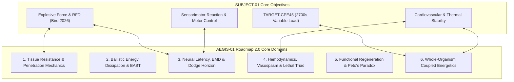

# SUBJECT-01 × AEGIS-01 — STRATEGIC ROADMAP 2.0
## Long-Term Research Strategy: Biological Defense & Human Survivability System

**Program:** AEGIS-01 (Integrated Biological Defense Direction of SUBJECT-01)  
**Parent Repository:** `G1F12/SUBJECT-01` | **Local Directory:** `D:\AEGIS-01`  
**Date of Ratification:** 2026-11-12  
**Cycle:** 13 (Strategic Realignment and Scientific Baseline)  
**Canonical Status:** Approved Strategic Roadmap (Supersedes Cycle 1 Preliminary Plan)  
**Related Registries:** [`DEC-0069`](file:///d:/AEGIS-01/registry/decisions.json), [`DEC-0074`](file:///d:/AEGIS-01/registry/decisions.json), [`MOD-0015`](file:///d:/AEGIS-01/registry/models.json)

---

## 1. Executive Summary & Strategic Imperative

Between Research Cycles 8 and 12, AEGIS-01 achieved deep forensic rigor, successfully dismantling multiple instances of circular reasoning, synthetic data generation, and over-fitted constitutive parameters in specialized biological sub-disciplines. Specifically, the program subjected keratin glass transition dynamics ($T_g$) and rodent Volumetric Muscle Loss (VML) priors to exhaustive empirical scrutiny.

However, this micro-architectural focus produced an unintentional **thematic capture**: the research program drifted into specialized polymer physics and single-muscle rodent pharmacology, effectively abandoning the project's original, comprehensive mandate. Crucial foundational vectors—such as acute traumatic hemodynamics, non-penetrating ballistic injury biomechanics (Behind-Armor Blunt Trauma), neural conduction and motor reaction horizons, and whole-organism metabolic-thermal survivability—remained largely static since Cycle 1.

**Strategic Roadmap 2.0** executes an uncompromising realignment:
1. **Mission Re-Elevation:** AEGIS-01 returns to its foundational mission of engineering and evaluating human biological survivability across mechanical, ballistic, traumatic, and physiological vectors without external powered armor or exoskeletons.
2. **Whole-Organism Architecture:** Replaces isolated heuristic models with a unified contract of nine interdependent physiological and biomechanical subsystems.
3. **Rigorous Epistemic Boundaries:** Enforces strict demarcation between software code execution, simulated exploratory scenarios, and authentic empirical out-of-sample validation.
4. **Targeted Research Velocity:** Focuses active research on high-information-value neglected domains while transitioning verified micro-mechanical models to maintenance.

---

## 2. Research Horizons (Cycles 13 – 24)

### Horizon 1: Multi-Scale Biological Tissue Protection (Cycles 13–15)
- **Primary Focus:** Stratified integumentary composite mechanics, cut, puncture, and shear dissipation.
- **Physical Boundaries:** Dermal collagen triple-helix tensile strength ($50\text{--}100\text{ MPa}$), keratin intermediate filament $\alpha\text{--}\beta$ phase transition ($18\text{--}22\text{ GPa}$ crystalline limits), Gibson-Ashby cellular solid mechanics.
- **Milestones:**
  - Complete multi-layer shear stress transfer model linking epidermis, stratum compactum dermis, and subcutaneous fascia.
  - Formulate non-linear blade slice resistance incorporating lateral draw kinematics (distinguishing guillotine wedging from razor slicing).
  - Quantitative boundary assessment of biohybrid dermal mineralization (osteoderm vs dermal plate mechanics).

### Horizon 2: Traumatic Hemodynamics, Coagulopathy & Vascular Resilience (Cycles 14–17)
- **Primary Focus:** Circulatory collapse prevention, dynamic arterial vasospasm, local hemostatic shear stability, and lethal triad mitigation.
- **Physical Boundaries:** Mean arterial pressure maintenance ($MAP > 50\text{ mmHg}$ cerebral perfusion floor), critical clot dislodgement wall shear stress ($\tau_{\text{crit}} \in [15, 35]\text{ Pa}$), cardiac output reserve limit ($CO_{\max} \approx 20\text{--}22\text{ L/min}$).
- **Milestones:**
  - Multi-compartment closed-loop lumped vascular model coupling cardiac preload, venous return collapse, and baroreflex compensation under massive hemorrhage.
  - Fluid-structure interaction model of arterial transection: active circular smooth muscle constriction vs hydrodynamic wall shear dislodgement.
  - Thermal-acidotic-coagulopathic degradation model (the trauma lethal triad) governing enzyme kinetics of thrombin generation during hypothermia.

### Horizon 3: Ballistic Injury Biomechanics & Sensorimotor Reaction Limits (Cycles 15–19)
- **Primary Focus:** Non-penetrating thoracic deflection, acoustic impedance wave dispersion, and biophysical evasion horizons.
- **Physical Boundaries:** Hursh conduction limit ($v_{\text{nerve}} \le 120\text{ m/s}$), electromechanical delay ($EMD \ge 30\text{--}55\text{ ms}$), Viscous Criterion safety threshold ($VC_{\max} < 0.6\text{ m/s}$, Backface Deformation $BFD < 44\text{ mm}$).
- **Milestones:**
  - Viscoelastic acoustic impedance mismatching engine simulating compressive stress wave reflection across layered bio-interfaces.
  - Thoracic dynamic response model coupling ribcage compliance, fluid-filled viscera, and myocardial contusion risk.
  - Biophysical Dodge Horizon model resolving sensory transduction, central synaptic delay, efferent conduction, and musculoskeletal activation dynamics against supersonic and subsonic projectile kinematics.

### Horizon 4: Whole-Organism Integration & TARGET-CPE45 (Cycles 18–24)
- **Primary Focus:** Systemic thermodynamic coupling, heat storage, cardiovascular drift, and multi-system endurance under variable combat workloads.
- **Physical Boundaries:** Maximum cutaneous blood flow cap ($2.5\text{ L/min}$), lumped heat capacity ($C_{\text{th}} = 270,450\text{ J/K}$ for $75\text{ kg} + 6.8\text{ kg}$), core temperature physiological limit ($T_{\text{core}} < 40.0^\circ\text{C}$).
- **Milestones:**
  - Full implementation of the 9-subsystem interdependent contract (`MOD-0015`).
  - Simulation of TARGET-CPE45 as a 2700-second variable duty-cycle protocol (intermittent explosive bursts vs short recovery) rather than constant-velocity locomotion.
  - Multi-factorial fatigue and tissue recovery engine cross-referenced against SUBJECT-01 in vivo muscle force data (Bird et al. 2026).

---

## 3. Decision Gates & Governance Rules

To ensure scientific honesty and prevent methodological drift, all future research cycles must strictly adhere to the following governance rules:

1. **The Evidence Gate Standard (No Test-as-Validation Fallacy):**
   A passing software unit test or integration script asserts only syntactic correctness, numerical stability, and implementation consistency. It does **NOT** constitute scientific empirical validation. Scientific validation requires evaluation against independent, out-of-sample, experimentally measured data from published literature or verified data repositories.
2. **Anti-Conflation Rule:**
   No theoretical or numerical model may assert biological feasibility, clinical efficacy, or physical survivability without documented experimental proof. Models must explicitly carry one of the canonical statuses:
   - `EXTERNALLY_VALIDATED`
   - `PARTIALLY_VALIDATED`
   - `NOT_EXTERNALLY_VALIDATED`
   - `MODEL_ASSUMPTION`
3. **Decoupled State Representation (No Monolithic Index):**
   The program strictly forbids collapsing multi-dimensional physiological states into an artificial scalar "survival index" (e.g., $S = 0.88$). Survivability must be represented as a vector of decoupled physical state variables ($T_{\text{core}}$, $MAP$, $\text{Blood Loss}$, $VC_{\max}$, etc.) with individual failure thresholds.
4. **Maintenance Transition Protocol:**
   When a research track reaches empirical closure or a state of `INSUFFICIENT_DATA` where no further published data exists, it must be formally transitioned to `MAINTENANCE` status rather than absorbing active research cycles. Active research is restricted to a maximum of two prioritized hypotheses per cycle.

---

## 4. Cycle 13–16 Master Schedule

| Cycle | Primary Theme | Priority Hypotheses | Primary Deliverables | Status |
| :---: | :--- | :--- | :--- | :---: |
| **Cycle 13** | **Strategic Realignment & Scientific Baseline** | Systemic Realignment & Epistemic Audit | `ROADMAP_2_0.md`, `ORIGINAL_MISSION_TRACEABILITY.md`, `SCIENTIFIC_DEBT_REGISTER.md`, `WHOLE_ORGANISM_MODEL_CONTRACT.md` | **ACTIVE** |
| **Cycle 14** | **Traumatic Hemodynamics & Acoustic Impedance** | `HYP-0051` (Vasospasm Shear Limits), `HYP-0052` (Multilayer Acoustic Dispersion) | Coupled Arterial Spasm Model, Acoustic Wave Dissipation Suite, `CYCLE_14_REPORT.md` | Scheduled |
| **Cycle 15** | **Ballistic BABT & Sensorimotor EMD** | Viscous Criterion Thoracic Mechanics, Premotor Latency & Dynamic Evasion | Viscoelastic Thorax Simulator, Sensorimotor Loop Engine, `CYCLE_15_REPORT.md` | Planned |
| **Cycle 16** | **Whole-Organism TARGET-CPE45 Integration** | Dynamic Workload Thermal Coupling, Cutaneous-Muscular Perfusion Tradeoff | 2700s Variable Load Engine, SUBJECT-01 Biomechanical Cross-Validation | Planned |

---

## 5. Traceability and Cross-Repository Synchronization

- **Parent Project:** SUBJECT-01 (`D:\SUBJECT-01`, `G1F12/SUBJECT-01`)
- **Integration Target:** Pull Request #9 (`https://github.com/G1F12/SUBJECT-01/pull/9`)
- **Disjoint Registry Invariant:** AEGIS-01 maintains strict numerical separation from SUBJECT-01 registries:
  - `EXP-0055+` (SUBJECT-01 max: `EXP-0045`)
  - `FND-0055+` (SUBJECT-01 max: `FND-0045`)
  - `NEG-0048+` (SUBJECT-01 max: `NEG-0039`)
  - `SRC-0086+` (SUBJECT-01 max: `SRC-0076`)
  - `DEC-0024+` (SUBJECT-01 max: `DEC-0020`)
  - `ISS-0025+` (SUBJECT-01 max: `ISS-0020`)
  - `HYP-0009+` (SUBJECT-01 max: `HYP-0008`)
- **Automerge Guard:** In strict adherence to project directives, no automatic merge into `main` will ever be executed. PR #9 remains open for upstream review.
