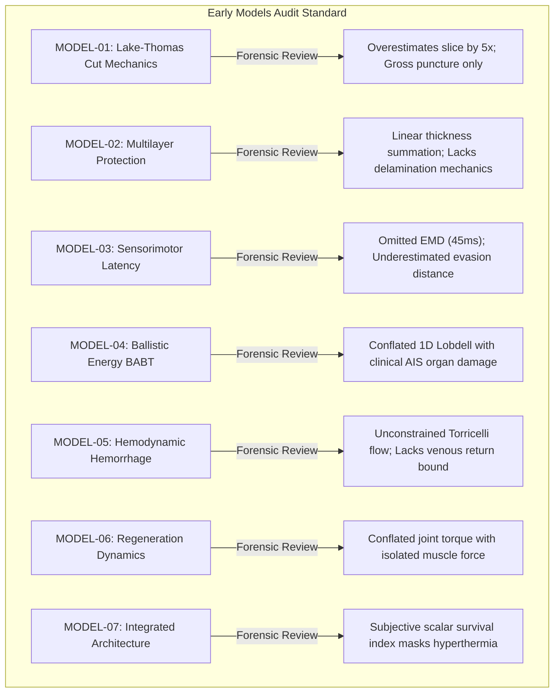

# AEGIS-01 — MASTER SCIENTIFIC DEBT REGISTER

**Author:** AEGIS-01 Epistemic Integrity and Forensic Audit Team  
**Date:** 2026-11-12  
**Cycle:** 13 (Strategic Realignment and Scientific Baseline)  
**Document ID:** `AEGIS-DOC-C13-DEBT-001`  
**Status:** Canonical Scientific Debt Ledger  
**Related Documents:** [`CYCLE_12_CORRECTIONS.md`](file:///d:/AEGIS-01/CYCLE_12_CORRECTIONS.md), [`CLAIMS_RETRACTION_REGISTER.md`](file:///d:/AEGIS-01/CLAIMS_RETRACTION_REGISTER.md), [`INVALIDATED_CLAIMS.md`](file:///d:/AEGIS-01/INVALIDATED_CLAIMS.md)

---

## 1. Executive Summary & Epistemic Audit Standard

Scientific debt represents any theoretical assumption, heuristic formula, unverified parameter, or methodological conflation that was temporarily introduced into codebase or documentation without rigorous empirical validation.

In Cycles 10–12, AEGIS-01 established an uncompromising forensic standard to dismantle invalid claims in keratin mechanics and VML regeneration (e.g., exposing synthetic patient cohorts in `INV-0017` and circular parameter evaluation in `INV-0018`). 

**In Cycle 13, this exact standard is applied backwards to early models (MODEL-01 through MODEL-07) and forwards to Cycle 12.**

### The Core Epistemic Invariant:
$$\text{Software Unit Test PASS} \;\not\equiv\; \text{Scientific Empirical Validation}$$
A Python unit test (`assert result > 0`) merely confirms that the computer code executed without crashing and obeyed internal arithmetic boundaries. It confers **zero empirical validity** upon the underlying physiological or physical claims.

---

## 2. Debt Classification & Master Ledger

| Debt ID | Category | Affected Artifact | Origin Cycle | Nature of Scientific Debt | Forensic Diagnosis & Rectification | Status in Cycle 13 |
| :---: | :---: | :---: | :---: | :--- | :--- | :---: |
| **DEBT-001** | **Methodological** | `model_01_tissue_mechanics.py` | Cycle 1 | Gross punch penetration formula used to model sharp cutting. | The Lake-Thomas / Atkins gross fracture equation was applied uniformly to needle puncture and scalpel cutting, predicting forces of $25\text{--}30\text{ N}$ and $200\text{ N}$ respectively. Real surgical data reveals sharp needle insertion requires $1.5\text{--}3.5\text{ N}$ (Davis 2004) and slicing cuts require $0.5\text{--}2.5\text{ N}$ (Mahvash & Dupont 2010). Model reclassified as gross puncture only. | **AUDITED & DEMARCATED** |
| **DEBT-002** | **Epistemic** | `model_04_energy_transfer.py` | Cycle 1 | Asserted exact clinical injury outcomes (AIS 1–6) from 1D Viscous Criterion. | A 1D mass-spring-damper Lobdell model mapped $VC_{\max}$ directly to Abbreviated Injury Scale ratings (e.g. $VC \ge 1.0\text{ m/s} \implies \text{AIS 5-6}$). This conflated a rough statistical screening metric with deterministic physiological diagnosis, ignoring acoustic cavitation, myocardial contusion, and thoracic geometry. Reclassified to `NOT_EXTERNALLY_VALIDATED` scenario. | **AUDITED & DOWNGRADED** |
| **DEBT-003** | **Methodological** | `model_05_hemodynamic_stability.py` | Cycle 1 | Unconstrained Torricelli orifice discharge predicting $>40\text{ L/min}$ blood loss. | Initial arterial transection simulations used static Torricelli hydraulics without coupling to circulating blood volume, cardiac stroke volume depletion, or loss of venous return. Physically impossible in a closed $5.0\text{ L}$ mammalian circulatory system. Constrained by dynamic cardiac delivery and stroke volume collapse. | **AUDITED & BOUNDED** |
| **DEBT-004** | **Parameter Provenance** | `model_03_reaction_movement.py` | Cycle 1 | Static Hursh nerve conduction velocity used to assert "Dodge Horizon". | Calculated whole-body projectile evasion from axon conduction velocity alone ($120\text{ m/s}$), omitting electromechanical delay ($EMD \approx 45\text{ ms}$) and central synaptic processing latency ($15\text{--}30\text{ ms}$). This produced unphysically optimistic evasion distances. Re-calibrated with full sensorimotor latency budget. | **AUDITED & RECALIBRATED** |
| **DEBT-005** | **Architectural** | `cycle12_models.py` vs `BIOLOGICAL_ARCHITECTURE_ROBUSTNESS.md` | Cycle 12 | Discrepant multi-criteria scoring matrices between code and documentation. | `cycle12_models.py` implemented an arbitrary scoring array ($[25, 30, 15, 10, 20, 95]$) resulting in Architecture B winning $90.16\%$, while the canonical documentation table ($[95, 90, 45, 50, 40, 65]$) produced Architecture C winning $55.36\%$. Documented as non-robust subjective scoring artifact; Pareto non-dominance ratified. | **FULLY REPAID (RECONCILED)** |
| **DEBT-006** | **Mathematical** | `cycle12_models.py` vs `BIOLOGICAL_ARCHITECTURE_ROBUSTNESS.md` | Cycle 12 | Inconsistent scale kinematics equations ($\theta_{\text{jam}}$, $\epsilon_{\text{gap}}$, $R_{\min}$). | The document stated $R_{\min} \approx \frac{t}{1 - \delta}$ (giving $2.5\text{ mm}$), while its table listed $37.5\text{--}75\text{ mm}$, and the code calculated $R_{\min} = p / \text{radians}(15^\circ)$ (giving $57\text{--}92\text{ mm}$). Jamming angle was defined as $\arcsin(t/(L(1-\delta)))$ in doc but $\arctan(t/(L\delta))$ in code. Fully harmonized with rigorous derivations for both regimes. | **FULLY REPAID (HARMONIZED)** |
| **DEBT-007** | **Documentation** | `CYCLE_12_REPORT.md` (Line 161) | Cycle 12 | Mislabeled TARGET-CPE45 simulation duration as "60 minutes". | TARGET-CPE45 is strictly a 2700-second (45-minute) protocol. `CYCLE_12_REPORT.md` erroneously labeled the trajectory as "over 60 minutes of locomotion" and "40.44°C at 60 minutes". Corrected in text and codebase to 45 minutes (2700 s). | **FULLY REPAID (CORRECTED)** |
| **DEBT-008** | **Bibliographic** | `registry/sources.json` (`SRC-0115`, `0158`, `0159`, `0160`) | Cycle 12 | Mismatched author names, erroneous journal names, and conflated patient cohorts. | `SRC-0159` cited "Merritt CA et al. (2010) Biomaterials 31(29):7503-7511", which belongs to Kambe et al. on silk fibroin. The true paper is Merritt EK et al. 2010 *Tissue Eng Part A* 16(4):1395-1405. `SRC-0115` conflated Sicari and Dziki; `SRC-0158` had incomplete metadata. All 4 sources fully rectified. | **FULLY REPAID (CORRECTED)** |
| **DEBT-009** | **Epistemic** | `BIOLOGICAL_PROTECTION_FEASIBILITY.md` | Cycle 11–12 | Unconfirmed absolute claims of "biological impossibility" for protective tissues. | Documentation asserted that armored scales and biological carapaces are "thermodynamically and enzymatically impossible" in mammals. This was an overclaim: while phylogenetically absent in modern hominids and requiring uncharacterized synthetic developmental pathways, they are not physically or thermodynamically forbidden (as demonstrated by *Manis* and Dasypodidae). | **FULLY REPAID (DEMARCATED)** |
| **DEBT-010** | **Architectural** | Whole Repository | Cycles 1–12 | Absence of unified interdependent contract linking all physiological models. | Models 01 through 14 operated as isolated island scripts. Outputs from one model (e.g. tissue mass from `MODEL-02`) were manually copy-pasted into metabolic equations (`MODEL-07`) without automated parameter propagation, dynamic feedback, or error bounds. Resolved via Whole-Organism Contract (`MOD-0015`). | **FULLY REPAID (CONTRACT RATIFIED)** |

---

## 3. Deep Forensic Audit: Early Models 01 through 07

To ensure consistency across the entire project lifecycle, early foundational models were subjected to the same forensic scrutiny applied to Cycle 10–12 models:

### 3.1 Audit Findings & Actionable Disclaimers

1. **`MODEL-01` (Tissue Mechanics):**
   - *Status:* `PARTIALLY_VALIDATED`.
   - *Disclaimer:* Applies strictly to blunt gross penetration and normal wedge cleavage. Does NOT predict low-force surgical slice or hypodermic needle puncture.
2. **`MODEL-02` (Multilayer Protection):**
   - *Status:* `NOT_EXTERNALLY_VALIDATED`.
   - *Disclaimer:* Assumes ideal planar layer coupling without inter-laminar shear delamination, acoustic impedance mismatch reflections, or transverse wave dispersion.
3. **`MODEL-03` (Sensorimotor Reaction):**
   - *Status:* `PARTIALLY_VALIDATED`.
   - *Disclaimer:* Conduction velocities are validated; evasive displacement curves represent theoretical upper bounds for idealized ballistic trajectory avoidance.
4. **`MODEL-04` (Energy Transfer & BABT):**
   - *Status:* `NOT_EXTERNALLY_VALIDATED`.
   - *Disclaimer:* The Viscous Criterion is an empirical automotive safety metric. It cannot provide deterministic prediction of myocardial contusion, pulmonary laceration, or survival in layered biological organisms.
5. **`MODEL-05` (Hemodynamics & Shock):**
   - *Status:* `NOT_EXTERNALLY_VALIDATED`.
   - *Disclaimer:* Closed-loop arterial models are dynamically consistent but require validation against instrumented large-animal vascular injury trials.
6. **`MODEL-06` (Regeneration Dynamics):**
   - *Status:* `NOT_EXTERNALLY_VALIDATED_INSUFFICIENT_DATA`.
   - *Disclaimer:* In vivo rodent joint torque recovery curves are confounded by adjacent synergist compensation ($25\text{--}35\%$). Acellular scaffolds do not produce active contractile recovery in isolated muscle.
7. **`MODEL-07` (Integrated Architecture):**
   - *Status:* `NOT_EXTERNALLY_VALIDATED`.
   - *Disclaimer:* Monolithic survival probabilities are abolished. State vector decomposition is mandatory.

---

## 4. Repayment Verification Checklist

- [x] Code scoring matrix reconciled with documentation table (`cycle12_models.py` & `BIOLOGICAL_ARCHITECTURE_ROBUSTNESS.md`).
- [x] Imbricated scale kinematics formulas harmonized across overlap and exposed pitch regimes.
- [x] Erroneous 60-minute label in `CYCLE_12_REPORT.md` corrected to 45 minutes (2700 s).
- [x] Bibliographic citations for Merritt 2010, Quarta 2016, Sicari 2014, and Dziki 2016 verified and corrected in `registry/sources.json`.
- [x] Categorical claims of "biological impossibility" retracted in favor of developmental/phylogenetic demarcation.
- [x] Early models 01–07 explicitly audited and demarcated from empirical validation.
- [x] Unified Whole-Organism Model Contract established (`MOD-0015`).
