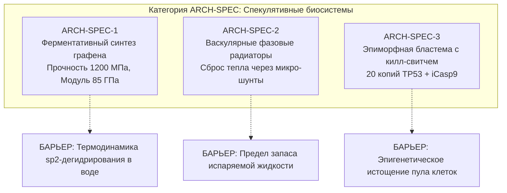

# AEGIS-01 — ARCH-SPEC: SPECULATIVE BIOLOGICAL ARCHITECTURES
## Спекулятивные биологические системы: гипотезы принципиально новых механизмов биоминерализации, синтеза и физиологии

**Программа:** AEGIS-01: Biological Defense & Survivability Program (Cycle 3)  
**Статус:** Теоретический поисковый документ категории `ARCH-SPEC`  
**Рабочая директория:** `D:\AEGIS-01`  
**Сопряжённый проект:** `D:\SUBJECT-01`  
**Дата:** 9 ноября 2026 г.  
**Уровень зрелости технологий (TRL):** `TRL 1–2 (Базовые научные принципы / Концептуальная формулировка)`  
**Научный статус:** `NOT EXTERNALLY VALIDATED / SPECULATIVE`  

---

## 1. Назначение и методологические рамки категории ARCH-SPEC

Категория **`ARCH-SPEC`** предназначена для формулирования, строгой физической проверки и отсева **радикальных биоинженерных гипотез, требующих принципиально новых механизмов биосинтеза, биоминерализации или системной физиологической реорганизации**, не встречающихся в известной филогении млекопитающих.

### Исследовательские правила:
1. **Изоляция от реализуемых решений:** Запрещено смешивать спекулятивные концепции с эндогенными (`ARCH-BIO`) или биогибридными (`ARCH-HYBRID`) моделями при оценке текущей осуществимости проекта.
2. **Проверка термодинамикой и квантовой биохимией:** Любая спекулятивная идея проверяется законами сохранения энергии, кинетикой ферментативных реакций и клеточной токсичностью.
3. **Безопасность исследований:** Категорический отказ от разработки прикладных протоколов или инструкций для самостоятельного генетического редактирования. Документ носит исключительно фундаментально-теоретический характер.

---

## 2. Исследуемые спекулятивные концепции

---

### 2.1. ARCH-SPEC-1 — Эндогенный ферментативный биосинтез ковалентных sp²-углеродных нанокомпозитов (Графен-Белок)

#### Концепция:
Гипотетическое встраивание в геном рибосомальных или нерибосомальных пептид-синтетазных (NRPS) комплексов, способных катализировать дегидрирование алифатических углеводородных цепей и формировать ориентированные двумерные листы графена или наноленты, ковалентно сшитые с коллагеновым матриксом.

#### Расчетные теоретические свойства (MODEL-12):
- Плотность композита: $\rho \approx 1650$ кг/м³.
- Модуль Юнга во влажном состоянии: $E \approx 85.0$ ГПа.
- Предел прочности на растяжение: $\sigma_u \approx 1200.0$ МПа.
- Вязкость разрушения: $G_c \approx 45.0$ кДж/м².
- Сопротивление проколу: $F_p \approx 750$ Н при толщине всего $2.5$ мм.
- Теоретическая баллистическая стойкость: Способность остановить высокоскоростной осколок со скоростью $V_{50} \approx 650$ м/с при поверхностной плотности всего $4.1$ кг/м².

#### Фундаментальные физико-химические барьеры:
1. **Термодинамический барьер ароматизации в водной среде:**  
   Синтез графена из простых углеводородов (например, метана или жирных кислот) требует разрыва связей C–H ($413$ кДж/моль) и формирования сопряженных связей C=C в плоской геометрии. В живой клетке реакция протекает в водной фазе ($[H_2O] \approx 55.5$ М), где окислительно-восстановительный потенциал жестко ограничен окном электролиза воды ($-0.82\dots +0.82$ В относительно стандартного водородного электрода). Прямое дегидрирование до чистого графена в этих условиях термодинамически запрещено: окислители достаточной силы вызывают мгновенный лизис клеточных органелл.
2. **Мембранная цитотоксичность (Механический нано-нож):**  
   Свободные графеновые чешуйки субмикронного размера с атомарно острой кромкой физически прорезают липидные бислои плазматических мембран, митохондрий и лизосом, запуская некроптоз и высвобождение цитохрома *c*. Организм не обладает механизмом безопасного внутриклеточного транспорта свободных sp²-углеродных плоскостей.

**Статус:** `ФУНДАМЕНТАЛЬНО ЗАБЛОКИРОВАНО БИОХИМИЕЙ (NO-GO В ТЕКУЩЕЙ ПАРАДИГМЕ)`.

---

### 2.2. ARCH-SPEC-2 — Активные эндогенные фазовые радиаторы и васкулярные конвективные тепловые трубы

#### Концепция:
Формирование глубоких артериовенозных анастомозов с повышенной пропускной способностью (до $3.5$ л/мин), соединенных с подкожными сосудистыми синусами, содержащими интерстициальные микропузырьки с термообратимыми фазовыми гидрогелями (например, на основе модифицированного эластиноподобного полипептида ELP), поглощающими скрытую теплоту фазового перехода при $T \ge 38.5\ ^\circ\text{C}$.

#### Расчетные теоретические свойства (MODEL-14):
- Поглощение пикового импульса тепла: До $+450$ кДж тепловой энергии без повышения температуры ядра выше 38.5 °C.
- Сглаживание 300-секундных спринтерских пиков нагрузки в протоколе CPE45.

#### Фундаментальные физиологические барьеры:
1. **Предел скрытой теплоты фазового перехода воды:**  
   Эндогенный фазовый переход белков и липидов обладает удельной теплотой всего $15\dots 45$ кДж/кг (в отличие от испарения воды, дающего $2430$ кДж/кг). Чтобы поглотить метаболическое тепло 45-минутного боя ($2.5$ МДж), организму потребовалось бы носить в себе более **$55$ кг фазового вещества**, что абсурдно с точки зрения биомеханики.
2. **Гемодинамический коллапс:**  
   Сброс крови в подкожные сосудистые синусы со скоростью $>3$ л/мин при максимальной мышечной нагрузке вызывает перераспределительный шок: давление в аорте падает ниже 50 мм рт.ст., лишая перфузии работающие мышцы бедра и головной мозг (гиповолемический коллапс центрального кровообращения).

**Статус:** `ФИЗИОЛОГИЧЕСКИЙ ТУПИК ДЛЯ ДЛИТЕЛЬНЫХ НАГРУЗОК (CPE45)`.

---

### 2.3. ARCH-SPEC-3 — Индуцированная эпиморфная бластема млекопитающих с синтетическим супрессорным контуром (Peto-Stabilized Epimorphic Blastema)

#### Концепция:
Создание условий для истинной эпиморфной регенерации конечностей и объемных дефектов мышц (по типу аксолотля *Ambystoma mexicanum*) во взрослом организме млекопитающего. Концепция объединяет:
1. Временную локальную дедифференциацию миоцитов и фибробластов в мультипотентные клетки бластемы.
2. Экспансию противоопухолевых механизмов (по образцу африканского слона *Loxodonta africana* — 20 копий гена *TP53* и ретроген *LIF6*).
3. Синтетический генетический контур экстренного апоптоза (индуцибельный килл-свитч на базе каспазы-9 — iCasp9), активируемый низкомолекулярным химическим индуктором димеризации при обнаружении хромосомных аберраций.

#### Расчетные теоретические показатели (MODEL-13):
- Закрытие объемного мышечного дефекта $V > 15\%$ фасциального компартмента без образования фиброзного рубца за $55\dots 75$ дней.
- Полное восстановление упорядоченной архитектуры мышечных волокон (order parameter $\approx 0.88$).
- Снижение относительного онкогенного риска при гиперпролиферации в 12 раз по сравнению с нестабилизированной дедифференциацией.

#### Главные барьеры переноса на человека:
1. **Цитогенетический барьер онкогенеза:**  
   Эволюционная утрата способности к эпиморфной регенерации у теплокровных млекопитающих не является случайным дефектом. Это плата за гомойотермию, высокую скорость клеточного метаболизма и адаптивный иммунитет. Попытка реактивации плюрипотентности *in vivo* у взрослых приматов с огромной вероятностью приводит к образованию тератом и злокачественных сарком.
2. **Иммунный барьер заживления:**  
   У аксолотля иммунная система лишена зрелого репертуара адаптивных Т-хелперов 17 и агрессивных нейтрофилов. У человека подавление фиброза до уровня, необходимого для формирования бластемы, требует глубокой локальной иммуносупрессии, превращающей открытую рану в ворота для генерализованного сепсиса.
3. **Временной масштаб масштабирования:**  
   Регенерация крошечной лапки аксолотля длиной 1 см занимает 60 суток. Экстраполяция на объем человеческой конечности (объем 3–5 литров, длина 80 см) при биологических скоростях клеточного деления дает срок формирования органа в $4\dots 7$ лет.

**Статус:** `ФУНДАМЕНТАЛЬНО ПЕРСПЕКТИВНАЯ ТЕОРЕТИЧЕСКАЯ МОДЕЛЬ ДЛЯ ДОЛГОСРОЧНЫХ ИССЛЕДОВАНИЙ (ГОРИЗОНТ 2040+)`.

---

## 3. Сводная матрица спекулятивных систем

| Система | Заявляемый эффект | Ключевой физический барьер | Статус PoC | Допустимость в SUBJECT-01 |
| :--- | :--- | :--- | :---: | :---: |
| **ARCH-SPEC-1** (Био-графен) | Защита от пуль при массе 2.5 кг | Термодинамика дегидрирования в воде, пробитие мембран | `NO-GO` | **НЕДОПУСТИМО (Токсично)** |
| **ARCH-SPEC-2** (Фазовый теплосброс) | Поглощение 450 кДж тепла без пота | Низкая удельная теплота фазового перехода органики, коллапс АД | `NO-GO` | **НЕДОПУСТИМО (Гемодинамика)** |
| **ARCH-SPEC-3** (Peto-Бластема) | Безрубцовое восстановление 100% объема мышцы | Тератомогенез, инфекционный риск, годы на выращивание | `EXPLORATORY` | **ТЕОРЕТИЧЕСКИЙ РЕЗЕРВ (TRL 1)** |

---

## 4. Итоговый вывод по ARCH-SPEC

Спекулятивные концепции наглядно демонстрируют фундаментальные границы биологии. Ни одна из них не готова к практическому прототипированию. В рамках программы AEGIS-01 и приоритетов SUBJECT-01 все усилия должны быть сконцентрированы на **строгой физической оптимизации эндогенных структур (`ARCH-BIO-4`) и биогибридных локальных вставок (`ARCH-HYBRID-A/C`)**, не требующих нарушения законов биохимии.
