# AEGIS-01 — UPDATED RESEARCH PRIORITIES (CYCLE 1A)
## Ревизия научно-исследовательских приоритетов программы биологической защиты

**Дата ревизии:** 08 ноября 2026 г.  
**Контекст:** Независимый аудит Cycle 1A, устранение ложной точности, калибровка физических границ моделей.  
**Связь с мета-проектом:** SUBJECT-01 (`D:\SUBJECT-01`).

---

## 1. Трёхсегментная классификация направлений исследований

По итогам физического и источниковедческого аудита Cycle 1A все исследовательские векторы AEGIS-01 разделены на три взаимоисключающие категории:

```mermaid
flowchart TD
    A["Исследовательские векторы AEGIS-01"] --> B["Категория I: Физически обоснованные и перспективные"]
    A --> C["Категория II: Требующие доработки и верификации"]
    A --> D["Категория III: Фундаментальные тупики (No-Go)"]

    B --> B1["Локальный гемостаз мышечных артерий"]
    B --> B2["Безрубцовая регенерация дермы (Acomys)"]
    B --> B3["Защита от порезов и низкоскоростных осколков"]
    B --> B4["Многослойное затухание акустической амплитуды"]

    C --> C1["Зонированная баллистическая защита с мостиком на ребра"]
    C --> C2["Подавление тыльного откола (spallation) в остеодермах"]
    C --> C3["Многозвенное противоопухолевое подавление (Peto)"]
    C --> C4["Механические васкулярные сфинктеры"]

    D --> D1["Реактивное уклонение от пуль на 7-50 м"]
    D --> D2["Мгновенная регенерация конечностей и нервов в бою"]
    D --> D3["Монолитный остеодермальный панцирь (>70% покрытия)"]
    D --> D4["Химическое удержание разрыва аорты"]
    D --> D5["Системная гиперкоагуляция (риск ДВС-синдрома)"]
```

---

### Категория I: Физически обоснованные и высокоперспективные направления

1. **Биоинженерный локальный гемостаз микроциркуляторного русла и мышечных артерий (MODEL-05)**
   - *Физическая база:* В сосудах диаметром до 1.5 мм пристенное напряжение сдвига ($\tau_{\text{wall}} < 15\text{--}25\text{ Па}$) и выраженный вазоспазм гладкомышечной оболочки позволяют тромбоцитарно-фибриновому сгустку надёжно перекрывать дефект.
   - *Перспектива:* Сокращение времени гемостаза лучевой артерии со 180 до 25–35 с, ограничение кровопотери до $<8\%$ ОЦК (шок I класса, полная выживаемость).
   - *Приоритет:* **ВЫСОКИЙ (P1)**.

2. **Цитокиново-модулированная безрубцовая регенерация дермы (фенотип Acomys, MODEL-06)**
   - *Физическая база:* Доминирование TGF-$\beta3$ над TGF-$\beta1$ и ранняя поляризация макрофагов M2 подавляют дифференцировку миофибробластов и отложение плотного гиалинизированного коллагена.
   - *Перспектива:* Полное восстановление эластичности кожи, волосяных фолликулов и потовых желез без образования контрактур и фиброзных рубцов.
   - *Приоритет:* **ВЫСОКИЙ (P1)**.

3. **Композитная противоосколочная и противопорезная защита суставов и конечностей (MODEL-01, MODEL-02)**
   - *Физическая база:* Перекрестно-слоистый $\beta$-кератин (панголин) в сочетании с плотным коллагеновым матриксом обеспечивает вязкость разрушения $G_c \ge 14.5\text{ кДж/м}^2$ и усилие разреза лезвием $>600\text{--}800\text{ Н}$, блокируя холодное оружие и вторичные осколки.
   - *Приоритет:* **ВЫСОКИЙ (P1)**.

---

### Категория II: Направления, требующие существенной доработки моделей

1. **Механический скелетный мостик для предотвращения BABT (MODEL-04)**
   - *Проблема:* Допущение о фокальном диаметре рассеяния 120 мм требует доказательства передачи нагрузки на рёберно-грудинный каркас. Без анатомического каркаса локальная масса составляет $<50\text{ г}$, приводя к смертельной травме сердца (BFD $>50\text{ мм}$, $VC > 4.5\text{ м/с}$).
   - *Задача Cycle 2:* Разработка 3D-балочной биомеханической модели сопряжения остеодерм с надкостницей рёбер.
   - *Приоритет:* **КРИТИЧЕСКИЙ (P0 для концепции ARCH-4)**.

2. **Устранение эффекта тыльного откола (Spallation) в биоминеральной броне (MODEL-02)**
   - *Проблема:* Разница акустических импедансов минеральной плитки ($Z \approx 6.3\times 10^6\text{ Rayl}$) и субдермального гидрогеля ($Z \approx 1.5\times 10^6\text{ Rayl}$) генерирует растягивающую волну $-271.7\text{ МПа}$, разрушающую плитку изнутри.
   - *Задача Cycle 2:* Моделирование градиентных материалов с непрерывным согласованием импеданса (Functionally Graded Materials, FGM).
   - *Приоритет:* **КРИТИЧЕСКИЙ (P0 для баллистики)**.

3. **Количественная трансляция парадокса Пето на модифицированного человека (MODEL-06)**
   - *Проблема:* Эмпирические формулы риска рака при амплификации *TP53* лишены количественной калибровки для человека.
   - *Задача Cycle 2:* Построение стохастической клеточной модели накопления драйверных мутаций в бластеме с учетом дозозависимого апоптоза и ретрогенов (LIF6).
   - *Приоритет:* **СРЕДНИЙ (P2)**.

4. **Механические васкулярные сфинктеры магистральных артерий (MODEL-05)**
   - *Проблема:* Биохимический гемостаз аорты невозможен. Требуется исследование возможности формирования спиральных гладкомышечных сфинктеров вокруг крупных сосудов с триггерной барорефлекторной активацией.
   - *Приоритет:* **СРЕДНИЙ (P2)**.

---

### Категория III: Фундаментально невозможные или высокорисковые тупики (No-Go)

1. **Реактивное уклонение от выстрела после вылета пули (Dodge Horizon, MODEL-03)**
   - *Статус:* **ФУНДАМЕНТАЛЬНО ЗАПРЕЩЕНО ФИЗИКОЙ И НЕЙРОФИЗИОЛОГИЕЙ**.
   - *Обоснование:* Подлётное время на 7–50 м (19–69 мс) строго меньше минимальной сенсомоторной задержки (30.2 мс теор., 108.2 мс норма). Тело физически совершает 0.0 мм смещения в момент попадания.
   - *Решение:* Полное исключение реактивного уклонения от пули из перечня проектных требований. Допускается только предиктивное смещение по стволу стрелка до спуска курка.

2. **Мгновенная регенерация тканей и нервов во время боя (MODEL-06)**
   - *Статус:* **БИОЛОГИЧЕСКИЙ ЗАПРЕТ**.
   - *Обоснование:* Скорость регенерации аксонов фундаментально ограничена медленным антероградным транспортом тубулина (1.0–2.0 мм/сут). Дефект нерва 120 мм требует не менее 72–118 суток.
   - *Решение:* Исключение концепции «боевой регенерации». Регенерация рассматривается исключительно как постоперационный процесс реабилитации.

3. **Сплошной монолитный панцирь (ARCH-1, MODEL-07)**
   - *Статус:* **ИНЖЕНЕРНО-ФИЗИОЛОГИЧЕСКИЙ ТУПИК**.
   - *Обоснование:* Окклюзия $>70\%$ поверхности потоотделения гарантированно вызывает летальный тепловой удар ($T_{\text{core}} \ge 41.5^\circ\text{C}$) через 34–54 минуты нагрузки средней интенсивности при температуре $25^\circ\text{C}$.

4. **Химическая остановка разрыва брюшной аорты (MODEL-05)**
   - *Статус:* **ГИДРОДИНАМИЧЕСКИЙ ТУПИК**.
   - *Обоснование:* Пристенное напряжение сдвига $>40\text{ Па}$ смывает любые несвязанные коагуляционные полимеры; потеря 40% ОЦК наступает за 20–50 секунд.

5. **Системная гиперкоагуляция организма (MODEL-05)**
   - *Статус:* **КЛИНИЧЕСКИЙ ТУПИК**.
   - *Обоснование:* Время свёртывания крови $<10\text{ с}$ на системном уровне вызывает ДВС-синдром, микрососудистый тромбоз органов и ишемический инсульт.

---

## 2. Ключевые вычислительные эксперименты для Cycle 2

| ID эксперимента | Область | Название и цель | Метод реализации | Критерий валидации |
|---|---|---|---|---|
| **EXP-0044** | Биомеханика | Моделирование скелетного мостика остеодерма-ребро под воздействием импульса 9мм и 7.62мм | Конечно-элементная модель (FEA) распределения контактных напряжений по рёберной дуге | Локальная BFD грудины $< 20\text{ мм}$, $VC < 0.6\text{ м/с}$ |
| **EXP-0055** | Волновод | Разработка градиентного антиоткольного слоя (FGM) для биоминеральных пластин | Численное решение волнового уравнения для сред с непрерывным акустическим импедансом | Растягивающее напряжение откола $\sigma_{\text{tensile}} < 45\text{ МПа}$ |
| **EXP-0056** | Физиология | Модель сопряжённого тепло- и массопереноса с учётом дегидратации и влажности воздуха | Интеграция дифференциальных уравнений потоотделения, осмолярности плазмы и конвекции | Определение допустимой влажности и температуры среды для сохранения работоспособности $> 2\text{ ч}$ |
| **EXP-0057** | Гемостаз | Моделирование локальных активных мышечных клапанов артерий | Моделирование кольцевой гладкомышечной окклюзии при падении периферического сопротивления | Способность снизить кровопотерю бедренной артерии на $>60\%$ |

---

## 3. Чёткие критерии отсева бесперспективных гипотез (Kill-Criteria)

Для исключения рецидивов нереалистичных архитектур в Cycle 2 устанавливаются строгие критерии немедленного отсева:

1. **Критерий сохранения энергии и импульса:**
   - Если гипотеза утверждает «поглощение импульса» без указания поглощающей массы или распределяющей скелетной структуры — гипотеза отклоняется немедленно.
2. **Критерий теплового баланса:**
   - Любая защитная конфигурация, блокирующая более 40% поверхности испарения человека, подлежит отклонению, если не содержит активной системы рассеяния тепла (например, васкуляризованных радиаторов с конвекцией).
3. **Критерий времени регенерации:**
   - Любое заявление о восстановлении двигательной функции органа быстрее, чем $\frac{L_{\text{gap}}}{2.2\text{ мм/сут}} + 18\text{ сут}$, признаётся ненаучным и бракуется.
4. **Критерий гидродинамического удержания:**
   - Предложения остановить кровотечение из сосудов с расходом $>1\text{ л/мин}$ без создания прямого механического противодавления или васкулярного пережима отвергаются.
5. **Критерий ложной точности:**
   - Введение детерминированных эмпирических формул вероятности рака или выживания без калибровочного набора данных запрещено. Любые вероятности должны выражаться интервалами неопределенности.
