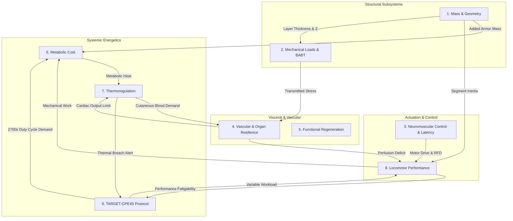

# AEGIS-01 — WHOLE-ORGANISM MODEL INTERDEPENDENCE CONTRACT
## Unified Architectural Specification for Decoupled Multi-System Physiology

**Author:** AEGIS-01 Systems Architecture & Computational Biology Team  
**Date:** 2026-11-12  
**Cycle:** 13 (Strategic Realignment and Scientific Baseline)  
**Document ID:** `AEGIS-DOC-C13-CONTRACT-001`  
**Registered Model ID:** [`MOD-0015`](file:///d:/AEGIS-01/registry/models.json)  
**Implementation Script:** [`aegis/cycle13_models.py`](file:///d:/AEGIS-01/aegis/cycle13_models.py)  
**Status:** Approved Architectural Contract (Supersedes Heuristic Survival Indices)

---

## 1. Architectural Philosophy & Anti-Conflation Principles

Historically, survivability models attempted to combine diverse biomechanical, physiological, and traumatic stresses into a single scalar "survivability probability" (e.g., $P_{\text{survival}} = 0.82$). 

In Cycle 13, this practice is formally recognized as an epistemic failure (`NEG-0101`):
1. **Single-Point Failure Masking:** A subject exhibiting an $88\%$ composite score can simultaneously experience a fatal $40.5^\circ\text{C}$ exertional heat stroke breach or rapid femoral exsanguination. Averaging orthogonal physical threats obscures mortal bottlenecks.
2. **Non-Identifiable Weighting:** Weighting multipliers between blunt chest wall deflection, sweat evaporation deficit, and muscle fatigue are entirely subjective and lack empirical identification.

### The Whole-Organism Contract Standard:
- The organism is represented as a **decoupled dynamic state vector** spanning 9 biophysical subsystems.
- Each subsystem defines an explicit interface contract specifying input variables, output variables, physical units, parameter provenance, and uncertainty categorization.
- Survivability is evaluated as a set of **independent physical threshold constraints** (e.g., $T_{\text{core}} < 40.0^\circ\text{C}$, $MAP > 50\text{ mmHg}$, $VC_{\max} < 0.6\text{ m/s}$, $\epsilon_{\text{tendon}} < 8.0\%$).

---

## 2. The Nine Interdependent Subsystems

---

### Subsystem 1: Mass & Geometry (`SYS-01`)
*Determines total body composition, regional surface areas, layer thicknesses, and segment inertias.*

- **Governing Equations:**
  $$BSA = \sqrt{\frac{H_{\text{cm}} \cdot M_{\text{body}}}{3600.0}} \quad [\text{Mosteller}]$$
  $$M_{\text{protect}} = \sum_{k} \rho_k \cdot A_{\text{covered}, k} \cdot t_k$$
  $$M_{\text{total}} = M_{\text{body}} + M_{\text{protect}}$$
- **Interface Linkages:**
  | Variable | Direction | Unit | Parameter Provenance | Uncertainty | Available Data | Validation Feasibility |
  | :--- | :---: | :---: | :--- | :---: | :--- | :---: |
  | `body_height_m` | Input | $\text{m}$ | Standard human anthropometry ($1.78\text{ m}$) | ALEATORY | NHANES III anthropometric survey | High |
  | `baseline_mass_kg` | Input | $\text{kg}$ | Standard human baseline ($75.0\text{ kg}$) | ALEATORY | NHANES III anthropometric survey | High |
  | `protective_thickness_mm` | Input | $\text{mm}$ | Armor design parameter ($2.0\text{--}4.0\text{ mm}$) | DETERMINISTIC | Micrometer caliper measurements | Complete |
  | `coverage_fraction` | Input | $-$ | Anatomical coverage mapping ($0.70\text{--}0.85$) | DETERMINISTIC | 3D body surface scan analysis | High |
  | `total_mass_kg` | Output | $\text{kg}$ | Additive mass conservation | DETERMINISTIC | Gravimetric scale measurement | Complete |
  | `bsa_m2` | Output | $\text{m}^2$ | Mosteller clinical formulation | ALEATORY ($\pm 3\%$) | DuBois & Mosteller human cohorts | High |
  | `segment_inertia_kg_m2`| Output | $\text{kg}\cdot\text{m}^2$| Dempster/Hanavan body segment inertia | EPISTEMIC ($\pm 8\%$) | Cadaveric segment slicing (Dempster 1955) | Moderate |

---

### Subsystem 2: Mechanical Loads & Ballistic BABT (`SYS-02`)
*Calculates stress wave transmission, acoustic impedance reflections, dynamic indentation, and visceral injury metrics.*

- **Governing Equations:**
  $$Z_i = \rho_i \cdot c_i, \quad R_{12} = \frac{Z_2 - Z_1}{Z_2 + Z_1}, \quad T_{12} = 1 - R_{12}^2$$
  $$M_{\text{coupled}} \ddot{x} + c_{\text{visc}} \dot{x} + k_1 x + k_2 x^3 = F_{\text{impact}}(t)$$
  $$VC(t) = \dot{x}(t) \cdot \frac{x(t)}{D_{\text{torso}}} \quad [\text{Viano \& Lau 1988}]$$
- **Interface Linkages:**
  | Variable | Direction | Unit | Parameter Provenance | Uncertainty | Available Data | Validation Feasibility |
  | :--- | :---: | :---: | :--- | :---: | :--- | :---: |
  | `threat_mass_g` | Input | $\text{g}$ | Threat standard (e.g. $8.0\text{ g}$ 9mm) | DETERMINISTIC | NIJ 0101.06 ballistics | Complete |
  | `impact_velocity_m_s` | Input | $\text{m/s}$ | Threat standard ($350\text{--}430\text{ m/s}$) | ALEATORY | Doppler radar / chronograph | Complete |
  | `tissue_impedances_mrayl`| Input | $\text{MRayl}$| Ultrasonic tissue sound speed $\times$ density | EPISTEMIC ($\pm 10\%$)| Ultrasonic bio-tissue literature | High |
  | `transmitted_peak_mpa` | Output | $\text{MPa}$ | Wave propagation across acoustic interfaces | EPISTEMIC ($\pm 15\%$)| Instrumented ballistic gelatin / PMHS | Moderate |
  | `thoracic_deflection_mm`| Output | $\text{mm}$ | Dynamic 1D/2D Lobdell-Bass thoracic model | EPISTEMIC ($\pm 12\%$)| Bass 2006, Roberts 2007 PMHS tests | High |
  | `viscous_criterion_m_s`| Output | $\text{m/s}$ | Viano & Lau 1988 formula | EPISTEMIC ($\pm 20\%$)| Automotive PMHS impact datasets | High |

---

### Subsystem 3: Neuromuscular Control & Latency (`SYS-03`)
*Models neural conduction, electromechanical delay (EMD), rate of force development (RFD), and motor unit recruitment.*

- **Governing Equations:**
  $$v_{\text{nerve}} = k_{\text{hursh}} \cdot d_{\text{axon}} \quad [k \approx 6.0\text{ (m/s)}/\mu\text{m}]$$
  $$T_{\text{premotor}} = \tau_{\text{sensory}} + \frac{L_{\text{aff}}}{v_{\text{aff}}} + \tau_{\text{central}} + \frac{L_{\text{eff}}}{v_{\text{eff}}} + \tau_{\text{nmj}} + \tau_{\text{emd}}$$
  $$F_{\text{muscle}}(t) = F_{\max}(t) \cdot \left(1 - e^{-(t - T)/\tau_{\text{rfd}}}\right)$$
- **Interface Linkages:**
  | Variable | Direction | Unit | Parameter Provenance | Uncertainty | Available Data | Validation Feasibility |
  | :--- | :---: | :---: | :--- | :---: | :--- | :---: |
  | `axon_diameter_um` | Input | $\mu\text{m}$ | Morphological histology ($12\text{--}20\mu\text{m}$) | ALEATORY | Human nerve biopsy surveys | High |
  | `afferent_length_m` | Input | $\text{m}$ | Anatomical conduction path ($0.8\text{--}1.1\text{ m}$) | ALEATORY | Anthropometric segment measurements | High |
  | `electromech_delay_ms` | Input | $\text{ms}$ | Cavanagh & Komi 1979 ($30\text{--}55\text{ ms}$) | ALEATORY | High-density EMG + dynamometer | Complete |
  | `total_latency_ms` | Output | $\text{ms}$ | Sum of sequential neuro-mechanical delays | ALEATORY ($\pm 8\text{ ms}$)| Evoked potential + force onset | High |
  | `active_rfd_n_s` | Output | $\text{N/s}$ | Aagaard 2002; Bird 2026 (`SRC-0076`) | ALEATORY | In vivo radar / force plate | High |

---

### Subsystem 4: Vascular & Organ Resilience (`SYS-04`)
*Simulates acute hemorrhage, dynamic vasospasm, wall shear stress, baroreflex regulation, and cardiac reserve limits.*

- **Governing Equations:**
  $$\Delta P = \frac{8 \mu L}{\pi r^4} Q + \frac{\rho}{2 (C_d \pi r^2)^2} Q^2$$
  $$\tau_{\text{wall}} = \frac{4 \mu Q}{\pi r^3}, \quad \text{Clot Stable} \iff \tau_{\text{wall}} \le \tau_{\text{crit}} \in [15, 35]\text{ Pa}$$
  $$Q_{\text{actual}} = \min\left(Q_{\text{breach}}, CO_{\max} \cdot \left(\frac{V_{\text{blood}}}{V_0}\right)^{1.5}\right)$$
  $$MAP(t) = MAP_0 \cdot \left(1 - \left(\frac{f_{\text{loss}}}{0.45}\right)^{1.6}\right)$$
- **Interface Linkages:**
  | Variable | Direction | Unit | Parameter Provenance | Uncertainty | Available Data | Validation Feasibility |
  | :--- | :---: | :---: | :--- | :---: | :--- | :---: |
  | `breach_radius_mm` | Input | $\text{mm}$ | Trauma penetration geometry ($0.5\text{--}3.0\text{ mm}$)| ALEATORY | Ballistic wound tract ballistics | High |
  | `vasospasm_ratio` | Input | $-$ | Vascular smooth muscle contraction ($0.0\text{--}0.95$)| EPISTEMIC | In vivo intravital microscopy | Moderate |
  | `blood_viscosity_pa_s` | Input | $\text{Pa}\cdot\text{s}$| Hematocrit-dependent blood rheology ($0.0035$)| ALEATORY | Clinical laboratory rheometry | Complete |
  | `bleeding_rate_l_min` | Output | $\text{L/min}$ | Coupled viscous-inertial orifice flow | EPISTEMIC ($\pm 15\%$)| Swine vascular injury hemorrhage | High |
  | `wall_shear_pa` | Output | $\text{Pa}$ | Navier-Stokes cylindrical shear | EPISTEMIC ($\pm 12\%$)| Microfluidic platelet channels | High |
  | `map_mmhg` | Output | $\text{mmHg}$ | Systemic baroreflex autoregulation | ALEATORY ($\pm 10\%$)| ICU trauma arterial line data | High |

---

### Subsystem 5: Functional Tissue Regeneration (`SYS-05`)
*Models de novo myofiber reconstitution, nerve reinnervation, fibrotic scar deposition, and oncogenic limits.*

- **Governing Equations:**
  $$F_{\text{functional}}(t) = (1 - d) \cdot \max(0.20, 1 - 0.75 d) + d \cdot \eta_{\text{tx}} \cdot e^{-d / d_{\text{crit}}}$$
  $$v_{\text{axon}} = 1.0\text{--}2.2\text{ mm/day} \quad [\text{Slow Axonal Tubulin Transport, Sunderland 1947}]$$
- **Interface Linkages:**
  | Variable | Direction | Unit | Parameter Provenance | Uncertainty | Available Data | Validation Feasibility |
  | :--- | :---: | :---: | :--- | :---: | :--- | :---: |
  | `defect_fraction` | Input | $-$ | Volumetric loss of original muscle mass | DETERMINISTIC | Post-op MRI / gravimetric biopsy | Complete |
  | `treatment_prior` | Input | $-$ | Tissue engineering intervention coefficient | EPISTEMIC | Merritt 2010, Quarta 2016 | Low (Conflicting) |
  | `axon_regrow_mm_day` | Input | $\text{mm/day}$| Tubulin polymerization rate ($1.0\text{--}2.2$) | ALEATORY | Histological nerve crush models | High |
  | `force_recovery_pct` | Output | $\%$ | Isolated muscle-tendon tetanic force | EPISTEMIC ($\pm 25\%$)| Isolated in situ rodent mechanics | Moderate |
  | `reinnervation_days` | Output | $\text{days}$ | Distance to motor endplate / $v_{\text{axon}}$ | ALEATORY ($\pm 15\%$)| Clinical electromyography (EMG) | High |

---

### Subsystem 6: Metabolic Energetics (`SYS-06`)
*Calculates basal and active metabolic power, mechanical efficiency, heat conversion, and glycogen consumption.*

- **Governing Equations:**
  $$P_{\text{met}} = P_{\text{BMR}} + \left(C_{\text{transport}} \cdot M_{\text{total}} \cdot v\right) + P_{\text{external}}$$
  $$\dot{Q}_{\text{thermal}} = P_{\text{met}} \cdot (1 - \eta_{\text{mechanical}}) \quad [\eta_{\text{mech}} \approx 0.20\text{--}0.25]$$
- **Interface Linkages:**
  | Variable | Direction | Unit | Parameter Provenance | Uncertainty | Available Data | Validation Feasibility |
  | :--- | :---: | :---: | :--- | :---: | :--- | :---: |
  | `locomotor_speed_m_s` | Input | $\text{m/s}$ | Movement speed ($0.0\text{--}5.0\text{ m/s}$) | DETERMINISTIC | GPS / treadmill tachometer | Complete |
  | `cost_of_transport` | Input | $\text{J/(kg}\cdot\text{m)}$| Margaria 1963 running cost ($3.8\text{--}4.5$) | ALEATORY ($\pm 8\%$)| Indirect calorimetry CPET | Complete |
  | `mechanical_efficiency`| Input | $-$ | Muscle cross-bridge efficiency ($0.20\text{--}0.25$) | ALEATORY ($\pm 5\%$)| Ergometry calorimetry literature | Complete |
  | `metabolic_power_w` | Output | $\text{W}$ | Total gross energy expenditure rate | ALEATORY ($\pm 6\%$)| Douglas bag / gas exchange CPET | High |
  | `heat_generation_w` | Output | $\text{W}$ | Net thermal power added to body core | ALEATORY ($\pm 6\%$)| Whole-body direct calorimetry | High |

---

### Subsystem 7: Thermoregulation (`SYS-07`)
*Simulates core/skin thermal balance, convective/radiative/evaporative heat loss, and cardiovascular drift.*

- **Governing Equations:**
  $$C_{\text{th}} \frac{dT_{\text{core}}}{dt} = \dot{Q}_{\text{thermal}} - \left(\dot{Q}_{\text{conv}} + \dot{Q}_{\text{rad}} + \dot{Q}_{\text{evap}}\right)$$
  $$\dot{Q}_{\text{evap}} = \min\left(\dot{m}_{\text{sweat}} \cdot h_{fg}, \, A_{\text{open}} h_e \Delta P + \frac{A_{\text{cov}} \Delta P}{R_{e,\text{armor}}}\right)$$
  $$Q_{\text{skin, blood}} = \min(2.5\text{ L/min}, \, \max(0.3, (T_{\text{core}} - 37.0) \cdot 1.2))$$
- **Interface Linkages:**
  | Variable | Direction | Unit | Parameter Provenance | Uncertainty | Available Data | Validation Feasibility |
  | :--- | :---: | :---: | :--- | :---: | :--- | :---: |
  | `ambient_temp_c` | Input | $^\circ\text{C}$ | Climatic condition ($20.0\text{--}45.0$) | DETERMINISTIC | Thermocouple sensor | Complete |
  | `ambient_rh_pct` | Input | $\%$ | Ambient relative humidity ($10\text{--}95\%$) | DETERMINISTIC | Capacitive hygrometer | Complete |
  | `armor_vapor_resist` | Input | $\text{kPa}\cdot\text{m}^2/\text{W}$| Keratin scale sweat barrier ($0.045$) | EPISTEMIC ($\pm 20\%$)| Sweating guarded hotplate | High |
  | `core_temperature_c` | Output | $^\circ\text{C}$ | 1-node / 2-node heat balance ODE | EPISTEMIC ($\pm 0.4^\circ\text{C}$)| Ingestible telemetric pill / rectal probe | High |
  | `skin_blood_flow_l_min`| Output | $\text{L/min}$ | Thermoregulatory cutaneous vasodilation | ALEATORY ($\pm 15\%$)| Laser Doppler flowmetry / Rowell | High |

---

### Subsystem 8: Locomotor Performance (`SYS-08`)
*Tracks speed, acceleration, ground reaction forces, and tendon strain limits under added protective mass.*

- **Governing Equations:**
  $$a_{\text{propulsive}}(t) = \frac{F_{\text{propulsive}}(t) - F_{\text{drag}} - F_{\text{ground}}}{M_{\text{total}}}$$
  $$\epsilon_{\text{tendon}} = \frac{F_{\text{muscle}}}{A_{\text{tendon}} \cdot E_{\text{tendon}}}, \quad \text{Constraint: } \epsilon_{\text{tendon}} \le 8.0\text{--}10.0\%$$
- **Interface Linkages:**
  | Variable | Direction | Unit | Parameter Provenance | Uncertainty | Available Data | Validation Feasibility |
  | :--- | :---: | :---: | :--- | :---: | :--- | :---: |
  | `active_force_n` | Input | $\text{N}$ | Muscle force capacity (Bird 2026) | ALEATORY | In vivo UWB radar + dynamometry | High |
  | `total_mass_kg` | Input | $\text{kg}$ | Output of `SYS-01` | DETERMINISTIC | Gravimetric balance | Complete |
  | `tendon_modulus_gpa` | Input | $\text{GPa}$ | Human Achilles tendon modulus ($1.2\text{--}1.5$) | ALEATORY | In vivo ultrasound elastography | High |
  | `acceleration_m_s2` | Output | $\text{m/s}^2$ | Newton's second law | DETERMINISTIC | Inertial measurement units (IMU) | High |
  | `tendon_strain_pct` | Output | $\%$ | Structural mechanical elongation | ALEATORY ($\pm 1\%$)| Ultrasound speckle tracking | High |

---

### Subsystem 9: TARGET-CPE45 (`SYS-09`)
*Executes the 2700-second variable duty-cycle evaluation protocol, verifying performance fatigability.*

- **Governing Equations:**
  $$W_{\text{completed}} = \int_0^{2700} P_{\text{external}}(t) \, dt$$
  $$\text{Performance Fatigability} = \frac{P_{\text{late}} - P_{\text{early}}}{P_{\text{early}}}$$
- **Interface Linkages:**
  | Variable | Direction | Unit | Parameter Provenance | Uncertainty | Available Data | Validation Feasibility |
  | :--- | :---: | :---: | :--- | :---: | :--- | :---: |
  | `duty_cycle_pattern` | Input | $-$ | Alternating explosive / submaximal bursts | DETERMINISTIC | Standardized combat workout definition| Complete |
  | `duration_seconds` | Input | $\text{s}$ | Fixed protocol duration ($2700\text{ s} = 45\text{ min}$) | DETERMINISTIC | Digital chronometer | Complete |
  | `work_completed_kj` | Output | $\text{kJ}$ | Integral of mechanical power | ALEATORY ($\pm 5\%$)| Instrumented cycle/treadmill ergometer| High |
  | `fatigability_index` | Output | $-$ | Relative power loss over 2700s | ALEATORY ($\pm 8\%$)| Longitudinal Subject-01 performance | High |
  | `threshold_breaches` | Output | $\text{List}$ | Event log of physical limit violations | DETERMINISTIC | Sensor telemetry threshold monitors | High |

---

## 3. Dynamic State Vector & Failure Criteria

The state of the whole organism at any time $t \in [0, 2700\text{ s}]$ is defined by the following decoupled vector:

$$\mathbf{S}(t) = \begin{bmatrix}
T_{\text{core}}(t) \\
\text{Blood Loss Fraction}(t) \\
MAP(t) \\
Q_{\text{skin}}(t) \\
Q_{\text{muscle}}(t) \\
CO_{\text{total}}(t) \\
\epsilon_{\text{tendon}}(t) \\
VC_{\max}(t) \\
T_{\text{reaction}}(t)
\end{bmatrix}$$

### Failure Threshold Invariants:
1. **Thermal Collapse:** $T_{\text{core}}(t) \ge 40.0^\circ\text{C}$ (Simulation stopping limit).
2. **Hemorrhagic Shock (Class IV):** $\text{Blood Loss Fraction} \ge 0.40$ or $MAP < 50\text{ mmHg}$.
3. **Cardiovascular Drift Depletion:** $CO_{\text{demand}}(t) > CO_{\max} \approx 22.0\text{ L/min}$.
4. **Musculoskeletal Rupture:** $\epsilon_{\text{tendon}}(t) \ge 9.0\%$.
5. **Visceral Contusion (BABT):** $VC_{\max}(t) \ge 1.0\text{ m/s}$ or $BFD > 44\text{ mm}$.

If any single threshold is breached, the simulation logs an independent failure event. **No mathematical combination into a scalar probability is permitted.**
